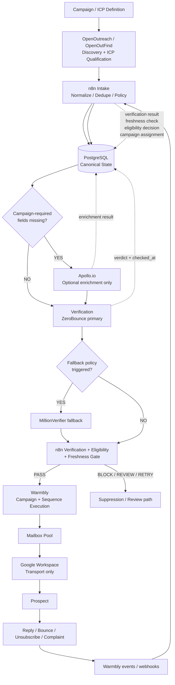
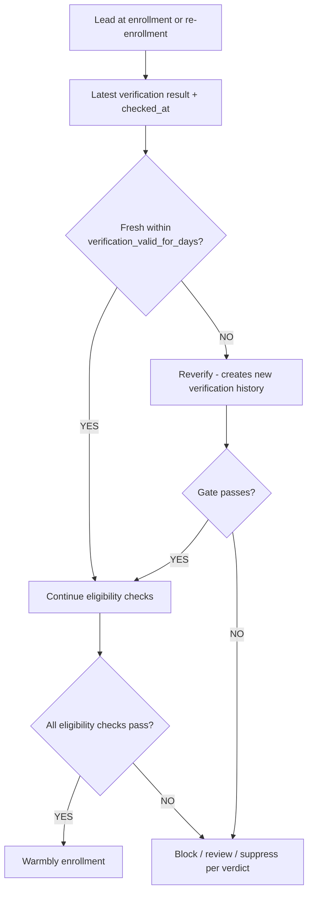
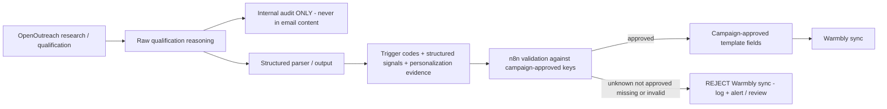
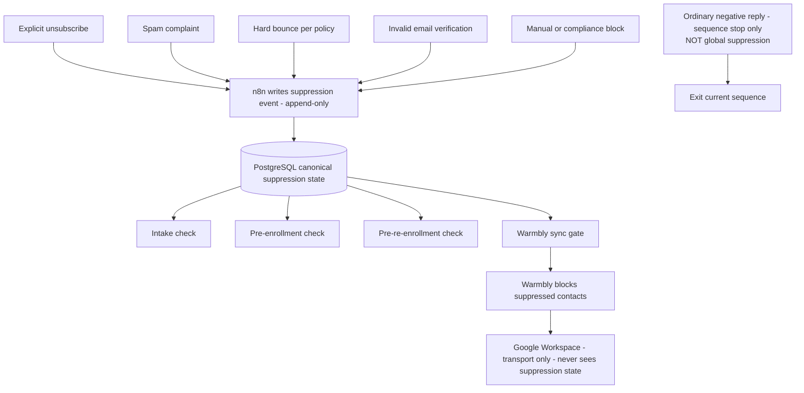

# SKMC Cold Email Automation — Architecture

**Version:** 1.3 | **Date:** 2026-10-13 | **Status:** Approved — Single Source of Truth

**Purpose:** Single architectural source of truth for which component does what, how data flows, where gates are enforced, and which decisions remain open. Downstream documents (database schema, n8n workflow specifications, API integration specifications, UAT) must be derived FROM this document — not the reverse.

Supersedes v1.2 (2026-10-09). This version completes previously incomplete areas (lifecycle, signals, suppression triggers, reply handling), corrects the top-level data flow (Apollo is optional, not mandatory), replaces the fixed four-mailbox model with a mailbox pool, and removes all references to unextractable PDF sections. This document is standalone.

---

## 1. Document Control & Purpose

- This document defines architecture only. It does not define database schemas, n8n node graphs, API payloads, or project schedules.
- Established decisions recorded here are binding for downstream specifications.
- Genuinely unresolved items are collected in §28 Open Decisions — never silently guessed.
- Three kinds of statements are distinguished throughout:
  - **ARCHITECTURAL DECISION** — fixed unless a new approved version changes it.
  - **CONFIGURABLE OPERATING VALUE** — initial value given, must be tunable without architectural change.
  - **OPEN DECISION** — listed in §28; downstream docs must not assume an answer.

## 2. Architecture Principles

1. **PostgreSQL is the canonical source of operational lead state and history.** No external SaaS owns lifecycle or suppression truth.
2. **OpenOutreach is responsible for prospect discovery, ICP/qualification, and structured qualification output.** It is NOT merely a "lead scraper."
3. **n8n is the central orchestration and policy-enforcement layer.** All gates live in n8n.
4. **Apollo is supplemental, optional enrichment.** It must not duplicate data already available from OpenOutreach or another approved source (double-buy guard).
5. **Email verification is a gate before campaign execution.** No lead enters a sequence without a current verification result that is acceptable under the applicable campaign verification policy and passes the freshness gate.
6. **ZeroBounce is the primary verification provider.**
7. **MillionVerifier is the fallback/secondary verification provider**, used per configured retry/fallback policy (provider failure, designated uncertain outcomes) — not for every email by default.
8. **Warmbly owns campaign execution, sequences, follow-ups, and outbound event production for the MVP.** It is not the canonical source of lead state.
9. **Google Workspace is transport/mailbox infrastructure only.** No suppression logic, no sequence logic, no volume decisions in Gmail.
10. **Suppression is centrally controlled.** A suppressed contact can never be sent to again without an approved, audited state change.
11. **Operational values (caps, pacing, warmup periods, health thresholds) are configurable operating policy — NOT immutable architecture law.**
12. **Raw AI qualification reasoning is internal data.** It never reaches outbound email content.
13. **Only approved structured personalization evidence/signals may reach outbound campaign templates.** Missing/unapproved required personalization fails closed.
14. **Audit/history is preserved** for state transitions, verification results, suppression changes, and configuration changes. Append-only where specified.

## 3. Component Responsibilities

Rule: no component duplicates another component's job. This table is the tiebreaker.

| Component | Responsibility | Explicitly NOT responsible for |
|---|---|---|
| Campaign & ICP Specification | Defines who qualifies, why, and for which campaign; declares required fields and approved personalization keys | Runtime decisions |
| OpenOutreach / OpenOutFind | Discovery + ICP qualification (BetterContact licensed data, not scraping); structured output incl. identity, fit, reason, signals; optional email resolution | Enrichment beyond returned fields; sending; suppression |
| n8n | Intake, merge, dedupe, normalization, verification calls, eligibility + freshness gate, suppression enforcement + sync, reply/bounce handling, alerts, config audit, retry/DLQ | ICP qualification; sending |
| PostgreSQL (outreach_db) | Canonical lead/company/event/config state and history | Policy decisions |
| Apollo.io | Optional firmographic enrichment ONLY when campaign-required fields are missing | Discovery; verification; mandatory path |
| ZeroBounce | Primary per-lead verification verdict | Campaign bounce accounting (observed sending data ≠ verification) |
| MillionVerifier | Fallback verification per policy | Default provider for every lead |
| Warmbly (SaaS, MVP) | Campaign/sequence execution, follow-ups, pacing execution where supported, mailbox rotation where supported, outbound event webhooks, native suppression enforcement at its boundary | Lead eligibility decisions; canonical lifecycle/suppression state; content authoring |
| Google Workspace | Transport only | Suppression; sequencing; volume; tracking pixels (disabled) |
| Redis | Queue/cache where the runtime requires it | Suppression flow |

## 4. Top-Level System Architecture



Notes:
- Apollo sits behind an explicit missing-fields decision — it is never a mandatory hop.
- Verification fallback (MillionVerifier) is policy-triggered, not default.
- All events return through Warmbly → n8n → PostgreSQL and drive lifecycle changes, reply state, bounce/complaint state, suppression, and health decisions.
- **Important results are persisted to PostgreSQL throughout processing:** intake/qualification output, optional enrichment result, verification verdict + checked_at, freshness check outcome, eligibility decision, campaign assignment, and Warmbly/webhook feedback.

## 5. Canonical Data & Ownership

- PostgreSQL (outreach application database) owns: lead identity and state, company identity, verification history, campaign assignments, suppression state, event history, lifecycle history, configuration history.
- Warmbly owns: execution state of sequences (its internal data) and outbound event production. Its data is NOT canonical.
- OpenOutreach owns: source/external identifiers for discovered contacts at discovery time.
- Verification providers own: their per-check verdicts at check time — captured into PostgreSQL with provider, canonical result, provider raw metadata as required, and checked_at timestamp.
- Ownership of n8n's internal runtime database (separate from the outreach application database) is an implementation concern, not an architectural mixing point.

**For stateful areas such as verification, suppression, and configuration, the architecture distinguishes:**

- **A. Current effective state** — used by runtime gates for real-time decisions;
- **B. Historical/audit records** — retained append-only for traceability.

Historical verification results remain append-only. Suppression changes remain auditable. Configuration changes remain auditable. The database specification will determine the physical current-state + history implementation; no SQL schema is prescribed here.

## 6. Lead Identity & Deduplication

**ARCHITECTURAL DECISION:** contact identity is resolved by priority:

1. Stable source/external lead ID (when available);
2. Normalized (lowercased) email (when available);
3. Stable external person/profile identifier (when available);
4. Unresolved ambiguity → manual/review path — never a silent auto-merge.

**External identifiers are scoped to their originating source/provider unless that provider guarantees globally unique semantics.** Therefore the downstream database may model identity conceptually as: `source_system + external_identifier`. Do NOT add SQL/database constraints here.

- `company_domain` must NEVER be used by itself to identify a person (`rajesh@abc.com`, `priya@abc.com`, `amit@abc.com` are three people).
- Company identity and contact identity are **separate** dimensions.
- `company_domain` may be used for company-level enrichment deduplication only — never for person-level deduplication and never as a campaign concurrency gate.
- Contacts may exist in DISCOVERED/QUALIFIED states **before** email resolution; the identity model supports this.
- Database indexes/keys are defined in the database schema, not here.

## 7. Discovery & Qualification (OpenOutreach Contract)

Campaign/ICP information is translated into OpenOutreach discovery/qualification inputs. OpenOutreach output contract (architecture-level):

| Output | Role |
|---|---|
| Source/external contact identity | identity key #1 |
| First/last name | required contact fields |
| Company, company website/domain | company identity + enrichment dedupe |
| Title | required contact field |
| Profile URL / external person identity | identity key #3 |
| Email (only if already resolved/available) | optional at discovery — NOT required for every qualified contact |
| Qualification fit | A-Fit / B-Fit / C-Fit / Reject (§8) |
| Qualification reason | INTERNAL audit/explanation only |
| Trigger codes / structured signals | structured qualification output |
| Personalization evidence | candidate outbound data — requires approval flow (§14) |

Hard separation: **raw qualification reason = internal audit/explanation**; **structured personalization evidence = potentially approved outbound data**. The two must never be merged.

## 8. Qualification / Fit Model

- **A-Fit / B-Fit:** may proceed toward enrichment, verification, and campaign eligibility according to campaign rules.
- **C-Fit:** → **PARKED** (deferred). While parked: no Apollo enrichment spend, no verification spend, no Warmbly enrollment. Revisit after a **configurable** C-Fit revisit period; requalification uses a fresh qualification verdict, not the stored reason. PARKED ≠ SUPPRESSED (parked = "not yet worth spend"; suppressed = "never contact").
- **Reject:** does not proceed through paid outreach processing; retained per retention policy for auditability.
- Campaign-specific scoring formulas belong to the ICP specification, not architecture.

## 9. Lifecycle Model

**ARCHITECTURAL DECISION:** three separate dimensions — (A) lifecycle state, (B) verification state, (C) suppression state. Never collapsed into one status. A lead is in exactly one lifecycle state at any time.

**A. Lifecycle states:** DISCOVERED, QUALIFIED, ENRICHMENT_PENDING, ENRICHED, VERIFICATION_PENDING, VERIFIED, CAMPAIGN_READY, IN_SEQUENCE, REPLIED_POSITIVE, REPLIED_NEGATIVE, UNSUBSCRIBED, BOUNCED, COMPLETED, PARKED.

**Major allowed transitions:**

| From | Event | To |
|---|---|---|
| DISCOVERED | qualification verdict A/B-Fit | QUALIFIED |
| DISCOVERED | qualification verdict C-Fit | PARKED |
| DISCOVERED | qualification verdict Reject | no paid processing; retained per retention policy |
| PARKED | revisit due + new trigger → fresh qualification | QUALIFIED or remains PARKED |
| QUALIFIED | enrichment required | ENRICHMENT_PENDING |
| QUALIFIED | no enrichment required | VERIFICATION_PENDING |
| ENRICHMENT_PENDING | enrichment done / not needed | ENRICHED |
| ENRICHED | verification started | VERIFICATION_PENDING |
| VERIFICATION_PENDING | verdict VALID and gate-ready | VERIFIED |
| VERIFICATION_PENDING | verdict invalid/disposable/trap | SUPPRESSED (suppression state activated; lifecycle remains VERIFICATION_PENDING) |
| VERIFICATION_PENDING | unknown/temporary failure | remains VERIFICATION_PENDING (workflow retries per bounded retry policy; exhausted retries route to review/DLQ) |
| VERIFIED | eligibility gate passes | CAMPAIGN_READY |
| CAMPAIGN_READY | Warmbly enrollment | IN_SEQUENCE |
| IN_SEQUENCE | positive reply | REPLIED_POSITIVE (then hand off/notify downstream human/CRM sales process) |
| IN_SEQUENCE | negative reply | REPLIED_NEGATIVE |
| IN_SEQUENCE | unsubscribe | UNSUBSCRIBED |
| IN_SEQUENCE | bounce | BOUNCED |
| IN_SEQUENCE | sequence exhausted, no reply | COMPLETED |
| any active state | suppression event | suppression state activated (lifecycle history preserved; suppression dimension recorded separately — §16) |

All transitions are logged with timestamps (append-only history). Re-enrollment for future campaigns is allowed only through the full eligibility gate (§11) and suppression checks (§15).

```mermaid
stateDiagram-v2
    "[*]" --> DISCOVERED
    DISCOVERED --> QUALIFIED: A or B fit verdict
    DISCOVERED --> PARKED: C fit
    PARKED --> QUALIFIED: revisit due and new trigger
    QUALIFIED --> ENRICHMENT_PENDING
    QUALIFIED --> VERIFICATION_PENDING: no enrichment needed
    ENRICHMENT_PENDING --> ENRICHED
    ENRICHED --> VERIFICATION_PENDING
    VERIFICATION_PENDING --> VERIFIED: valid
    VERIFICATION_PENDING --> VERIFICATION_PENDING: unknown/temporary failure (retry)
    VERIFIED --> CAMPAIGN_READY: eligibility gate passes
    CAMPAIGN_READY --> IN_SEQUENCE: Warmbly enrollment
    IN_SEQUENCE --> REPLIED_POSITIVE
    IN_SEQUENCE --> REPLIED_NEGATIVE
    IN_SEQUENCE --> UNSUBSCRIBED
    IN_SEQUENCE --> BOUNCED
    IN_SEQUENCE --> COMPLETED: sequence exhausted
    REPLIED_POSITIVE --> [*]: hand off to downstream sales process
```

REJECTED leads do not enter paid processing (retained per retention policy); REVIEW is a workflow-processing holding state after exhausted retries, not a lifecycle state.

## 10. Verification Architecture

**Preserved principle:** per-lead verification verdict ≠ aggregate observed bounce rate. Different mechanisms, never combined.

- Primary: ZeroBounce. Fallback: MillionVerifier, used only per configured retry/fallback policy (provider failure, designated uncertain outcomes). Both providers are NOT called for every email.
- Canonical verification concepts (architecture-level): NOT_CHECKED, VALID, INVALID, CATCH_ALL, RISKY, UNKNOWN, DISPOSABLE, TEMPORARY_FAILURE.
- No numeric per-lead bounce-risk percentage is invented or required. If a provider returns a score with documented semantics, it may be stored as provider metadata for analytics — it does not feed the gate.
- Verification results must retain: **provider, canonical result, provider result/raw metadata as required, checked_at timestamp**.
- Provider field-level mapping (which ZeroBounce status/sub_status maps to which canonical concept) belongs to the verification/API integration specification, derived from these canonical concepts.

## 11. Verification Freshness + Campaign Eligibility Gate

**Verification freshness (ARCHITECTURAL DECISION):** a previously VALID email is not considered permanently valid.

```
latest verification result + checked_at + verification_valid_for_days (configurable)
        → fresh?
   YES → continue eligibility
   NO  → reverify before campaign admission (initial enrollment OR re-enrollment)
```

- Reverification creates **new** verification history; historical results are never overwritten.
- Technical failures during reverify follow retry/fallback policy; exhausted processing failures remain observable through the reliability/DLQ architecture (§22).
- `verification_valid_for_days` is CONFIGURABLE — not hardcoded as architecture law.



**Campaign eligibility gate.** A lead reaches Warmbly only when ALL applicable checks pass:

1. Acceptable qualification fit;
2. Required campaign fields available (per Campaign & ICP specification);
3. Acceptable current verification result (CATCH_ALL/RISKY handling per configurable campaign verification policy — §12);
4. Verification freshness (above);
5. Not suppressed (suppression dimension check);
6. Valid campaign assignment;
7. Campaign concurrency rules satisfied (§13);
8. Approved personalization fields available where the campaign requires them.

Warmbly receives ONLY leads that have passed n8n's campaign eligibility gate.

## 12. Catch-all and Review Path

CATCH_ALL and RISKY verdicts route to a review/hold path by default. Whether, when, and at what risk level they proceed to campaigns is a CONFIGURABLE OPERATING VALUE per campaign policy (initial recommendation: hold-for-review). The *mechanism* (configurable hold/risk-cap) is an architectural decision; the *value* is operating policy.

## 13. Campaign Concurrency — Contact Level

**ARCHITECTURAL DECISION:** "One contact must not receive conflicting or overlapping active campaigns unless explicitly permitted."

This is a **CONTACT-level** rule. It is NOT "one company = one active campaign." A company may have multiple independently qualified contacts in different SKMC service campaigns:

```
ABC India
├── CFO                 -> SVB campaign
├── Compliance Head     -> BIS campaign
└── Sustainability Head -> EPR campaign
```

All three may be legitimate simultaneously — different contacts, independently qualified. `company_domain` must not be used as the campaign concurrency gate. The final database/n8n implementation of conflict detection and explicit permission is defined in downstream specifications; architecture defines the rule.

## 14. Signals & Personalization



**Hard architecture rule (fail closed):** Warmbly templates may use only approved structured fields. If a required template field is unknown, not approved, missing, or invalid, the Warmbly sync must FAIL — required personalization is never silently replaced with blank values. The failure must remain observable/reviewable (logging, alert, review queue).

The approved-keys allowlist is declared per campaign in the Campaign & ICP specification; n8n validates outbound payloads against it.

## 15. Suppression Architecture

**Canonical source:** PostgreSQL outreach suppression state/list. **n8n owns suppression policy enforcement.** Warmbly receives synchronized suppression state and must prevent suppressed contacts from sending (native enforcement at its boundary, where supported). Google Workspace remains transport only.

**Suppression must be checked/enforced at these points:**

1. Lead intake (where applicable);
2. Pre-enrollment;
3. Pre-re-enrollment (a previously-enrolled lead entering a future campaign passes the suppression check again);
4. Warmbly synchronization / campaign execution gate;
5. Event-driven updates — unsubscribe, spam complaint, hard bounce, or other approved suppression triggers.

**Trigger semantics:**

| Trigger | Behavior |
|---|---|
| Explicit unsubscribe / explicit "do not contact me again" | GLOBAL suppression |
| Spam complaint | GLOBAL suppression |
| Hard bounce | Suppression according to approved bounce policy |
| Invalid email (verification) | Must not be sent |
| Ordinary negative reply | Stop/exit the relevant sequence per reply policy — NOT automatic global suppression (§16) |
| Legal/compliance/manual block | Suppression according to configured scope |

**GLOBAL suppression has no automatic expiry. Any removal/reactivation requires an explicitly authorized and audited state change, subject to applicable legal/compliance requirements.** Do not describe global suppression as technically irreversible unless that is explicitly intended.

Suppression history is append-only and auditable; deletion is forbidden (soft-deactivation with reason only). No jurisdiction-specific legal retention periods are defined here.



## 16. Suppression vs Lifecycle (separate dimensions)

**SUPPRESSED is a suppression state, not a lifecycle state.** The lifecycle enumeration in §9 does not include SUPPRESSED.

- Lifecycle and suppression are **separate dimensions**. A lead may have lifecycle history showing previous campaign activity while simultaneously being globally suppressed.
- **PARKED ≠ SUPPRESSED** — parked means "deferred, not yet worth optional spend"; suppressed means "do not contact."
- Ordinary negative reply: stops/exits the relevant sequence per reply policy; does NOT automatically create permanent global suppression. Explicit unsubscribe is the global-suppression trigger.
- Suppression history never disappears when lifecycle changes.
- Suppressed contacts cannot bypass suppression through re-enrollment — the pre-re-enrollment check (§15 point 3) makes this structural.
- When a suppression event occurs: suppression state becomes active at the appropriate scope; active sequence/campaign execution is stopped or blocked; lifecycle history remains preserved; suppression does NOT erase or overwrite historical lifecycle meaning.

## 17. Warmbly Campaign Execution

For MVP, **Warmbly SaaS owns:** campaign/sequence execution; follow-ups; sending windows/pacing execution where supported; mailbox execution/rotation where supported; outbound event/webhook production; native suppression enforcement where supported.

- **n8n remains the policy/orchestration authority.** Warmbly must NOT become the canonical source of lead lifecycle or suppression state — PostgreSQL remains canonical.
- Warmbly receives only eligibility-gate-PASSED leads (§11) with only approved structured personalization fields (§14).
- **Deployment:** Warmbly SaaS is the MVP decision (self-hosting adds infrastructure burden exactly when deliverability debugging matters most).
- **Review clause (not automatic):** review Warmbly SaaS vs self-hosted architecture after approximately 90 days of stable operation, **or earlier** if API, data-residency, reliability, cost, webhook, or feature constraints materially affect the architecture. Migration is NOT automatic after 90 days.

## 18. Mailbox / Google Workspace Architecture

- Warmbly → **mailbox pool** → Google Workspace mailboxes. Each mailbox belongs to an appropriate sending domain.
- The current four-mailbox / two-domain deployment is an **INITIAL CONFIGURATION, not a structural limit.** The architecture supports adding, removing, and replacing mailboxes without redesign.
- Diagrams may show Mailbox A … Mailbox N. Google Workspace remains transport only regardless of pool size.
- Mailbox assignment persistence/rotation mechanics are implementation details (§28 Open Decision #9).

## 19. Domain & Mailbox Health

**Corrected escalation principle: problem scope = action scope.** No blind automatic cascade.

| Evidence | Action |
|---|---|
| Mailbox-specific issue | Pause/degrade affected mailbox first |
| Domain-wide issue | Pause/degrade affected domain and its mailboxes |
| Campaign-wide issue across healthy domains | Content/list-quality problem → pause/investigate affected campaign |
| Systemic issue | Broader pause/escalation only when evidence supports it |

Health decisions use: **metric + time window + minimum sample size + threshold + scope/context + action**. Small samples (e.g., 1 bounce from 20 sends) are not treated as equivalent to large-sample signals (50 bounces from 1,000 sends). `minimum_sample_size` is CONFIGURABLE — not hardcoded as architecture law.

## 20. Events / Webhooks

- Warmbly produces outbound events (sent, delivered, bounce type, reply, unsubscribe, complaint) → n8n → PostgreSQL.
- Events drive: lifecycle changes, reply records, bounce/complaint state, suppression, and mailbox/domain/campaign health decisions.
- Event idempotency is required (duplicate webhook deliveries must not double-count metrics). Mechanism defined downstream.
- **Webhook silence (corrected rule):** alert only when activity was reasonably expected. Expected sending/event activity + absence of expected webhook data = potential webhook pipeline failure (alert). No campaign activity + no webhook events = not automatically an incident. DLQ/retry observability preserved.

## 21. Configuration Architecture

**CONFIGURABLE OPERATING VALUE policy** — architecture identifies scopes and keys; exact persistence is downstream:

- Scopes: GLOBAL, DOMAIN, MAILBOX, CAMPAIGN (as appropriate per key).
- Configurable policy includes: daily send cap, sending windows, pacing/spacing, warmup policy, bounce thresholds, complaint thresholds, minimum sample size, verification freshness (`verification_valid_for_days`), C-Fit revisit timing, catch-all policy, negative-reply cooldown, Apollo credit alert threshold.
- There is a current effective configuration, and **configuration changes are auditable** (who, when, old value, new value, reason).
- The database design will decide exact persistence location (including whether an audit table lives in the n8n internal or outreach application database).

## 22. Reliability / Retry / DLQ

Failures must not silently disappear. Architecture requirements:

- Retryable errors → bounded retries (counts/values configurable unless already approved);
- Fallback where applicable (e.g., verification provider fallback);
- Dead-letter handling for exhausted failures, remaining observable/replayable where safe;
- Workflow execution visibility;
- Alerts based on meaningful thresholds/windows (not fixed silence).

Failure classes covered: OpenOutreach input/output failure; Apollo API failure/credit exhaustion; ZeroBounce failure; MillionVerifier fallback failure; Warmbly API/sync failure (incl. signal-key validation failures, §14); webhook processing failure; stale verification at enrollment/re-enrollment; PostgreSQL failure; mailbox/domain health events.

## 23. Monitoring & Alerts

Monitored: workflow failures; DLQ volume; retry queue depth; PostgreSQL availability; verification API failures and credit balance; Apollo/BetterContact credit balance; Warmbly API errors; webhook failures and context-aware silence (§20); mailbox send failures; mailbox/domain/campaign bounce and complaint rates (min-sample-size aware); unsubscribe rate; suppression sync failures; disk usage. Alert channel is an Open Decision (§28).

## 24. Security

- API keys/secrets are never stored in workflow code or documentation — n8n credential storage / environment / Docker secret mechanisms as appropriate.
- PostgreSQL and Redis must not be publicly exposed.
- Reverse proxy/TLS for externally reachable services.
- Least-privilege database/service accounts; separate n8n internal database from the outreach application database.
- Backup and restore capability required.
- Audit important configuration/state changes.
- Sensitive lead data must not be unnecessarily copied between systems.
- Retention/privacy policy remains an Open Decision (§28) — not invented here.

## 25. Infrastructure / Deployment Topology

**MVP deployment decision:** hosted VPS runs reverse proxy/HTTPS, n8n, PostgreSQL, OpenOutreach, and Redis only where the selected runtime architecture actually requires it. External/managed: Warmbly SaaS, ZeroBounce, MillionVerifier, Apollo (optional), BetterContact/OpenOutreach dependencies, LLM provider, Google Workspace.

PostgreSQL hosts the n8n internal database and the outreach application database **without sharing the same application schema**.

Initial CPU/RAM/disk sizing figures, where referenced anywhere, are labeled: **"Initial sizing baseline — validate during pilot."** They are not architectural guarantees.

## 26. Pilot & Scaling Principles

Start with: one SKMC service/campaign; one approved Campaign & ICP specification; limited controlled lead volume; limited mailbox pool; complete event/suppression monitoring. Validate: lead quality, enrichment behavior, verification, suppression, webhook reliability, bounce/complaint metrics, infrastructure load, operational recovery. **Scale only after the pilot is stable.** Initial pilot quantities are not permanent architecture limits.

## 27. Implementation Sequencing Considerations

Dependency ordering (not a schedule): architecture → downstream specifications → infrastructure → lead pipeline → verification → campaign execution → event handling → pilot → scale. Warmup may run in parallel with the technical build. A separate implementation plan (already drafted) owns the schedule.

## 28. Open Decisions

Distinguish: ARCHITECTURAL DECISION (fixed here) / CONFIGURABLE OPERATING VALUE (mechanism fixed, value tunable) / OPEN DECISION (below).

1. Catch-all campaign policy value (hold-for-review vs risk-cap) — configurable value, unresolved choice.
2. Data retention / PII cleanup policy.
3. Exact verification freshness period (`verification_valid_for_days`).
4. Exact C-Fit revisit period.
5. Exact negative-reply cooldown policy.
6. Exact minimum sample sizes for health decisions.
7. Campaign conflict / explicit-permission implementation details (downstream spec).
8. Exact Warmbly API endpoints/auth/webhook capabilities to be used.
9. Mailbox assignment persistence/rotation details, if Warmbly does not fully own them.
10. Alert channel (Slack/Telegram/other) and backup destination/RPO.
11. Any other issue genuinely not determined by this architecture.

## 29. Architecture Invariants

Non-negotiable; every one is supported by the body above:

1. PostgreSQL is canonical operational state.
2. n8n owns orchestration/policy gates.
3. Warmbly executes only approved/gated campaign records.
4. Google Workspace is transport only.
5. Apollo is optional enrichment.
6. Verification result and observed bounce rate are different concepts.
7. Suppressed contacts cannot bypass suppression through re-enrollment.
8. Company domain is not a person identity key.
9. Campaign conflict enforcement is contact-level, not company-level.
10. Raw AI reasoning is not outbound personalization.
11. Required personalization fails closed if missing/unapproved.
12. Historical verification/lifecycle/suppression/config changes remain auditable.
13. Operating thresholds are configurable unless explicitly fixed.
14. Failures must not silently disappear.
15. Four mailboxes/domains are not a structural system limit.
16. Verification verdict ≠ aggregate bounce rate.
17. Ordinary negative reply is not automatic global suppression.
18. Stale verification cannot bypass the freshness gate.
19. **Lifecycle and suppression are separate dimensions; SUPPRESSED is not a lifecycle state.**
20. **Current effective state (used by runtime gates) is distinguished from historical/audit records for verification, suppression, and configuration.**
21. **CRM sales stages (meeting booked, closed won/lost) are not cold-email lifecycle states; positive reply hands off to downstream sales process.**
22. **External identifiers are scoped to their source/provider unless globally unique semantics are guaranteed.**

## 30. Mermaid Diagram Index

| # | Diagram | Section |
|---|---|---|
| A | Top-Level System Architecture | §4 |
| B | Lead Lifecycle State Machine | §9 |
| C | Verification / Freshness Gate | §11 |
| D | Signals / Personalization Flow | §14 |
| E | Suppression Flow | §15 |
| F | Event / Feedback Loop | §4 return path + §20 |
| G | Mailbox / Domain Health Decision Flow | §19 (table-form decision flow) |

## 31. Change Log

| Version | Date | Change |
|---|---|---|
| 1.0 | 2026-10-08 | Initial draft from cold_email_workflow.pdf + discussion |
| 1.1 | 2026-10-08 | External review: OpenOutreach relabelled; verification gate split from aggregate bounce rate; suppression at n8n/Warmbly (Gmail = transport only); Warmbly SaaS for MVP; company_domain dedupe fallback removed; lifecycle expanded; enums split; negative-reply suppression nuanced; configurable policy; AUP rationale corrected; signals field added; separate DBs; webhook dead-letter monitoring |
| 1.2 | 2026-10-09 | Mermaid appendix added; no architectural changes |
| 1.3 | 2026-10-13 | Standalone rewrite: Architecture Principles (14) added; top-level flow corrected (Apollo optional behind missing-fields decision; MillionVerifier fallback policy-triggered); OpenOutreach output contract expanded (email optional at discovery); identity model = 4-priority hierarchy (replaces "dedupe on email only"); A/B/C/Reject qualification model with configurable C-Fit revisit; complete lifecycle + mermaid state diagram (no PDF references); verification canonical concepts + freshness gate + append-only history; campaign eligibility gate (8 checks); contact-level concurrency rule (ABC India example); signals fail-closed model + mermaid; suppression trigger semantics + 5 enforcement points + mermaid; reply classification promoted (5 classes, configurable cooldown); Warmbly responsibilities clarified + rephrased 90-day review (not automatic); mailbox pool replaces fixed GW x 4; context-aware health escalation (no blind cascade) + min-sample-size rule; smart webhook silence rule; Apollo graceful degradation; config scopes + audit; reliability/DLQ failure classes; security section; pilot/scale principles; implementation sequencing (schedule removed to implementation plan); Open Decisions (11); Architecture Invariants (18); full consistency review performed; **final-review corrections: lifecycle states reduced to 14 (removed RETRY, REVIEW, MEETING_BOOKED, CLOSED_WON, CLOSED_LOST, SUPPRESSED); RETRY/REVIEW clarified as workflow processing only; CRM sales stages removed from cold-email lifecycle; SUPPRESSED is suppression state not lifecycle state; verification gate wording precision; external IDs source-scoped; global suppression durability clarified; current effective state vs history distinguished; top-level flow shows multi-stage PostgreSQL persistence; invariants extended to 22; final architecture review completed — lifecycle/processing-state separation, suppression/lifecycle separation, verification-gate wording, source-scoped external identifiers, suppression durability, current-state/history distinction, and PostgreSQL persistence flow validated. Approved as the single architectural source of truth for downstream specifications.** |
