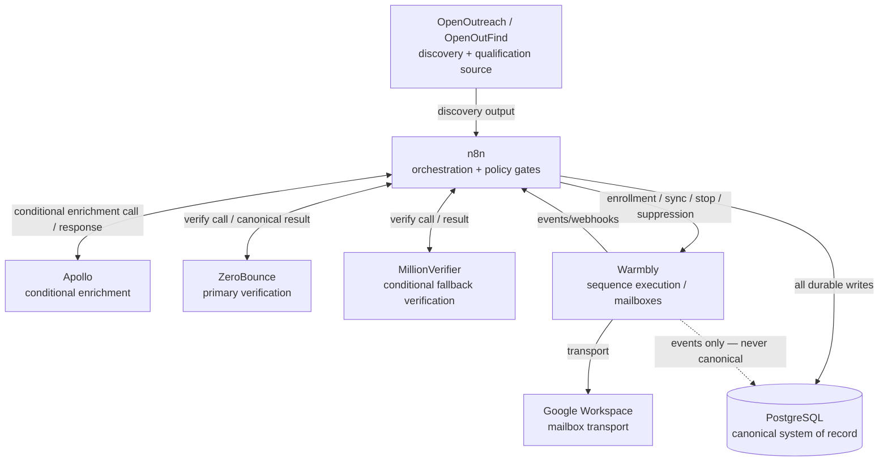
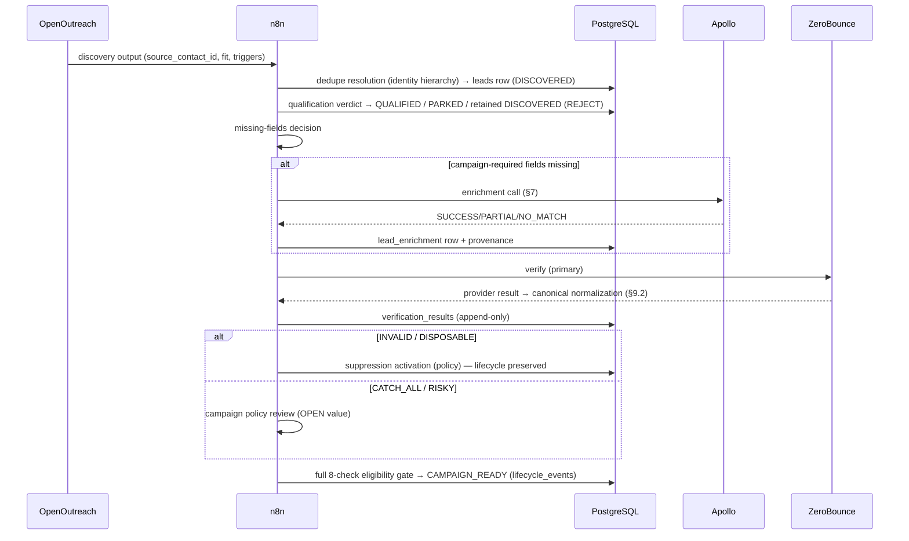

# SKMC Cold Email Automation — API Integration Specification

**Version:** 1.0 | **Date:** 2026-10-13 | **Status:** Approved — API integration implementation specification of Architecture v1.3

**Purpose:** Implementation-level specification of inputs, outputs, ownership boundaries, canonical mappings, failure behavior, idempotency, and webhook/event handling for every integration used by the SKMC cold-email automation system.

**Governing Architecture:** `/opt/data/skmc-cold-email/docs/architecture.md` — Version 1.3 — Approved — Single Source of Truth
**Database Reference:** `/opt/data/skmc-cold-email/docs/database-schema.md` — Version 1.2 — Approved — Database implementation of Architecture v1.3
**Lifecycle Reference:** `/opt/data/skmc-cold-email/docs/lead-lifecycle-status-flow.md` — Version 1.0 — Approved — Lead lifecycle implementation specification of Architecture v1.3

**Last updated:** 2026-10-13

**Authority rule:** architecture.md overrides everything. database-schema.md and lead-lifecycle-status-flow.md are approved implementation specifications subordinate to architecture.md. campaign-icp-spec.md (template v0.1) and implementation-plan-v1.3.md are supporting context only and may NOT override the approved documents; discrepancies found against them are recorded in §24.

---

## 2. Purpose

Define a precise, implementation-ready integration layer for n8n workflows:

- what each external system receives from and returns to n8n;
- what PostgreSQL writes each integration operation must produce;
- how provider-native results are normalized into canonical SKMC statuses;
- how failure, retry, idempotency, and suppression behave at the integration boundary;
- which provider facts are verified versus still requiring verification.

This document is written to be sufficient for n8n workflow implementation. It deliberately does NOT invent undocumented provider APIs: every provider-native detail is classified CONFIRMED, PROJECT CONTRACT, or OPEN / TO VERIFY.

## 3. Scope

**Integrations covered:**

1. OpenOutreach / OpenOutFind — discovery + qualification source (SKMC-internal tool; no public API documentation).
2. Apollo.io — conditional/supplemental enrichment only.
3. ZeroBounce — primary email verification.
4. MillionVerifier — conditional fallback / second-opinion verification.
5. Warmbly — sequence execution, follow-ups, mailbox execution/rotation, sending windows, limits, delivery/reply/bounce/unsubscribe/complaint event integration.
6. Google Workspace — mailbox/email transport boundary only (where relevant to the integration boundary).
7. n8n — orchestration layer (consumer of every adapter contract defined here).
8. PostgreSQL — canonical system of record (target of every durable write).

**Not covered:**

- Gmail/Google Workspace internal configuration (SMTP relay setup, sending-window mechanics inside Warmbly) — Warmbly execution internals are not redesigned here.
- Campaign/ICP business rules (owned by campaign-icp-spec.md once approved).
- n8n node-level workflow design (n8n Workflow Specification, future document).
- Warmbly UI configuration steps.

**Provider API details still requiring verification:** all items marked OPEN / TO VERIFY throughout, consolidated in §24. As of this draft: OpenOutreach API shape, Warmbly API endpoints/auth/webhooks, Apollo pagination/rate-limit specifics, provider webhook signatures.

---

## 4. Integration Architecture



Rule: every durable write flows through n8n into PostgreSQL. Providers never write canonical state. Warmbly's dashed line denotes events only — Warmbly is NEVER the canonical owner of lifecycle, suppression, verification history, campaign eligibility, or lead identity (Arch §17, §29; Lifecycle §15).

---

## 5. Common Integration Contract

**Classification: PROJECT CONTRACT unless noted.** These rules apply to every adapter.

| Rule | Specification |
|---|---|
| Correlation ID | Every provider call carries a correlation ID = n8n `execution_id` (workflow run identifier). Persisted in `workflow_runs.n8n_exec_id` for retry/DLQ traceability. |
| Workflow execution ID | n8n workflow execution ID; logged with every request/response for observability (§18). |
| Campaign ID | Canonical campaign identifier: `campaigns.campaign_id` (UUID primary key per approved Database Schema §5.7). Business registry labels such as `WPC-ETA-01` are DRAFT Campaign/ICP naming conventions from non-governing material — they are not the physical `campaigns.campaign_id` value. Carried on enrollment, assignment, and campaign-scoped suppression operations. |
| Canonical lead ID | `leads.lead_id` (UUID). The ONLY identity used in canonical writes; provider IDs are never lead identity. |
| Source system | `leads.source_system` (TEXT column per approved Database Schema §5.4) carrying the approved source values; OpenOutreach/OpenOutFind rows use the approved discovery source value. |
| External identifier | Source-scoped pair per approved Database Schema §5.4: `(source_system, leads.external_lead_id)` and/or `(source_system, leads.external_person_id)`, uniqueness enforced by `uq_leads_source_lead` and `uq_leads_source_person`. Never treated as a global key; no generic physical `external_id` column exists. |
| Timestamps | All canonical writes use DB-managed `created_at`/`updated_at`; provider `processed_at` fields are retained as evidence in raw payload/provenance, never as canonical time. |
| Idempotency | Outbound calls are retried only when the provider operation is idempotent or explicitly supported; otherwise guard with the DB-side uniqueness constraints listed in §16. Event ingestion is guarded by `email_events.idempotency_key` (DB §12) and provider event ID when available (DB-D4 fallback OPEN). |
| Retry classification | Every adapter outcome classified with the taxonomy in §14. |
| Timeout handling | Every HTTP adapter sets an explicit timeout (value configurable, not hardcoded); timeout → RETRYABLE unless provider indicates otherwise; never blocks a lifecycle transition silently — leads stay in their current lifecycle state during retry (Lifecycle §13). |
| Provider error preservation | Full raw error response (or truncated redacted form per §17) is persisted into `dead_letter_events` on final failure, and into workflow-run logs; errors are never discarded or silently converted into fabricated data. |
| Raw payload retention | Raw provider payloads stored per approved DB design (provenance/raw payload columns where defined); retention beyond approved policy is an Open Decision — no independent retention rule is introduced here. |
| Secret handling | API keys from credential store only (§17); never in workflow source, logs, or documentation. |
| PII handling | Minimal PII per call (§17): only fields the operation requires. No bulk export of full lead PII to non-essential providers. |
| Observability/audit | §18 logging/metrics; durable audit via `lifecycle_events`, `suppression_events`, `workflow_runs`, `dead_letter_events`, `config_history` (as applicable to each operation). |
| Schema validation | Every inbound/outbound payload is schema-validated by n8n before any canonical write; unknown/missing required fields → VALIDATION_FAILURE (fail-closed), never silent defaulting. |

---

## 6. OpenOutreach / OpenOutFind Contract

**Classification: PROJECT CONTRACT.** OpenOutreach is an SKMC-internal discovery/qualification tool. Its actual API/CLI JSON field names are NOT verified here — the contract below defines the REQUIRED canonical output semantics; n8n normalization maps actual fields to it.

### 6.1 Discovery output contract (per lead)

| Field (canonical name) | Meaning | Mapping into PostgreSQL |
|---|---|---|
| `source_contact_id` | OpenOutreach's identifier for the discovered contact | `leads.external_lead_id` (or `leads.external_person_id` where the identifier is a person-profile ID) with `source_system` = approved discovery source value; uniqueness scoped by `uq_leads_source_lead` / `uq_leads_source_person` |
| `source_system` | Discovery source system label | `leads.source_system` (approved TEXT value per DB §5.4) |
| `person_name` | Full name as discovered | `leads.first_name` + `leads.last_name` (split where OpenOutreach provides a single string; no physical `full_name` column exists) |
| `company_name` | Company legal/brand name | `leads.company` (denormalized display value); canonical company name is `companies.company_name` where the company row is populated |
| `company_domain` | Normalized registrable domain | `leads.company_domain` — dedupe/enrichment context ONLY, never a person identity key or campaign gate (Arch invariant; Lifecycle invariant #13) |
| `job_title` | Discovered title | `leads.title` |
| `profile_url` / `source_url` | Source profile page where available | stored as provenance/external profile reference per approved DB columns |
| `campaign_id` | Campaign the discovery was performed for | `campaign_assignments.campaign_id` reference (assignment created later at eligibility, not at discovery) |
| `eligibility_pass` | Boolean firmographic gate result | qualification inputs; drives `qualification_fit` |
| `fit` | A-FIT / B-FIT / C-FIT / REJECT | `leads.qualification_fit` (approved enum) |
| `persona_tier` | Decision-maker priority tier (P1/P2/P3) | qualification signal — persisted as structured signal/attribute per approved schema |
| `trigger_codes` | Structured trigger signal codes (T1–T6 semantics per campaign spec — codes themselves are campaign-scoped) | persisted as structured trigger evidence |
| `qualification_reason` | Free-text rationale | **INTERNAL ONLY.** Persisted as qualification evidence; never parsed to make critical campaign decisions; never used outbound (Arch §7 / Lifecycle §6). |
| `enrich_email` | The email OpenOutreach proposes to purchase | `leads.email` only AFTER purchase + verification; never before |
| `personalization_evidence` | Structured evidence for outbound personalization (device type, launch timing, approval signal) | must pass approved structured parsing/validation before any outbound use (Arch §8 / §14; Lifecycle §5 CAMPAIGN_READY gate) |

### 6.2 Rules

- `qualification_reason` is internal-only; n8n MUST NOT branch critical campaign decisions on its free text — decisions derive from structured `fit`, `trigger_codes`, `persona_tier`.
- `personalization_evidence` may be used outbound ONLY after approved structured parsing/validation; unknown required signal keys fail closed (Lifecycle §10, Arch §29 #14/#18).
- Discovery dedupe follows the approved 4-priority identity hierarchy (Arch §6; Lifecycle §6): 1) `(source_system, external_lead_id)`; 2) normalized email; 3) `(source_system, external_person_id)`; 4) unresolved ambiguity → manual review, never auto-merge. `company_domain` is never a contact-identity key; fuzzy name/domain matching is not an identity rule.
- No lifecycle transition happens at discovery beyond DISCOVERED persistence (per approved lifecycle §5 DISCOVERED row).

### 6.3 Provider detail status

OpenOutreach API/CLI shape, auth, payload fields, pagination: **OPEN / TO VERIFY** — SKMC-internal; verify against the actual tool output before the n8n intake workflow is built. The contract above fixes semantics, not field names.

---

## 7. Apollo Integration Contract

**Classification: PROJECT CONTRACT with CONFIRMED Apollo API basics (see §7.4).** Apollo is CONDITIONAL/supplemental enrichment only (Arch §2 #4, §4; Lifecycle §7).

### 7.1 Input / Output

**Input:** only leads with missing campaign-required fields, after the n8n missing-fields decision. Never called for leads already enriched with acceptable values (double-buy guard: if enrichment data is already present and acceptable, n8n records the skip rather than re-buying — DB `lead_enrichment.skipped` and Lifecycle §6.1 rule; Apollo enrichment never duplicates a completed purchase).

**Output:** supplemental person/company/contact attributes mapped through `lead_enrichment` (fields requested, fields returned, source provenance). Provider external identifiers are source-scoped: `(source_system, external_person_id)` with the Apollo person ID stored in `leads.external_person_id` (or enrichment provenance only, per approved schema) — never a canonical lead key.

### 7.2 Rules

- `company_domain` is enrichment/dedupe context only — never contact identity or campaign gate.
- Apollo does not decide lifecycle eligibility — the n8n eligibility gate does.
- Failure does not silently fabricate data: unmatched/failed enrichment leaves required fields missing → lead stays in ENRICHMENT_PENDING with retry/review path; no invented values (Lifecycle §6.2).
- Provenance preserved: every Apollo-supplied attribute is recorded with its source so downstream consumers can distinguish OpenOutreach, Apollo, and manual data.

### 7.3 Internal adapter outcomes (PROJECT CONTRACT — NOT Apollo-native statuses)

| Outcome | Meaning | Handling |
|---|---|---|
| SUCCESS | Matched; requested fields returned | Write `lead_enrichment` row (requested/returned fields + provenance); resume eligibility path |
| NO_MATCH | Person not found | Record no-match provenance; lead remains missing required fields → ENRICHMENT_PENDING hold with retry/policy path |
| PARTIAL | Matched; some required fields returned | Persist what was returned with provenance; remaining fields → missing-fields decision again |
| RETRYABLE_FAILURE | HTTP/network/timeout failure | Bounded retry per §15; state unchanged during retry |
| PERMANENT_FAILURE | Auth/quota/schema-invalid responses that retries cannot fix | DLQ/manual review; no canonical write |

### 7.4 Provider detail status

CONFIRMED (Apollo official docs): enrichment endpoints exist at `api.apollo.io/api/v1/people/match` (single) and `api/v1/people/bulk_match` (bulk, up to 10 people), authenticated via API key (`x-api-key` header pattern per Apollo docs); 429 responses occur on rate limiting. OPEN / TO VERIFY: exact pagination behavior for search endpoints, current rate-limit quota numbers, plan-dependent field availability, batch-response error shapes, webhook availability.

---

## 8. Email Verification Contract

**Classification: PROJECT CONTRACT for canonical semantics; provider normalization per §9/§10.** ZeroBounce = primary; MillionVerifier = conditional fallback / second opinion according to verification policy (never automatically for every lead).

### 8.1 Canonical verification statuses (approved — must align exactly with DB `verification_status_enum` and Lifecycle §8)

`NOT_CHECKED`, `VALID`, `INVALID`, `CATCH_ALL`, `RISKY`, `UNKNOWN`, `DISPOSABLE`, `TEMPORARY_FAILURE`

No other canonical status may exist. Provider results normalize into these 8; nothing else.

### 8.2 Input / Output

**Input:** `email` (the lead's canonical email) + canonical lead/context identifiers (`lead_id`, `campaign_id` where policy needs it).

**Output (per check):**

- canonical verification result (from §8.1);
- provider (`ZEROBOUNCE` | `MILLIONVERIFIER` — approved physical DB enum values, `verification_provider_enum` DB §4);
- `checked_at` (canonical timestamp);
- provider reference/raw status (provider-native status + sub-status retained as evidence);
- error information where applicable.

Writes: append-only `verification_results` row (history NEVER overwritten; DB §5.6, Lifecycle §8). Freshness evaluated from the LATEST row's `checked_at` against the freshness policy (`verification_valid_for_days` — value OPEN).

### 8.3 Rules

- **VALID** may proceed only subject to applicable campaign policy (CATCH_ALL/RISKY admission is a campaign-policy decision — value OPEN, Arch §28 #1).
- **INVALID / DISPOSABLE** block sending and invoke approved suppression behavior (suppression reason `invalid_email` — trigger table approved in Arch §15 / Lifecycle §12).
- **CATCH_ALL / RISKY** follow campaign policy (default hold-for-review; policy value OPEN).
- **UNKNOWN / TEMPORARY_FAILURE** follow retry/fallback policy: bounded retry with the SAME provider, then provider-fallback per policy (fallback to MillionVerifier is policy-triggered, not unconditional).
- Freshness: checked from canonical `checked_at`/history only; stale verification blocks enrollment until reverified (reverify consumes a new credit and writes a NEW history row — never bypasses the gate; Arch §29 #18, Lifecycle §5/§14).
- **Verification verdict ≠ observed campaign bounce rate.** The canonical verification result is a pre-send mailbox-level verdict; aggregate bounce rates are observed delivery outcomes and are never stored as a per-lead `bounce_risk_score` (Arch §10; no such column exists in DB §5.6 `verification_results` or anywhere else in the approved schema).

---

## 9. ZeroBounce Adapter

**Classification: PROJECT CONTRACT + CONFIRMED provider facts (ZeroBounce official API docs, verified 2026-10-13).**

### 9.1 Provider facts — CONFIRMED

- Real-time single validation: `GET/POST https://api.zerobounce.net/v2/validate` (SSL required), with API key parameter; regional hosts `api-us.zerobounce.net` / `api-eu.zerobounce.net` exist for both single validation and batch.
- Response status values: `valid`, `invalid`, `catch-all`, `unknown`, `spamtrap`, `abuse`, `do_not_mail`.
- Sub-status examples: `mailbox_not_found`, `greylisted`, `antispam_system`, `failed_smtp_connection`, `timeout_exceeded`, `disposable`, `toxic`, `role_based`, `accept_all`, `global_suppression`, `possible_typo`, `alias_address` (full list in ZeroBounce status-codes docs).
- Free/professional flags (`free_email`, `mx_found`, `catchall_domain`, `smtp_provider`) are returned.
- Batch validation endpoint: `POST /v2/validatebatch` with an optional processing timeout (10–120 s) — on timeout the API returns `unknown`/`greylisted`.
- Credits: unknown results are not charged by ZeroBounce (their stated policy).

### 9.2 Normalization (adapter responsibility — PROJECT CONTRACT mapping table)

| ZeroBounce `status` (native) | Canonical result | Notes |
|---|---|---|
| `valid` (incl. `accept_all` sub-status) | `VALID` | sub-status retained as evidence; `accept_all` may feed CATCH_ALL policy review — mapping of accept_all→CATCH_ALL is policy input, final canonical mapping per campaign policy (OPEN where applicable) |
| `invalid` | `INVALID` | includes `mailbox_not_found`, `failed_syntax_check`, etc. |
| `catch-all` | `CATCH_ALL` | follows campaign policy (default hold-for-review) |
| `unknown` + retryable sub-statuses (`greylisted`, `mail_server_temporary_error`, `timeout_exceeded`, `mail_server_did_not_respond`, `failed_smtp_connection`, `forcible_disconnect`, `antispam_system`) | `UNKNOWN` (or `TEMPORARY_FAILURE` for transport-level failure of the call itself) | bounded retry; then fallback per policy |
| `do_not_mail` + sub-status `disposable` | `DISPOSABLE` | suppression trigger (`invalid_email`) |
| `do_not_mail` + other sub-statuses (`toxic`, `role_based`, `role_based_catch_all`, `global_suppression`, `possible_trap`, `spamtrap`, `abuse`) | `INVALID` (suppress) or `RISKY` per policy | **RECOMMENDATION / CANDIDATE MAPPING — NOT APPROVED; OPEN pending campaign-policy approval.** Possible treatment (illustrative only, not an adopted default): suppress (`invalid_email`) for spamtrap/toxic/abuse; RISKY+review for role_based. The canonical mapping for these sub-statuses is not yet approved policy — it must be defined by the campaign/verification policy before production use |

**Idempotency:** single validation is naturally idempotent (a repeat check returns the same verdict at cost of a credit — dedupe by checking existing fresh verification history before calling). Canonical writes are idempotent via append-only history + freshness lookup: a replayed response writes one new history row; dedupe of duplicate in-flight checks is enforced by n8n (no concurrent duplicate verification per lead — workflow-level lock or freshness check before call).

**Retry/failure handling:** transport errors/timeouts → RETRYABLE (bounded); auth failures (invalid API key error shape) → AUTH_FAILURE (non-retryable); schema/JSON errors → VALIDATION_FAILURE (non-retryable, DLQ); provider 5xx/unavailability → PROVIDER_UNAVAILABLE (RETRYABLE with backoff).

**Audit:** every check writes an append-only `verification_results` row (provider, canonical result, raw status/sub-status evidence, `checked_at`). Errors are recorded into `dead_letter_events`/`workflow_runs` on final failure.

---

## 10. MillionVerifier Adapter

**Classification: PROJECT CONTRACT + CONFIRMED provider facts (MillionVerifier official API docs, verified 2026-10-13).** MillionVerifier is NOT automatically called for every lead. Invocation is conditional per verification policy (fallback after bounded ZeroBounce retries on UNKNOWN/TEMPORARY_FAILURE, or a second-opinion policy trigger). No unresolved policy thresholds are hardcoded here.

### 10.1 Provider facts — CONFIRMED

- Single real-time verification: `GET https://api.millionverifier.com/api/v3/?api=<key>&email=<email>&timeout=<sec>` (auth via `api` query parameter; docs also show a test key pattern). SSL supported.
- Result fields: `result` (ok / invalid / catch_all / disposable / unknown), `resultcode` (numeric), `subresult`, `quality` (good/bad/risky), `free`, `role`.
- Result semantics (official help pages): **Ok** = safe; **Invalid** = not safe; **Disposable** = not safe; **Catch-All** = risky; **Unknown** = risky (may verify later). Credits are charged only for Ok, Invalid, Disposable (Risky = Catch-all/Unknown free).
- Bulk API exists: file upload + status polling + filtered report download (`filter` enum: ok / ok_and_catch_all / unknown / invalid / all / custom; status enums include ok, catch_all, unknown, invalid, disposable). Bulk file endpoints (`/api/v3/fileupload`, file info/list/download/stop/delete) documented by the provider.

### 10.2 Normalization (adapter responsibility — PROJECT CONTRACT mapping table)

| MillionVerifier `result` (native) | Canonical result | Notes |
|---|---|---|
| `ok` | `VALID` | `quality=good` consistent |
| `invalid` | `INVALID` | suppress per policy (`invalid_email`) |
| `disposable` | `DISPOSABLE` | suppress per policy |
| `catch_all` | `CATCH_ALL` | campaign policy (default hold-for-review) |
| `unknown` | `UNKNOWN` | bounded retry / second-opinion policy |
| transport failure of the call itself | `TEMPORARY_FAILURE` | retry with backoff; fallback policy |

### 10.3 Invocation rules

- Conditional only: fallback after ZeroBounce retry exhaustion on UNKNOWN/TEMPORARY_FAILURE, or per a second-opinion policy trigger defined in `policy_config`. Never the default first call.
- Same append-only canonical write contract as §9.3 (provider = `millionverifier`).
- Same retry/failure/audit contract as §9.3.
- Bulk API is available for future re-verification sweeps; using it is a policy decision, not a requirement of this document (no threshold hardcoded).

---

## 11. Warmbly Integration Contract

**Classification: PROJECT CONTRACT. Warmbly API endpoint/auth/payload details: OPEN / TO VERIFY (per approved Architecture Open Decision — Warmbly's exact API and webhook capabilities are carried as OPEN in Arch §28 #8 / DB-D4 / Lifecycle §19).** Warmbly is execution-only: sequence execution, follow-ups, mailbox execution/rotation, sending windows, limits, and event integration. It is NEVER canonical for lifecycle, suppression, verification history, campaign eligibility, or lead identity.

### 11.1 Operations (internal contract)

**A. Enrollment / sequence sync**

Request (internal contract): canonical lead ID, canonical email, campaign ID, assignment ID, approved personalization fields mapped to campaign signal keys, required fields, mailbox/rotation context.

Enrollment MUST require ALL of (fail-closed — any failure → sync REJECTED, no partial enrollment):

1. valid canonical lead (`lead_id` exists, identity resolved);
2. valid campaign assignment target — the enrollment target campaign exists, is active, and is a valid target for this lead (Lifecycle §14 check 6); the `campaign_assignments` row is created/activated AS the enrollment side effect per the approved lifecycle/database flow (Lifecycle §5 Warmbly-sync row; DB §5.8) — first-time enrollment must not require a row that enrollment itself creates;
3. lifecycle eligibility (`CAMPAIGN_READY` or approved re-entry state);
4. acceptable current verification per campaign policy (Lifecycle §8);
5. verification freshness (latest `checked_at` within `verification_valid_for_days` — value OPEN);
6. no effective suppression (global or campaign-scoped, active);
7. required campaign fields present (`campaigns.required_fields` satisfied);
8. approved personalization evidence (structured, validated);
9. campaign/template compatibility (template signal keys ⊆ approved `campaigns.signals_template_keys`).

**Unknown required personalization signal key → sync REJECTED** (not silently blanked) — fail-closed (Arch §29 #14, Lifecycle §5 CAMPAIGN_READY row / §10).

**B. Contact update where permitted:** field updates for an enrolled contact only; same identity + freshness preconditions; updates never rewrite lifecycle.

**C. Sequence stop:** issued on: positive reply, negative reply (per reply policy), explicit unsubscribe, spam complaint, suppression activation affecting the contact, bounce-policy escalation. Stop is an execution instruction; the canonical lifecycle effect follows the approved transition table (Lifecycle §5/§11).

**D. Suppression propagation:** on approved suppression activation, n8n propagates suppression to Warmbly so execution stops immediately; propagation failure does not weaken the canonical suppression (which is already durable in PostgreSQL); sync-failure → retry/DLQ (see §23 suppression sync failure).

**E. Mailbox/campaign assignment context:** n8n supplies execution context (which campaign, which mailbox rotation parameters as approved); Warmbly owns execution inside those bounds — sending windows/limits are Warmbly-owned execution parameters, not canonical state.

**F. Event/webhook ingestion:** §12.

### 11.2 Ownership rule

Warmbly must NOT become canonical owner of lifecycle state. Warmbly events are EVIDENCE driving n8n canonical transitions (§12). A Warmbly-side state mismatch is a reconciliation/alert matter, never an excuse to adopt Warmbly state as canonical.

---

## 12. Warmbly Event / Webhook Contract

**Classification: PROJECT CONTRACT. Warmbly-native webhook event names, payload field names, authentication mechanism, retry semantics, event IDs, and ordering guarantees: OPEN / TO VERIFY.** The conceptual events below define the internal contract; the adapter maps actual Warmbly event names (once verified) to these.

For each conceptual event:

| Conceptual event | Required canonical identifiers | Event timestamp | Provider event ID | Idempotency / dedupe | Canonical DB writes | Lifecycle impact | Suppression impact | Sequence action | Audit |
|---|---|---|---|---|---|---|---|---|---|
| **Delivery / sent** | lead_id, campaign_id, assignment_id, event message ref | event timestamp | if available (else fallback — OPEN) | `email_events.idempotency_key` UNIQUE (DB §12) — PENDING EXAMPLE / DESIGN CANDIDATE for the key composition: (lead, campaign, message/event-type, timestamp-scope); the exact composition remains OPEN under DB-D4; duplicate provider event ID → DUPLICATE_EVENT, drop | `email_events` row | none (sending in progress) | none | none | event row + workflow log |
| **Reply** | lead_id, campaign_id, reply content ref | event timestamp | if available | idempotency key; reply rows deduped | `replies` row; classification result | classification drives transitions (§ below) | none by itself | positive/negative → stop per policy | lifecycle_events row on transition |
| **Positive reply** (classification of reply) | as reply | as reply | as reply | as reply | reply row + lifecycle_events | `IN_SEQUENCE → REPLIED_POSITIVE` (deterministic); handoff downstream; NO CRM states | none | stop sequence | lifecycle_events |
| **Negative reply** (classification of reply) | as reply | as reply | as reply | as reply | reply row + lifecycle_events | `IN_SEQUENCE → REPLIED_NEGATIVE`; NOT automatic global suppression; cooldown configurable/OPEN | none (negative reply never auto-global-suppression) | stop sequence/exit per reply policy | lifecycle_events |
| **Bounce** | lead_id, campaign_id, bounce type (hard/soft) | event timestamp | if available | idempotency key | email_events + lifecycle_events on hard bounce | hard bounce → `BOUNCED` + bounce-policy suppression (`hard_bounce` reason; scope per configured policy); soft bounce → per bounce policy, not lifecycle-terminal | per approved bounce policy | hard: stop; soft: per policy | lifecycle_events / suppression_events |
| **Unsubscribe** | lead_id, campaign_id | event timestamp | if available | idempotency key | suppression_list + suppression_events (`explicit_unsubscribe`, GLOBAL) + lifecycle_events | `IN_SEQUENCE → UNSUBSCRIBED` (the ONLY event producing UNSUBSCRIBED) | GLOBAL suppression ACTIVATED; no automatic expiry | stop immediately | lifecycle_events + suppression_events |
| **Spam complaint** | lead_id, campaign_id | event timestamp | if available | idempotency key | suppression_list + suppression_events (`spam_complaint`, GLOBAL) + lifecycle_events (preservation event) | **lifecycle PRESERVED — remains IN_SEQUENCE; MUST NOT rewrite to UNSUBSCRIBED** (Arch §9/§16; Lifecycle §5/§11 patched semantics) | GLOBAL suppression ACTIVATED; no automatic expiry | stop sequence/further sending immediately | lifecycle_events + suppression_events |
| **Sequence completion** | lead_id, campaign_id, sequence ref | event timestamp | if available | idempotency key | lifecycle_events; assignment exit handling per workflow spec | `IN_SEQUENCE → COMPLETED` (no reply) | none | sequence ended; lead holds; re-enrollable only via full gate | lifecycle_events |

Webhook ingestion pipeline (n8n): authenticate → parse → schema-validate → resolve canonical lead (never trust provider IDs as identity without resolution) → dedupe by idempotency key → classify → canonical writes in transaction → 2xx acknowledgment. Unauthenticated webhooks are rejected (POLICY_REJECTED); duplicate events are acknowledged but not re-applied (DUPLICATE_EVENT). Out-of-order events: apply per approved event semantics — a terminal-ish event (unsubscribe/complaint) and a later delivery event must not resurrect sending; delivery events for a suppressed/stopped lead are logged and ignored for lifecycle purposes. Event-ordering guarantees from Warmbly: OPEN / TO VERIFY.

---

## 13. Google Workspace Boundary

Google Workspace is the mailbox/email transport. Warmbly controls execution (sending windows, rotation, limits) where approved. This document:

- does NOT redesign Gmail/Workspace into the orchestration system;
- does NOT integrate GW as an API provider of record — mailbox health metrics that Warmbly produces are consumed as execution evidence, never as canonical state;
- keeps GW provider/API details (OAuth scopes, Gmail API usage inside Warmbly) out of scope — they are Warmbly-internal execution concerns and OPEN / TO VERIFY at the Warmbly boundary only.

---

## 14. Canonical Error Model

**Classification: PROJECT CONTRACT** (internal taxonomy; does not conflict with approved docs; not provider-native terminology).

| Error class | Meaning | n8n handling |
|---|---|---|
| RETRYABLE | Transient transport/provider failure where retry is expected to succeed | Bounded retry with backoff (§15); lifecycle state unchanged during retry |
| NON_RETRYABLE | Semantically cannot succeed on retry (e.g., NO_MATCH with no policy path) | DLQ/manual review; no fabricated data |
| RATE_LIMITED | Provider 429 / rate-limit response | Respect Retry-After if supplied; exponential backoff; bounded |
| AUTH_FAILURE | Credentials invalid/expired | NON_RETRYABLE → alert + DLQ; fix credentials out-of-band |
| VALIDATION_FAILURE | Payload/schema mismatch against contract | NON_RETRYABLE → DLQ; fail-closed (no canonical write) |
| PROVIDER_UNAVAILABLE | Provider outage/5xx | RETRYABLE with backoff; fallback provider per policy (verification) |
| TIMEOUT | Request exceeded configured timeout | RETRYABLE (bounded); lifecycle unchanged |
| DUPLICATE_EVENT | Idempotency key already processed | Acknowledge, drop, log; never re-apply |
| POLICY_REJECTED | Gate/policy refused the operation (fail-closed) | No provider retry; observable review state; lead stays in current lifecycle state |

---

## 15. Retry / Backoff / DLQ Rules

Derived from approved architecture/lifecycle behavior (Arch §22; Lifecycle §5 failure columns, §13).

- **Bounded retry:** every retryable error retried a bounded, configurable number of times (not hardcoded in this document); bounds are deployment configuration.
- **Backoff:** exponential/configurable backoff; values are configuration, not policy decisions resolved here.
- **Retry-After respect:** where a provider supplies `Retry-After` (rate limiting), the adapter honors it before the next attempt.
- **DLQ/manual review:** after exhaustion → `dead_letter_events` row + `workflow_runs` failure record + alert; human review resolves; no silent drop.
- **No lifecycle corruption:** transient provider failure NEVER advances or corrupts lifecycle — the lead remains in its current lifecycle state; only the workflow run retries (Lifecycle §13).
- **Idempotent replay:** DLQ replay re-executes the adapter operation with the same correlation ID; idempotency/dedupe (§16) prevents double effects.
- **Visibility/alerting:** final failures and suppressed-enrollment rejections are alerted (channel OPEN — Arch §28 #10); metrics in §18.

---

## 16. Idempotency & Deduplication

| Operation | Idempotency mechanism (approved DB constraints) |
|---|---|
| Outbound provider calls (verify, enrich) | Guarded by pre-call freshness/existing-history checks (verification) and existing-enrichment checks (double-buy guard); retries safe because provider calls are read-type or credit-gated re-checks |
| Enrollment | Enrollment requires a fresh canonical pre-state; duplicate sync attempts guarded by active-assignment uniqueness (`uq_assign_active_lead_campaign` — one active assignment per lead per campaign) |
| Webhook replay | `email_events.idempotency_key` UNIQUE (DB §12) is mandatory; the exact key composition is a PENDING EXAMPLE / DESIGN CANDIDATE only — OPEN under DB-D4; duplicate provider event ID → DUPLICATE_EVENT |
| Duplicate provider event IDs | Same mechanism; acknowledged, not re-applied |
| Source-scoped identifiers | `(source_system, leads.external_lead_id)` uniqueness (`uq_leads_source_lead`) and `(source_system, leads.external_person_id)` uniqueness (`uq_leads_source_person`) on leads |
| Canonical lead identity | approved 4-priority hierarchy (Arch §6; Lifecycle §6): 1) `(source_system, external_lead_id)`; 2) normalized email; 3) `(source_system, external_person_id)`; 4) unresolved ambiguity → manual review, never auto-merge. `company_domain` is never a contact-identity key |
| Suppression propagation | canonical suppression durable in PostgreSQL first (`uq_supp_active_global` / `uq_supp_active_campaign` — one active suppression per scope); Warmbly propagation is execution-only and idempotent (re-propagation harmless) |
| Verification result writes | append-only history; replay writes a new row only when a recheck actually occurred; dedupe via freshness check before calling |

---

## 17. Security & Secrets

- Secrets (API keys, credentials) live in the n8n credential store / environment — NEVER in workflow source, logs, or documentation. No specific secret-management product is approved; use the existing approved store mechanism (no new product invented here).
- Least privilege: each integration uses a key scoped to only its function (verification keys cannot send; Warmbly credentials are execution-only).
- No API keys or secrets in logs — redact auth headers and key parameters from all logged payloads.
- Webhook authentication/signature verification: required where supported; for Warmbly the mechanism is OPEN / TO VERIFY (once verified, enforce HMAC/signature verification; until then the ingestion endpoint must be network-restricted and fail-closed on missing auth).
- HTTPS everywhere for provider calls (SSL required by ZeroBounce docs; assume-and-verify for others).
- PII minimization: send only fields the operation requires (e.g., verification gets the email only; Apollo gets identification fields; no bulk PII export).
- Raw provider payloads: retained per approved DB design as evidence; raw payloads containing PII are access-restricted and not logged in plaintext.

---

## 18. Observability

Conceptual logging/metrics per provider call:

- provider (openoutreach, apollo, zerobounce, millionverifier, warmbly);
- operation (discovery, enrich, verify, enroll, sync, stop, propagate-suppression, ingest-event);
- success/failure + error class (§14);
- latency;
- retry count;
- correlation/workflow execution ID;
- canonical lead ID (where appropriate — NOT for raw webhook logs);
- campaign ID;
- provider result (verification verdicts, enrichment outcomes).

Avoid logging unnecessary PII: log identifiers and results, not full payloads; raw payloads go to approved storage, not logs. Aggregate verification verdicts and bounce rates feed health metrics — verdict and observed bounce rate remain distinct measures (§8.3).

---

## 19. Integration Matrix

| Integration | Purpose | Called By | Input | Canonical Output | System of Record | Failure Behavior | API Verification Status |
|---|---|---|---|---|---|---|---|
| OpenOutreach / OpenOutFind | Discovery + qualification | n8n intake workflow | Campaign spec context | leads row (source-scoped ID, fit, triggers) | PostgreSQL (via n8n) | Intake failure → workflow retry/DLQ; ambiguous identity → manual review | OPEN / TO VERIFY (internal tool) |
| Apollo | Conditional enrichment | n8n | lead_id + missing required fields | lead_enrichment row (requested/returned + provenance) | PostgreSQL (via n8n) | NO_MATCH/PARTIAL/RETRYABLE/PERMANENT per §7.3 | CONFIRMED endpoints; limits/pagination OPEN |
| ZeroBounce | Primary verification | n8n | lead email + context | verification_results row (canonical result + evidence) | PostgreSQL (via n8n) | Retry/fallback per §8/§9/§15 | CONFIRMED endpoints + statuses |
| MillionVerifier | Conditional fallback / second opinion | n8n | lead email + context | verification_results row (canonical result + evidence) | PostgreSQL (via n8n) | Same contract as ZeroBounce | CONFIRMED endpoints + results |
| Warmbly | Sequence execution + events | n8n | Enrollment/sync/stop/suppression context | execution events + webhooks (evidence) | Warmbly executes; PostgreSQL canonical | Sync rejection fail-closed; event ingestion deduped | OPEN / TO VERIFY (API + webhooks) |
| Google Workspace | Mailbox transport | Warmbly | Warmbly-internal | delivery evidence via Warmbly events | Warmbly execution; PostgreSQL canonical via events | Out of integration scope (Warmbly-internal) | Out of scope |
| n8n | Orchestration + policy | — | All of the above | All canonical writes | PostgreSQL | Per §14/§15 | PROJECT CONTRACT |
| PostgreSQL | Canonical system of record | n8n only | Canonical writes | — | PostgreSQL | DB transactional; no provider writes | Not applicable |

---

## 20. API Contract Tables

### 20.1 OpenOutreach / OpenOutFind

| Operation | Direction | Required Internal Input | Expected Internal Output | Side Effects | Idempotency | Provider Detail Status |
|---|---|---|---|---|---|---|
| Discover + qualify | Outbound (n8n → tool) | campaign_id, ICP spec version | Lead candidate set (§6.1 fields) | leads rows created (DISCOVERED) after dedupe resolution | Dedupe by identity hierarchy; source-scoped uniqueness | OPEN / TO VERIFY (payload field names) |
| Email purchase signal | Outbound | lead_id, credit authorization context | purchase confirmation → resolved email | `leads.email` set; credit recorded per approved design | One purchase per lead+email; re-purchase guarded | OPEN / TO VERIFY |

### 20.2 Apollo

| Operation | Direction | Required Internal Input | Expected Internal Output | Side Effects | Idempotency | Provider Detail Status |
|---|---|---|---|---|---|---|
| Single person enrichment | Outbound | lead_id + identification fields (name/company_domain/title) | SUCCESS / NO_MATCH / PARTIAL + attributes | lead_enrichment row; state stays ENRICHMENT_PENDING until fields complete | Pre-call existing-data check (double-buy guard); outcome idempotent on replay | CONFIRMED endpoint; params/pagination OPEN |
| Bulk enrichment | Outbound | up to 10 leads | batch outcomes per lead | lead_enrichment rows | Same | CONFIRMED endpoint; OPEN: batch error shape |

### 20.3 ZeroBounce

| Operation | Direction | Required Internal Input | Expected Internal Output | Side Effects | Idempotency | Provider Detail Status |
|---|---|---|---|---|---|---|
| Single validate | Outbound | email (canonical) | canonical result + provider evidence | verification_results row (append-only) | Freshness-check before call; replay-safe via history | CONFIRMED |
| Batch validate | Outbound | email batch | per-email canonical results | verification_results rows | Bulk tracking via provider file/batch ID where used | CONFIRMED endpoint; batch workflow usage = policy decision |
| Credit/usage check | Outbound | — | remaining credits | none (observability) | read-only | CONFIRMED (endpoint exists in docs) |

### 20.4 MillionVerifier

| Operation | Direction | Required Internal Input | Expected Internal Output | Side Effects | Idempotency | Provider Detail Status |
|---|---|---|---|---|---|---|
| Single verify | Outbound | email + api key | canonical result + evidence | verification_results row (append-only) | Freshness-check before call | CONFIRMED |
| Bulk verify | Outbound | email file | file_id + polling + filtered report | verification_results rows on completion | file_id tracking | CONFIRMED endpoints; bulk usage = policy decision |
| API credits check | Outbound | — | remaining credits | none | read-only | CONFIRMED |

### 20.5 Warmbly

| Operation | Direction | Required Internal Input | Expected Internal Output | Side Effects | Idempotency | Provider Detail Status |
|---|---|---|---|---|---|---|
| Enrollment / sequence sync | Outbound | §11.1 nine preconditions | sync acceptance | campaign_assignments activation + lifecycle_events (canonical, pre-state); Warmbly sequence starts | One active assignment per lead per campaign | OPEN / TO VERIFY (API endpoints/auth) |
| Contact update | Outbound | lead_id + permitted fields | update confirmation | none canonical (provenance log) | Replay-safe | OPEN / TO VERIFY |
| Sequence stop | Outbound | lead_id + campaign_id + reason | stop confirmation | lifecycle_events where transition applies | Repeat-safe (idempotent stop) | OPEN / TO VERIFY |
| Suppression propagation | Outbound | lead_id + suppression scope | propagation confirmation | suppression canonical already durable; Warmbly stops sending | Repeat-safe | OPEN / TO VERIFY |
| Event/webhook ingestion | Inbound | Warmbly webhook payload | §12 outcomes | email_events/lifecycle_events/suppression_events | idempotency_key + event ID | OPEN / TO VERIFY (event names/auth/retry) |

### 20.6 Google Workspace

Out of integration scope — see §13. No API contract defined here.

---

## 21. Database Mapping

Maps integration operations to approved DB v1.2 objects ONLY (no invented tables).

| Integration operation | DB objects written |
|---|---|
| OpenOutreach discovery intake | `leads` (+ `lifecycle_events` DISCOVERED row); source-scoped identity columns |
| Qualification recording | `leads.qualification_fit` + qualification signal columns + `lifecycle_events` (QUALIFIED/PARKED per verdict) |
| Apollo enrichment | `lead_enrichment` (requested/returned fields, skipped flag, provenance); `lifecycle_events` on state change |
| ZeroBounce / MillionVerifier verification | `verification_results` (append-only: provider, canonical result, evidence, checked_at); `lifecycle_events` on transitions; suppression trigger rows where INVALID/DISPOSABLE per policy (`suppression_list`, `suppression_events`) |
| Warmbly enrollment | `campaign_assignments` (new row; `uq_assign_active_lead_campaign`), `lifecycle_events` (CAMPAIGN_READY → IN_SEQUENCE) |
| Warmbly events | `email_events` (idempotency_key), `replies`, `lifecycle_events` (transitions), `suppression_list` + `suppression_events` (unsubscribe/complaint/bounce per policy) |
| Suppression propagation | `suppression_list` + `suppression_events` (canonical, first); Warmbly propagation recorded in workflow logs |
| Retry/DLQ | `workflow_runs`, `dead_letter_events` |
| Policy/config | `policy_config` + `config_history` (reads only by workflows; writes by config process) |

No mapping exists (and none is invented) for: CRM stages, mailbox health as canonical columns, or any provider-owned state. If a future need arises, it must be added via the approved schema-change process, not by this document.

---

## 22. Sequence Diagrams

### A. Discovery → qualification → enrichment → verification → campaign ready



### B. Campaign enrollment → Warmbly → Google Workspace

```mermaid
sequenceDiagram
    participant N as n8n
    participant DB as PostgreSQL
    participant WB as Warmbly
    participant GW as Google Workspace
    N->>DB: eligibility gate re-check (freshness, suppression, concurrency)
    N->>WB: enrollment sync (§11.1 — fail-closed preconditions)
    WB-->>N: acceptance / rejection
    alt accepted
        N->>DB: campaign_assignments (new row) + lifecycle_events (→ IN_SEQUENCE)
        WB->>GW: mailbox sends within sending windows/limits (Warmbly-owned)
        GW-->>WB: transport outcomes
    else rejected
        N->>DB: workflow record — no enrollment; lead stays CAMPAIGN_READY / review
    end
```

### C. Warmbly webhook → n8n → PostgreSQL

```mermaid
sequenceDiagram
    participant WB as Warmbly
    participant N as n8n
    participant DB as PostgreSQL
    WB->>N: webhook (conceptual event; auth verified)
    N->>N: schema validate → resolve canonical lead → idempotency check
    alt duplicate event
        N-->>WB: 2xx (acknowledged, not re-applied)
    else new event
        N->>DB: email_events (idempotency_key) + classification
        alt reply: positive
            N->>DB: lifecycle IN_SEQUENCE → REPLIED_POSITIVE; stop sequence
        else reply: negative
            N->>DB: lifecycle → REPLIED_NEGATIVE; NO automatic global suppression; cooldown OPEN
        else explicit unsubscribe
            N->>DB: lifecycle → UNSUBSCRIBED + GLOBAL suppression (explicit_unsubscribe)
        else spam complaint
            N->>DB: lifecycle PRESERVED (stays IN_SEQUENCE) + GLOBAL suppression (spam_complaint) + stop sending
        else hard bounce
            N->>DB: lifecycle → BOUNCED + suppression per bounce policy
        else sequence completed
            N->>DB: lifecycle → COMPLETED
        end
        N->>WB: stop/propagation as applicable
        N-->>WB: 2xx
    end
```

### D. Re-enrollment with stale verification

```mermaid
sequenceDiagram
    participant N as n8n
    participant DB as PostgreSQL
    participant ZB as ZeroBounce
    participant WB as Warmbly
    N->>DB: re-enrollment evaluation for COMPLETED / REPLIED_NEGATIVE lead
    N->>DB: full 8-check gate — freshness fails (stale checked_at)
    N->>ZB: reverify (new credit; never bypasses gate)
    ZB-->>N: fresh result
    N->>DB: NEW verification_results row (history append-only)
    alt result acceptable + all other gate checks pass
        N->>DB: lifecycle VERIFICATION_PENDING → VERIFIED → CAMPAIGN_READY
        N->>WB: enrollment sync (new assignment row)
        WB-->>N: accepted → lifecycle IN_SEQUENCE
    else any gate check fails
        N->>DB: no re-enrollment; lead stays gated state; observable
    end
```

---

## 23. Failure Scenarios

| Scenario | Detection | Immediate Action | Canonical State Effect | Retry? | Suppression Effect | Audit/Visibility |
|---|---|---|---|---|---|---|
| OpenOutreach unavailable | Intake call fails/times out | workflow retry per bounds | leads not yet created — no state | RETRYABLE → DLQ | none | workflow_runs |
| Apollo no match | NO_MATCH outcome | record provenance; re-run missing-fields decision | lead stays ENRICHMENT_PENDING | NO (non-retryable; policy path) | none | lead_enrichment no-match provenance |
| Apollo timeout | TIMEOUT class | bounded backoff retry | lead stays ENRICHMENT_PENDING | RETRYABLE | none | workflow_runs |
| ZeroBounce temporary failure | provider temporary result / transport error | bounded retry with same provider | lifecycle unchanged (VERIFICATION_PENDING) | RETRYABLE | none | verification attempt logs |
| ZeroBounce ambiguous result needing policy/fallback | UNKNOWN after retries, CATCH_ALL requiring admission decision | fallback to MillionVerifier per policy; CATCH_ALL/RISKY → campaign policy review (OPEN) | lifecycle unchanged until policy resolves | RETRYABLE → fallback | none until policy | verification_results + policy evaluation |
| MillionVerifier unavailable | provider error/timeout | bounded retry; policy decides second-opinion failure handling | lifecycle unchanged | RETRYABLE | none | workflow_runs |
| Stale verification during enrollment | freshness gate fails (latest checked_at older than OPEN period) | block enrollment; reverify first (new history row + credit) | VERIFIED → VERIFICATION_PENDING (reverify) | reverify is a fresh operation | none | verification_results + lifecycle_events |
| Warmbly enrollment failure | sync rejection / API failure | fail-closed: no enrollment; retry bounds; alert | lead stays CAMPAIGN_READY (not IN_SEQUENCE) | RETRYABLE (sync) | none | workflow_runs + alert |
| Duplicate Warmbly webhook | idempotency_key exists / provider event ID seen | acknowledge 2xx, drop | none (previous application stands) | NO | none | email_events dedupe log |
| Out-of-order webhook | event for suppressed/stopped lead; late delivery event | apply approved event semantics; late delivery logged and ignored for lifecycle | none (no resurrection of sending) | NO | suppression holds | event logs |
| Unsubscribe | webhook classified explicit_unsubscribe | GLOBAL suppression activation + lifecycle UNSUBSCRIBED + stop | IN_SEQUENCE → UNSUBSCRIBED | NO | GLOBAL (`explicit_unsubscribe`); no auto-expiry | suppression_events + lifecycle_events |
| Spam complaint | webhook classified complaint | stop sending + GLOBAL suppression + lifecycle PRESERVED (stays IN_SEQUENCE) | lifecycle unchanged (NO UNSUBSCRIBED rewrite) | NO | GLOBAL (`spam_complaint`); no auto-expiry | suppression_events + lifecycle_events |
| Suppression sync failure | propagation call fails after canonical suppression durable | retry propagation; DLQ; alert — canonical suppression NOT weakened | none (suppression already durable) | RETRYABLE (propagation) | canonical suppression already active | suppression_events + workflow_runs |
| Provider authentication failure | AUTH_FAILURE class | stop retrying; alert; fix credentials out-of-band; DLQ | none | NO | none | workflow_runs + alert |
| Provider rate limiting | 429 / RATE_LIMITED | honor Retry-After; bounded exponential backoff | none | RETRYABLE (bounded) | none | retry metrics |
| Warmbly API capability unknown (pre-verification) | adapter build-time | treat as OPEN; do not fabricate endpoints | none | n/a | none | §24 tracking |

---

## 24. Open Decisions / To Verify

### A. Architecture/Business decisions already OPEN (carried forward — NOT resolved here)

| # | Decision | Source |
|---|---|---|
| A1 | Verification freshness period (`verification_valid_for_days`) | Arch §28 #3 / Lifecycle §19 |
| A2 | Data retention policy | Arch §28 #2 / Lifecycle §19 |
| A3 | C-Fit revisit period | Arch §28 #4 / Lifecycle §19 |
| A4 | Negative-reply cooldown value | Arch §28 #5 / Lifecycle §19 |
| A5 | Campaign concurrency implementation (conflict_group semantics) | Arch §28 #7 |
| A6 | CATCH_ALL/RISKY admission policy | Arch §28 #1 / Lifecycle §19 |
| A7 | Warmbly exact API endpoints/auth/webhook capabilities | Arch §28 #8 / DB-D4 / Lifecycle §19 |
| A8 | Suppression GLOBAL vs CAMPAIGN coexistence/precedence | DB-D8 |
| A9 | Alert channel / monitoring implementation | Arch §28 #10 |

### B. Provider/API facts requiring official verification

| Provider | Item | Status |
|---|---|---|
| OpenOutreach | API availability, endpoint URLs, auth mechanism, payload field names, pagination, rate limits, webhook support | OPEN / TO VERIFY (internal tool — verify against actual output) |
| OpenOutreach | Email-purchase confirmation flow and credit accounting API | OPEN / TO VERIFY |
| Apollo | Pagination behavior for search endpoints; current rate-limit quota; plan-dependent field availability; batch error shape; webhook availability | OPEN / TO VERIFY |
| Apollo | Field-level availability per plan for the campaign-required field list | OPEN / TO VERIFY |
| ZeroBounce | Regional batch hosts latency expectations; sub_status full-list completeness for production values | CONFIRMED endpoints/statuses; residual edge-value mapping OPEN |
| ZeroBounce | ZeroBounce webhook availability (if any) | OPEN / TO VERIFY |
| MillionVerifier | Bulk file endpoint production parameters; timeout values; rate limits | CONFIRMED endpoints; OPEN: limits/timeouts |
| MillionVerifier | Webhook support (if any) | OPEN / TO VERIFY |
| Warmbly | API availability, endpoint URLs, auth mechanism, contact/sync endpoints | OPEN / TO VERIFY (approved OPEN decision) |
| Warmbly | Webhook support, event names, payload schema, authentication/signature, retry semantics, event IDs, ordering guarantees | OPEN / TO VERIFY (approved OPEN decision) |
| Warmbly | Batch limits, timeout expectations, rate limits, provider idempotency support | OPEN / TO VERIFY |
| Google Workspace | Out of scope (§13); Warmbly-internal | n/a |

**Discrepancies recorded (supporting documents vs approved docs):** campaign-icp-spec.md v0.1 is a template ("fill bracketed values") and contains campaign decisions (e.g., C-fit revisit "60 days", sequence cadence values) that are NOT approved policy — the approved OPEN decision list governs, and those template values must not be treated as fixed (Architecture v1.3 authority rule). implementation-plan-v1.3.md and ICP docs are context only; no conflict required action beyond this note.

---

## 25. Architecture Invariants

Restated from approved documents only (relevant subset):

1. PostgreSQL is the canonical system of record; n8n orchestrates; providers execute (Arch §2, §5; Lifecycle §15).
2. Lifecycle, verification, and suppression are separate dimensions, never collapsed (Arch §16; Lifecycle P3/P4).
3. Suppression is orthogonal to lifecycle: a suppression event preserves lifecycle history; lifecycle is never rewritten to a suppression value (Arch §9/§16; Lifecycle §12).
4. Spam complaint activates GLOBAL suppression and stops sending; it does NOT rewrite lifecycle to UNSUBSCRIBED (Lifecycle §5/§11 approved semantics).
5. Negative reply is NOT automatic global suppression; cooldown is configurable/OPEN (Arch §29 #17; Lifecycle §11).
6. External identity is source-scoped; `company_domain` is never a person identity key or campaign gate (Arch §29; DB §5.9; Lifecycle invariant).
7. Stale verification can never bypass the freshness gate; re-enrollment repeats all required gates (Arch §29 #18; Lifecycle §14).
8. Required personalization fields/signals fail closed: unknown required key → rejection, never silent blanking (Arch §29 #14; Lifecycle §10).
9. No lead enters Warmbly without current acceptable verification and suppression/eligibility checks (Arch §11; Lifecycle §5/§10).
10. Campaign concurrency is contact-level, decided by approved rules; `company_domain` is not a concurrency gate (Arch §13; DB §5.8; Lifecycle §9).
11. No CRM/sales lifecycle states; positive reply hands off downstream (Arch §29 #21; Lifecycle §3).
12. No lead is auto-enrolled: enrollment requires a deterministic approval decision (Arch §11; Lifecycle §5).

---

## 26. Traceability Matrix

| Integration rule in this document | Architecture v1.3 | Database Schema v1.2 | Lifecycle & Status Flow v1.0 |
|---|---|---|---|
| PostgreSQL canonical / n8n orchestration (§4, §19) | §2, §5 | §2, §5.4 | §1, §15 |
| OpenOutreach discovery contract (§6) | §6, §7 | §5.4 (leads identity/source columns) | §6, §7 |
| Apollo conditional enrichment (§7) | §2 #4, §4 | §5.5 (lead_enrichment) | §7 |
| Verification contract + canonical statuses (§8) | §10, §11 | §4 enum, §5.6 | §8 |
| ZeroBounce normalization (§9) | §10, §11 (provider policy) | §5.6 (provider columns) | §8 |
| MillionVerifier conditional fallback (§10) | §10, §11 | §5.6 | §8 |
| Warmbly execution-only + fail-closed enrollment (§11) | §11, §17 | §5.7 (campaigns), §5.8 (assignments) | §5, §10 |
| Warmbly events / spam complaint semantics (§12) | §9, §15, §16, §29 | §5.10–§5.13, §12 | §5, §11, §12 |
| Google Workspace boundary (§13) | §3, §18 | — | §10 (GW ownership row) |
| Error model / retry / DLQ (§14, §15) | §22 | §5.16 (workflow_runs), §5.17 (dead_letter_events) | §13, §17 |
| Idempotency (§16) | §20 | §12 | §16 |
| Security/observability (§17, §18) | §23, §24 | §5.18 (grants) | §18 |
| Config from policy_config only (§5, §15) | §21 | §5.14 | §14 |

---

## 27. Change Log

| Version | Date | Change |
|---|---|---|
| 1.0 | 2026-10-13 | Initial creation: implementation-level API Integration Specification derived from approved Architecture v1.3, Database Schema v1.2, and approved Lead Lifecycle & Status Flow v1.0 — integration architecture, common contract, provider contracts (OpenOutreach, Apollo, ZeroBounce, MillionVerifier, Warmbly, Google Workspace boundary), event/webhook semantics, canonical error model, retry/DLQ, idempotency, security, observability, matrix, DB mapping, sequence diagrams, failure scenarios, open decisions split (A: carried architecture/business; B: provider verification), invariants, traceability. Status: Draft for review |
| 1.0 (patch) | 2026-10-13 | Rigorous-review patch: corrected physical DB references (workflow_runs.n8n_exec_id, leads.external_lead_id/external_person_id, leads.first_name/last_name, leads.company, leads.title, leads.email, uq_leads_source_lead/uq_leads_source_person, verification_status_enum, ZEROBOUNCE/MILLIONVERIFIER enum case) and lead identity hierarchy (approved 4-priority model; company_domain never an identity key); fixed enrollment-order precondition (valid assignment target; assignment row created at enrollment) and traceability/open-decision section references; restored OPEN classification for policy-dependent normalization (ZeroBounce do_not_mail sub-statuses) and idempotency-key composition (DB-D4 pending example); corrected ZeroBounce regional-host wording. No architecture, lifecycle, or provider-contract redesign. |
| 1.0 | 2026-10-13 | Approved — Final post-patch verification passed with no blockers, SHOULD FIX findings, provider-fact regressions, architecture conflicts, lifecycle conflicts, or database alignment issues; API Integration Specification v1.0 approved as the integration implementation specification of Architecture v1.3. |
