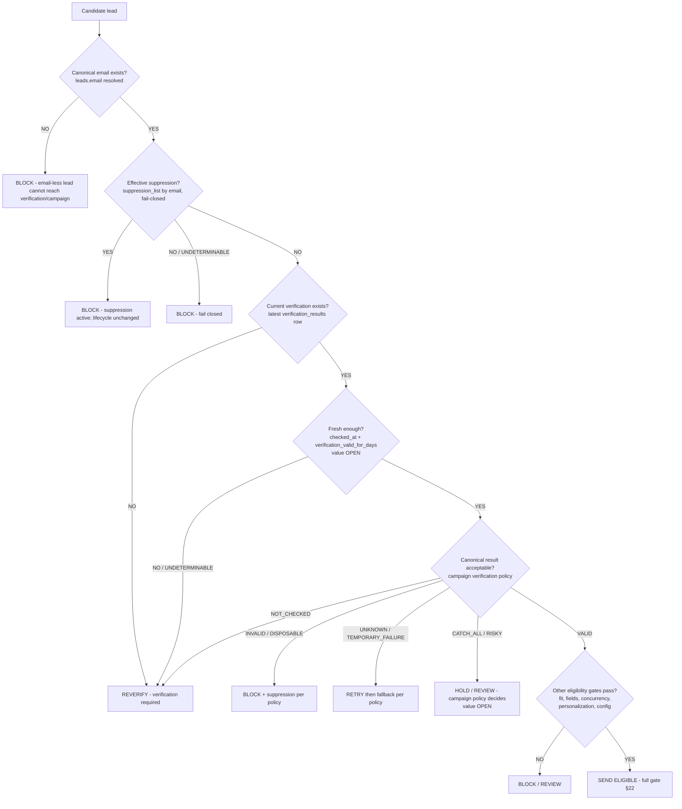
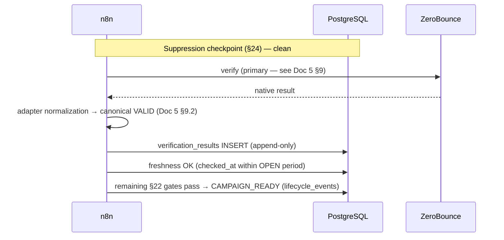

# SKMC Cold Email Automation — Verification & Suppression Rules

**Version:** 1.0 | **Date:** 2026-10-13 | **Status:** Approved — Verification & suppression implementation specification of Architecture v1.3

**Governing Architecture:** `/opt/data/skmc-cold-email/docs/architecture.md` — Version 1.3 — Approved — Single Source of Truth
**Database Reference:** `/opt/data/skmc-cold-email/docs/database-schema.md` — Version 1.2 — Approved — Database implementation of Architecture v1.3
**Lifecycle Reference:** `/opt/data/skmc-cold-email/docs/lead-lifecycle-status-flow.md` — Version 1.0 — Approved — Lead lifecycle implementation specification of Architecture v1.3
**API Reference:** `/opt/data/skmc-cold-email/docs/api-integration-spec.md` — Version 1.0 — Approved — API integration implementation specification of Architecture v1.3

**Last Updated:** 2026-10-13

**Authority rule:** Architecture v1.3 governs; Database Schema v1.2, Lead Lifecycle v1.0, and API Integration Specification v1.0 are approved implementation specifications subordinate to it. This document sits below them and defines POLICY/DECISION RULES only. campaign-icp-spec.md (draft template v0.1) and implementation-plan-v1.3.md are non-governing; where they conflict with approved documents, the approved documents govern and the discrepancy is recorded (§32 note). This document does NOT duplicate or redesign provider API contracts — see Document 5 for those; provider-native details are referenced, not redefined.

---

## 2. Purpose

This document protects outbound sending. It ensures a lead is emailed only when it:

- has an acceptable email verification result;
- has a sufficiently CURRENT verification result (freshness);
- is not effectively suppressed at any approved scope;
- remains eligible under the applicable campaign policy;
- passes every required enrollment/re-enrollment check.

**Central rule: passing verification alone does NOT mean a lead is send-eligible.** Send eligibility is the conjunction of multiple independent gates (§22). Any single failing or undeterminable gate blocks sending.

This document answers: when must an email be verified; which canonical results can proceed; which must be blocked, held, retried, or reviewed; when verification must be repeated; when MillionVerifier is allowed after ZeroBounce; how suppression interacts with lifecycle; which events create GLOBAL vs CAMPAIGN suppression; what happens on unsubscribe, complaint, bounce, and negative reply; what must run before enrollment and re-enrollment; and what happens when verification/suppression/configuration information is missing, stale, contradictory, or unavailable.

## 3. Scope

**IN SCOPE:** verification eligibility; use of canonical verification normalization; verification freshness; reverification; fallback verification; suppression (scope, reasons, activation, checks); unsubscribe; spam complaint; bounce; negative reply; enrollment; re-enrollment; fail-closed behavior; retry/review boundaries; auditability.

**OUT OF SCOPE:** provider API implementation details (Document 5 owns them); email discovery; Apollo enrichment mechanics; email copy; sequence content; sending volume/caps; CRM opportunity stages; Campaign/ICP business decisions.

## 4. Core Principles

1. **PostgreSQL is canonical.** Canonical verification history, suppression state, and lifecycle live in `outreach_db`; provider state is never canonical (Arch §2 #1, §5; DB §2 #1).
2. **n8n enforces verification/suppression policy.** All gates live in n8n (Arch §2 #3); Warmbly enforces only at its boundary on synchronized state.
3. **Provider-native status is not canonical status.** Adapter normalization (Document 5 §9.2/§10.2) produces the canonical value; raw provider status is evidence only.
4. **Canonical verification status is not itself send eligibility.** A VALID result satisfies only one gate of many (§22).
5. **Suppression is orthogonal to lifecycle.** Suppression is a separate dimension; lifecycle history is preserved when suppression activates (Arch §16; Lifecycle §12); SUPPRESSED is NOT a lifecycle state.
6. **GLOBAL suppression prevents sending across all campaigns.**
7. **CAMPAIGN suppression prevents sending for the applicable campaign** where canonical rules support it (DB `suppression_list.scope='CAMPAIGN'` + `campaign_id`); coexistence/precedence with GLOBAL remains OPEN (§15, DB-D8).
8. **Verification freshness is mandatory; the exact duration remains OPEN** (`verification_valid_for_days`, DB-D1/Arch §28 #3).
9. **Missing required verification/suppression/configuration data fails closed.** Gate-affecting NULL configuration must block (DB-D1 contract; Lifecycle §14 check 8).
10. **Re-enrollment repeats all required gates.** Previous verification or prior participation creates no bypass (Arch §9, §29 #7/#18; Lifecycle §14).
11. **Explicit unsubscribe is different from negative reply.** Unsubscribe → UNSUBSCRIBED + GLOBAL suppression; negative reply → REPLIED_NEGATIVE + sequence stop only (Arch §15/§16, §29 #17; Lifecycle §11).
12. **Spam complaint is different from unsubscribe at lifecycle level.** Complaint → GLOBAL suppression while lifecycle is PRESERVED (remains IN_SEQUENCE); unsubscribe → lifecycle UNSUBSCRIBED (Arch §9/§16; Lifecycle §5/§11 approved semantics).
13. **Provider/network failure must not be interpreted as VALID.** Transport failure is a workflow-processing condition, never a verification verdict (Lifecycle §13; API §14).
14. **Observed campaign bounce rate is not an email verification verdict** (Arch §10, §29 #6/#16). Per-lead verdicts come only from `verification_results`; aggregate bounce metrics come only from `email_events`.
15. **No downstream sender may override canonical suppression.** Warmbly receives synchronized suppression and blocks at its boundary; only an explicitly authorized, audited state change can deactivate suppression (Arch §15; DB §5.9/§5.18).

## 5. Decision Pipeline



CATCH_ALL/RISKY do NOT automatically pass — they route to campaign policy (OPEN, Arch §28 #1). Every BLOCK branch leaves lifecycle unchanged unless an approved transition/suppression rule applies.

## 6. Canonical Verification Status Model

Exactly these approved statuses (DB `verification_status_enum`; Lifecycle §8; API §8.1). No other canonical status may be introduced.

| Status | Meaning | Default workflow treatment | Send eligible by status alone? | Suppression implication | Retry/reverification implication | Policy dependency |
|---|---|---|---|---|---|---|
| `NOT_CHECKED` | No verification performed | Verification required before any campaign path | **NO** | None by itself | Reverify before any eligibility continuation | Freshness config (OPEN) |
| `VALID` | Acceptable canonical result | Proceed to remaining gates IF fresh | **NO** — one gate of many | None | Reverify when stale (§9) | Campaign policy + freshness (OPEN) |
| `INVALID` | Email does not exist / must not be sent | Block; suppression per approved policy (`invalid_email`) | **NO** | Yes — `invalid_email` per approved trigger (Arch §15; Lifecycle §8) | None for this email | Suppression policy already approved |
| `DISPOSABLE` | Temporary address provider | Block; suppression per approved policy | **NO** | Yes — mapped via `invalid_email` per approved policy (Lifecycle §8) | None for this address | Mapping recorded as approved in Lifecycle §8 |
| `CATCH_ALL` | Domain accepts all; deliverability unconfirmed | Hold-for-review default; campaign policy decides | **NO** — never silently | None by itself | Recheck per policy | **OPEN — catch-all policy value (Arch §28 #1)** |
| `RISKY` | Elevated risk; do not silently pass | Hold/review per policy | **NO** | None by itself | Recheck per policy | Campaign verification policy (OPEN) |
| `UNKNOWN` | Could not determine | Bounded retry with SAME provider, then fallback per policy | **NO** | None | Retry → MillionVerifier fallback per policy | Retry/fallback policy (OPEN values) |
| `TEMPORARY_FAILURE` | Verification attempt itself failed (transport/provider) | Bounded retry; must NOT be treated as VALID | **NO** | None | Retry → fallback per policy | Retry/fallback policy |

Distinguishing rule: **verification blocking ≠ suppression creation.** INVALID/DISPOSABLE both block sending AND create suppression per the approved trigger table; UNKNOWN/CATCH_ALL/RISKY/TEMPORARY_FAILURE/NOT_CHECKED block sending but do NOT by themselves create suppression records. No permanent suppression rule is invented for non-VALID statuses beyond the approved `invalid_email` trigger.

## 7. Verification Provider Order

**Primary: ZeroBounce (`ZEROBOUNCE`). Conditional fallback / second opinion: MillionVerifier (`MILLIONVERIFIER`) — never called for every lead automatically** (Arch §2 #6/#7; Lifecycle §8; API §8/§10).

| ZeroBounce canonical outcome | Immediate treatment | MillionVerifier candidate? | Send allowed immediately? | Policy dependency |
|---|---|---|---|---|
| `VALID` (fresh) | Continue remaining gates | No — MV is not a default second opinion for VALID | Only if ALL other gates pass | None beyond §22 |
| `INVALID` | Block; suppression `invalid_email` per approved policy | No — outcome is terminal for this email | No | Bounce/suppression policy already approved |
| `DISPOSABLE` | Block; suppression per approved policy | No | No | Approved mapping (Lifecycle §8) |
| `CATCH_ALL` | Hold-for-review default | Only if campaign policy designates MV second opinion for catch-all | No — policy decides | **OPEN — catch-all policy (Arch §28 #1)** |
| `RISKY` | Hold/review per policy | Only per second-opinion policy trigger | No | Campaign verification policy (OPEN) |
| `UNKNOWN` | Bounded retry (same provider), then fallback | **YES** — after bounded retry exhaustion per policy | No | Retry counts/fallback trigger OPEN values |
| `TEMPORARY_FAILURE` | Bounded retry, then fallback | **YES** — after retry exhaustion per policy | No | OPEN values |

Rules: fallback never overwrites historical verification records — every provider result appends a new `verification_results` row with its own `provider` value (`is_fallback` flag per DB §5.6); each result remains auditable; the canonical current determination is the LATEST row by `checked_at` per the approved DB/API model (DB §7; API §8.2). No fallback thresholds are hardcoded here.

## 8. Provider Result vs Canonical Result vs Policy

Three distinct layers:

- **Layer 1 — provider-native result:** e.g. ZeroBounce `catch-all`, `do_not_mail+toxic`; MillionVerifier `subresult`. Evidence only; retained in `provider_status`/`provider_sub_status`/`raw_metadata`.
- **Layer 2 — canonical verification status:** one of the 8 statuses in §6, produced by adapter normalization (Document 5 §9.2/§10.2 defines the approved mapping responsibilities; the do_not_mail sub-status mappings remain RECOMMENDATION/CANDIDATE — NOT APPROVED, OPEN per Document 5 §9.2).
- **Layer 3 — campaign/send policy decision:** HOLD / REVIEW / permitted risk-cap behavior / suppression, decided by n8n against campaign policy.

Conceptual flow: ZeroBounce native result → adapter normalization → canonical `RISKY` → campaign policy → HOLD / REVIEW / permitted risk-cap behavior. Provider-native mapping recommendations are NOT adopted policy; only Layer-2 canonical statuses feed Layer-3 decisions, and Layer-3 values remain configurable/OPEN where architecture leaves them unresolved.

## 9. Verification Freshness

Freshness is determined from the latest approved verification evidence — the latest `verification_results.checked_at` for the lead's current canonical email — evaluated against configured policy (`verification_valid_for_days`). **Exact duration: OPEN** (Arch §28 #3; DB-D1 seeds the key with NULL until approved).

Rules:

- Stale verification is not acceptable for enrollment (initial OR re-enrollment) — Arch §29 #18.
- Stale verification triggers reverification BEFORE any eligibility continuation (reverify consumes a new verification credit and appends a NEW history row; historical rows are never overwritten).
- Re-enrollment repeats the freshness check (§21).
- Freshness is evaluated at the decision point (§25 checkpoints), not merely at initial discovery.
- A previously VALID result does not remain indefinitely valid.
- Missing freshness configuration (`verification_valid_for_days` NULL) follows the approved fail-closed configuration behavior: the gate BLOCKS and alerts (DB-D1; Lifecycle §14 check 8).
- The provider does not need to proactively notify SKMC that an old address has changed — staleness is handled by the freshness policy, not provider push.

No number of days is invented in this document.

## 10. Reverification Rules

Reverification is triggered by:

- stale verification (latest `checked_at` older than the configured freshness period — value OPEN);
- re-enrollment after sufficient elapsed time under configured freshness;
- a previous `TEMPORARY_FAILURE` when retry becomes due per the bounded retry policy;
- a policy-required second opinion (fallback/second-opinion trigger — OPEN values);
- the email address changed (DB-D7 governs mutation policy; see below);
- a previous verification record that cannot be trusted/validated (cache/history contradiction — canonical history lookup wins and the gate blocks pending re-verification, DB §7);
- another explicitly configured approved trigger.

If the email address changes: the previous address's verification is NOT verification of the new address. The new address requires its own verification before any send eligibility; `leads.verification_status` must not be carried over; DB-D7 (email mutation under active suppression — OPEN, fail-closed) governs whether/how the mutation may occur, and suppression re-evaluation is required where an active suppression exists (DB §5.9 identity contract point 4; API §10).

Lifecycle/workflow treatment uses approved states only: a VERIFIED lead whose freshness fails at (re-)enrollment evaluation moves `VERIFIED → VERIFICATION_PENDING` (reverify) per the approved derived transition (Lifecycle §5, labeled [DERIVED, per Arch §11 freshness flow]); the lead proceeds only if the new result is acceptable and the full gate passes.

## 11. Verification Failure Matrix

| Scenario | Canonical status / current state | Send? | Retry? | Fallback? | Lifecycle/workflow action | Suppression? | Audit requirement |
|---|---|---|---|---|---|---|---|
| No verification | `NOT_CHECKED` | NO | n/a | n/a | Verification required before eligibility continuation | No | Eligibility-gate rejection observable |
| Stale verification | previous VALID, `checked_at` older than OPEN period | NO | Reverify (fresh operation) | n/a | `VERIFIED → VERIFICATION_PENDING` (reverify) per approved derived transition; blocks enrollment | No | New `verification_results` row on reverify |
| `VALID` (fresh) | VALID | Only if ALL other §22 gates pass | No | No | Continue eligibility path | No | Row already appended |
| `INVALID` | INVALID | NO | No | No | Suppression activation per approved policy; lifecycle remains VERIFICATION_PENDING (approved overlay) | **Yes — `invalid_email`** | `suppression_list` + `suppression_events` + lifecycle history |
| `DISPOSABLE` | DISPOSABLE | NO | No | No | Suppression per approved policy (`invalid_email` mapping per Lifecycle §8) | **Yes** | suppression rows + audit |
| `CATCH_ALL` | CATCH_ALL | NO — policy decides | Per policy | Per second-opinion policy | Hold-for-review default; lead remains VERIFICATION_PENDING | No by itself | Verdict persisted; policy evaluation recorded |
| `RISKY` | RISKY | NO — policy decides | Per policy | Per policy | Hold/review; lead remains VERIFICATION_PENDING | No by itself | Verdict persisted |
| `UNKNOWN` | UNKNOWN | NO | Yes — bounded, same provider | Yes — MV after exhaustion per policy | Lifecycle HOLDS at VERIFICATION_PENDING | No | Each attempt appends evidence |
| `TEMPORARY_FAILURE` | TEMPORARY_FAILURE | NO | Yes — bounded | Yes — per policy | Lifecycle HOLDS at VERIFICATION_PENDING | No | Attempt + failure class recorded |
| Provider timeout | No canonical verdict produced | NO | Yes — bounded | Per policy | Lifecycle HOLDS; workflow run retries | No | `workflow_runs` + attempt logs |
| Provider unavailable | No canonical verdict produced | NO | Yes — bounded backoff | Per policy (MV) | Lifecycle HOLDS | No | `workflow_runs`/`dead_letter_events` on exhaustion |
| Authentication failure | No canonical verdict produced | NO | NO (non-retryable) | No | Alert + DLQ; fix credentials out-of-band | No | `dead_letter_events` + alert |
| Malformed provider response | No canonical verdict produced | NO | NO (VALIDATION_FAILURE — non-retryable) | No | DLQ; fail-closed; no canonical write | No | `dead_letter_events` |
| Conflicting provider results (e.g., ZB VALID then MV INVALID) | Latest canonical row by `checked_at` governs current determination | Per the governing latest row's status + policy | Per policy for the divergent result | Per policy (second-opinion semantics OPEN) | Both rows retained append-only; contradiction is a policy/review signal, never silently merged | Only if governing latest row is INVALID/DISPOSABLE per approved policy | Both `verification_results` rows retained; contradiction visible |

No provider-native semantics are invented in this matrix.

## 12. Suppression Model

Suppression is an independent canonical control (Arch §15/§16; DB §5.9/§10). Approved scopes ONLY (DB `suppression_list.scope` CHECK):

- **GLOBAL** (`scope='GLOBAL'`, `campaign_id IS NULL`; identity = email alone, `uq_supp_active_global`): prevents sending across ALL campaigns.
- **CAMPAIGN** (`scope='CAMPAIGN'`, `campaign_id` NOT NULL, FK to `campaigns`; identity = (email, campaign_id), `uq_supp_active_campaign`): prevents sending for the applicable campaign where canonical rules support it.

Suppression does NOT need to become a lifecycle state, and MUST NOT: `SUPPRESSED` is not in the approved 14-state `lifecycle_status_enum` (DB §4; Lifecycle §3). A suppression event activates the suppression dimension while lifecycle history is preserved; lifecycle is not rewritten to a suppression value (Arch §9 last row; Lifecycle §5).

## 13. Suppression Identity

Suppression identity follows the approved schema exactly (DB §5.9 identity contract):

- **Canonical lookup key = `suppression_list.email` (CITEXT, case-insensitive).** Checks MUST look up suppression by the lead's canonical/normalized email so a lead created later cannot bypass an existing suppression (pre-lead suppression entries have `lead_id` NULL).
- `lead_id` on `suppression_list` is auxiliary traceability, not the canonical key.
- NOT permitted as suppression identity: `company_domain`, name+domain, `company`, job title — none of these identifies a person for suppression purposes (Arch §29 #8; DB §5.4/§5.9).
- No fuzzy suppression identity is introduced. Case-insensitivity comes from CITEXT, nothing else.

## 14. Suppression Reasons

Extracted directly from DB §4 `suppression_reason_enum` — these are ALL the approved reasons; no others exist and none is invented here:

| Suppression reason | Typical source/event | Allowed scope | Automatic or policy-dependent | Lifecycle impact | Can expire automatically? | Removal/reactivation rule |
|---|---|---|---|---|---|---|
| `explicit_unsubscribe` | Explicit unsubscribe / "do not contact me again" event | GLOBAL (approved trigger semantics) | Automatic on approved event | `IN_SEQUENCE → UNSUBSCRIBED` (the ONLY event producing UNSUBSCRIBED) | **NO automatic expiry** | Explicitly authorized, audited state change only (DEACTIVATED `suppression_events` row; runtime DELETE revoked — DB §5.18) |
| `spam_complaint` | Spam complaint event | GLOBAL (approved trigger semantics) | Automatic on approved event | **Lifecycle PRESERVED** (remains IN_SEQUENCE; NOT UNSUBSCRIBED) | **NO automatic expiry** | Explicitly authorized, audited only |
| `hard_bounce` | Hard bounce event (`email_events.bounce_type='hard'`) | Per approved bounce policy (scope configurable — GLOBAL or CAMPAIGN per configured policy) | Policy-dependent (approved bounce policy decides) | `IN_SEQUENCE → BOUNCED` (approved transition) | Per configured bounce policy — no general auto-expiry invented | Per bounce policy + audited deactivation where policy permits |
| `invalid_email` | Verification verdict INVALID / DISPOSABLE (approved trigger: "Invalid email (verification) — must not be sent") | Per configured policy scope | Automatic per approved verification→suppression rule (Lifecycle §8) | Lifecycle remains VERIFICATION_PENDING (approved overlay; no lifecycle rewrite) | Per configured policy — no general auto-expiry invented | Audited; policy-governed |
| `manual_compliance_block` | Manual/compliance action by an operator | Per configured scope at activation | Manual decision | None (overlay) | NO automatic expiry unless policy explicitly says otherwise | Explicitly authorized, audited |
| `legal_or_policy_exclusion` | Legal/compliance exclusion applied by policy | Per configured scope at activation | Policy decision | None (overlay) | Per governing policy — none invented here | Explicitly authorized, audited |
| `legal_or_policy_exclusion` scope note | applies "according to configured scope" (Arch §15) | GLOBAL or CAMPAIGN per configuration | Policy | — | — | — |
| `manual` | Operator-created suppression | Per configured scope at activation | Manual decision | None (overlay) | NO automatic expiry invented | Explicitly authorized, audited |

Rules: `negative_reply` is NOT a suppression reason — it does not exist in the approved enum and an ordinary negative reply never creates suppression (Arch §29 #17; DB §4 note). GLOBAL suppression has no automatic expiry; removal/reactivation requires an explicitly authorized, audited state change (a DEACTIVATED row in `suppression_events`; runtime DELETE is revoked by DB §5.18 grants). No reason name is invented.

## 15. Suppression Precedence / Coexistence

**OPEN — DB-D8 suppression coexistence/precedence.** Whether GLOBAL and CAMPAIGN suppressions may coexist for one contact, and any precedence between them, is NOT determined by the approved documents.

Already guaranteed by the approved schema:

- Active-state uniqueness per identity is PostgreSQL-enforced: `uq_supp_active_global` (one active GLOBAL per email) and `uq_supp_active_campaign` (one active CAMPAIGN per email+campaign) — duplicate simultaneous active records for the same identity are impossible.
- Scope shape coherence is CHECK-enforced (GLOBAL ⇔ `campaign_id IS NULL`).

Unresolved (do NOT invent):

- precedence between overlapping GLOBAL and CAMPAIGN records;
- whether records may be merged (they are NOT silently merged — each scope keeps its own record and history);
- the full set of configured-scope semantics beyond GLOBAL/CAMPAIGN.

Fail-closed rule (approved): gate logic treats ANY active suppression as blocking until precedence is defined (DB §5.9/§10; API §12). If effective suppression cannot be safely determined at a checkpoint, the gate blocks.

## 16. Explicit Unsubscribe

Exact approved behavior:

1. Explicit unsubscribe event received (reply classified `explicit_unsubscribe` or UNSUBSCRIBE event).
2. → stop the active sequence (Warmbly execution stop via n8n).
3. → lifecycle `IN_SEQUENCE → UNSUBSCRIBED` (the ONLY event producing UNSUBSCRIBED — Arch §9; Lifecycle §5/§11).
4. → activate GLOBAL suppression, reason `explicit_unsubscribe`.
5. → prevent all future campaign sending (pre-enrollment/pre-re-enrollment/Warmbly-sync gates enforce).
6. → persist `email_events` + `replies` (where applicable) + `suppression_list` + `suppression_events` + `lifecycle_events`.

GLOBAL suppression has NO automatic expiry. No automatic reactivation. Any removal requires an explicitly authorized, audited state change.

## 17. Spam Complaint

Exact approved behavior — repeated deliberately because confusing complaint with unsubscribe is a critical implementation error:

1. Spam complaint event received.
2. → stop the active sequence.
3. → stop future sending.
4. → activate GLOBAL suppression, reason `spam_complaint`.
5. → **PRESERVE the current lifecycle state — the lead remains IN_SEQUENCE; MUST NOT change lifecycle to UNSUBSCRIBED.** (Arch §9 outcome list contains no complaint transition; Arch §16 suppression events preserve lifecycle; Lifecycle §5/§11 approved patched semantics.)
6. → persist `email_events` + `suppression_list` + `suppression_events` + `lifecycle_events` (preservation is not a transition; no lifecycle_events row is appended for a complaint by itself, consistent with the approved "no lifecycle rewrite" rule).

Implementation cannot conflate complaint with unsubscribe: unsubscribe produces a lifecycle transition to UNSUBSCRIBED; complaint does not. Complaint is not a reply classification — it is an `email_events.event_type='SPAM_COMPLAINT'` event.

## 18. Negative Reply

Exact approved behavior:

- Reply classified `negative` (`replies.classification`).
- → lifecycle `IN_SEQUENCE → REPLIED_NEGATIVE`.
- → stop/handle the current sequence according to the approved reply policy (sequence stop/exit; Lifecycle §11).
- → **NOT automatic GLOBAL suppression.** No suppression record is created by the negative reply itself. (`negative_reply` does not exist as a suppression reason — §14.)

Exact cooldown policy: **OPEN** (`negative_reply_cooldown_days` — Arch §28 #5; DB-D1 NULL until approved).

If future campaign contact is considered, ALL of the following must be checked: suppression (canonical lookup); cooldown policy; eligibility re-evaluation; verification freshness. A negative reply creates no bypass of any gate. No fixed cooldown duration is invented.

## 19. Bounce Handling

Derived EXACTLY from the approved documents. The approved taxonomy distinguishes only hard vs soft via `email_events.bounce_type` (DB §5.11) — no new taxonomy is invented.

| Bounce type | Lifecycle effect | Suppression effect | Verification implications | Retry behavior | Audit/event writes |
|---|---|---|---|---|---|
| **Hard bounce** (`bounce_type='hard'`) | `IN_SEQUENCE → BOUNCED` (approved transition; Lifecycle §5) | Suppression per approved bounce policy — reason `hard_bounce`; scope per configured policy (OPEN values) | No new verification call implied; the address's prior verification is not retroactively invalidated — the observed bounce is delivery evidence, distinct from verification status (Arch §29 #6) | No resend to this address within the campaign; future contact only via full re-enrollment gate (suppression check applies) | `email_events` (idempotency_key) + `lifecycle_events` + `suppression_list`/`suppression_events` per policy |
| **Soft / transient bounce** (`bounce_type='soft'`) | Lifecycle unchanged — remains IN_SEQUENCE (Lifecycle §11: "not lifecycle-terminal by itself") | None unless the approved bounce policy escalates (configurable) | None implied | Warmbly/pacing handles per execution policy; escalation to suppression only via the approved bounce policy | `email_events` row; policy escalation audited where it occurs |

Observed bounce (campaign-level metric from `email_events`) is NEVER stored as, or confused with, a per-lead verification status; no `bounce_risk_score` exists in the approved schema.

## 20. Campaign Completion

COMPLETED (sequence exhausted, no reply) does NOT itself mean suppressed. The lead holds in COMPLETED; future re-enrollment is allowed ONLY through the complete approved gate:

suppression → verification existence → freshness → verification policy → campaign eligibility → enrollment requirements (§21/§22).

There is NO unconditional COMPLETED → IN_SEQUENCE transition; re-entry routes through VERIFICATION_PENDING (stale) or VERIFIED (fresh) → CAMPAIGN_READY → IN_SEQUENCE per the approved derived re-entry path (Lifecycle §4/§14, labeled DERIVED per Arch §11).

## 21. Re-enrollment Rules

Re-entry is approved for: `REPLIED_NEGATIVE`, `COMPLETED`, and other policy-permitted holds — always through the FULL gate. Decision flow:

1. **Effective suppression check** — canonical lookup by email; ANY active suppression blocks (fail-closed); Arch §29 #7.
2. **Cooldown/policy check where applicable** — e.g., negative-reply cooldown (value OPEN); BLOCK until elapsed.
3. **Current email verification check** — a verification must exist for the lead's CURRENT canonical email; an email change invalidates previous-address evidence (§10).
4. **Freshness check** — latest `checked_at` vs `verification_valid_for_days` (OPEN).
5. **Reverification if stale** — new history row, new credit; never a silent bypass.
6. **Verification policy check** — result acceptable under campaign policy (CATCH_ALL/RISKY → policy; OPEN).
7. **Campaign eligibility** — required fields, fit, campaign config.
8. **Campaign-conflict/concurrency policy** — contact-level conflict_group evaluation + explicit permission path (Arch §13, §28 #7 OPEN).
9. **Enrollment gate** — all Document-5 §11.1 preconditions incl. approved personalization/template compatibility.

No bypass exists because a lead was previously verified, previously enrolled, or previously completed. Re-entry lifecycle path uses approved states only (§20).

## 22. Send Eligibility Rule

Conceptual policy logic:

```
SEND_ELIGIBLE =
    canonical lead/email valid (lead_id exists; email resolved)
  AND no effective suppression (canonical lookup; fail-closed)
  AND current verification exists (verification_results row for current email)
  AND verification fresh (checked_at + verification_valid_for_days; OPEN value)
  AND verification result acceptable under campaign policy
      (VALID; CATCH_ALL/RISKY only if policy admits — OPEN)
  AND lifecycle permits enrollment/sending
      (CAMPAIGN_READY or approved re-entry path; not UNSUBSCRIBED/BOUNCED/PARKED-blocked)
  AND campaign eligibility passes (fit, required fields, campaign config)
  AND campaign concurrency/conflict policy passes (contact-level; Arch §13)
  AND required personalization/template fields pass (fail-closed; Arch §29 #14)
  AND all required configuration is resolvable (no NULL gate-affecting values; DB-D1)
```

**SEND_ELIGIBLE is conceptual policy logic, NOT a new lifecycle state.** The approved DB defines no equivalent physical column (`lifecycle_status_enum` has 14 approved states; none is SEND_ELIGIBLE) and none is invented here. It is evaluated by the n8n gate at the decision point.

## 23. Fail-Closed Rules

General principle: **when a safety-critical sending gate cannot be determined, do not send. But do not mutate lifecycle unnecessarily because of infrastructure failure** — the lead holds in its current lifecycle state; only the workflow run retries/reviews (Lifecycle §13).

| Case | Send allowed? | Immediate action | Retry/review | Lifecycle mutation? | Audit/alert |
|---|---|---|---|---|---|
| Suppression lookup unavailable (DB unreachable) | NO | Halt gate evaluation | Workflow retry (bounded) → DLQ | NO | `workflow_runs` + alert |
| Suppression state ambiguous (cache/canonical contradiction) | NO | Canonical lookup wins; cache repaired; gate blocks until consistent (DB §5.9/§7 contract) | Reconciliation query; retry after repair | NO | Reconciliation log + alert on persistent contradiction |
| Verification missing | NO | Reverify required | Reverify (fresh op) | NO (NOT_CHECKED holds) | Gate rejection visible |
| Verification stale | NO | Reverify FIRST (§9/§10) | Reverify | Approved transition only: `VERIFIED → VERIFICATION_PENDING` (reverify) | New history row |
| Verification provider unavailable | NO | Bounded backoff; MV fallback per policy | Retry → fallback → DLQ | NO (lead HOLDS at VERIFICATION_PENDING) | `workflow_runs`/`dead_letter_events` |
| Verification provider authentication failure | NO | Stop retrying; alert; credentials fix out-of-band | NON_RETRYABLE → DLQ | NO | `dead_letter_events` + alert |
| Verification normalization failure | NO | VALIDATION_FAILURE — no canonical write | NON_RETRYABLE → DLQ | NO | `dead_letter_events` |
| Campaign verification policy missing (catch_all_policy NULL) | NO | Fail-closed config block | Fix config via audited change | NO | Alert + `config_history` when fixed |
| Freshness configuration missing (`verification_valid_for_days` NULL) | NO | Fail-closed config block (DB-D1) | Fix config via audited change | NO | Alert + `config_history` when fixed |
| Required personalization missing/unknown | NO | Fail-closed REJECT of Warmbly sync (Arch §29 #14) | Fix/approve data; re-attempt | NO (lead stays CAMPAIGN_READY) | Rejection logged + alert/review |
| Campaign conflict decision unresolved at runtime | NO | BLOCK (contact-level conflict cannot be determined) | Human/explicit-permission path (Arch §28 #7 OPEN) | NO | Review queue record |
| Warmbly sync state uncertain (no confirmation) | NO | Do not treat as enrolled; reconcile | Retry sync; DLQ on exhaustion | NO (no IN_SEQUENCE without confirmed enrollment — Lifecycle §5) | `workflow_runs` + alert |

## 24. Suppression Checkpoints

Suppression is checked at the approved five enforcement points (Arch §15) plus replay safety:

1. **Before verification spend where appropriate** (intake): suppression keyed by email may predate the lead — checking before paid verification avoids spending on a contact that can never be sent (DB §5.9 identity contract point 2).
2. **Before campaign readiness** (eligibility gate check 5).
3. **Immediately before enrollment** (Warmbly sync — the state may have changed since CAMPAIGN_READY was granted).
4. **Before re-enrollment** (structural pre-re-enrollment check — Arch §29 #7).
5. **When processing relevant Warmbly events** (unsubscribe/complaint/bounce drive suppression).
6. **Before any retry/replay that could cause another send** (DLQ replay must re-run the suppression gate; replay never bypasses).

Why more than once: state changes between discovery and sending — an unsubscribe or complaint can arrive at any moment; a suppression created after CAMPAIGN_READY must still block the enrollment sync (§26 races). Each checkpoint uses the canonical email lookup (§13), fail-closed on ambiguity (§15/§23).

## 25. Verification Checkpoints

Verification is checked at minimum:

- **Before CAMPAIGN_READY** (eligibility gate checks 3+4);
- **Before initial enrollment** (state may have gone stale after CAMPAIGN_READY);
- **Before re-enrollment** (freshness repeated — §21);
- **After stale-result detection** (reverify before continuation);
- **After email-address mutation** (new address requires its own verification; DB-D7 governs the mutation itself);
- **After policy-required fallback/second opinion** (MV per §7).

Economy rule: do NOT create unnecessary provider calls — if a current, fresh, policy-acceptable verification already exists for the current email, reuse it (pre-call freshness check; API §16 idempotency/economy contract).

## 26. Race Conditions / Ordering

Principle: **suppression and the latest canonical safety state win over stale workflow work.** Required outcomes are defined below; exact concurrency mechanisms are not prescribed unless already approved (application-level same-transaction contracts are the approved mechanism — DB §5.9/§7; no new locking is invented).

| Race | Safe behavior |
|---|---|
| A. Unsubscribe arrives while enrollment is being processed | The unsubscribe's canonical writes (GLOBAL suppression + UNSUBSCRIBED) win; the in-flight enrollment sync must re-check suppression before the Warmbly call and abort if suppression now exists; an enrollment that completed despite a concurrent unsubscribe is corrected by post-sync suppression propagation (stop + suppression at Warmbly). The lead ends suppressed + UNSUBSCRIBED; never enrolled-and-sending. |
| B. Spam complaint arrives before delayed sent/delivery event | GLOBAL suppression activates immediately; the later sent/delivery event is recorded as evidence but does NOT resurrect sending and does NOT change lifecycle (complaint preserved lifecycle; the delivery event is ignored for lifecycle purposes — approved out-of-order semantics, API §12). |
| C. Suppression activated after campaign readiness but before Warmbly sync | The pre-enrollment suppression checkpoint (§24 point 3) blocks the sync; the lead stays CAMPAIGN_READY (lifecycle unchanged) with active suppression. |
| D. Stale verification detected during enrollment | Reverify FIRST (§9/§10); enrollment blocked until a fresh acceptable result exists; approved `VERIFIED → VERIFICATION_PENDING` transition. |
| E. Duplicate webhook | `email_events.idempotency_key` UNIQUE absorbs it; acknowledged 2xx, not re-applied (DB §12; API §16). |
| F. Out-of-order webhook | Approved event semantics: terminal-ish events (unsubscribe/complaint) and later delivery events never resurrect sending; late delivery for a suppressed/stopped lead is logged and ignored for lifecycle (API §12). |
| G. Reverification finishes after a suppression event | The suppression checkpoint re-runs after the new verification result: even a fresh VALID result cannot outrank active suppression — gate still blocks; both facts coexist (verification dimension + suppression dimension are separate). |
| H. Lead email changes while verification is in flight | The in-flight verification applies to the OLD address only; the new address requires its own verification (§10); DB-D7 (OPEN, fail-closed) governs the mutation; suppression re-evaluation is required where active suppression exists (DB §5.9 point 4). |

No DB locking mechanism beyond the approved application contracts is introduced.

## 27. Audit Requirements

Required auditability, mapped to existing DB objects only:

| Audit item | DB object (approved) |
|---|---|
| Verification request/result, provider, checked_at, canonical normalization, provider raw status | `verification_results` (append-only: provider, result_status, provider_status, provider_sub_status, raw_metadata, checked_at, is_fallback) |
| Fallback invocation | `verification_results.is_fallback = TRUE` row |
| Suppression activation / reason / scope / source event | `suppression_list` (current) + `suppression_events` ACTIVATED row (reason, scope, source_event_id) |
| Suppression removal/reactivation | `suppression_events` DEACTIVATED / SCOPE_CHANGED / REASON_UPDATED row (explicitly authorized; runtime DELETE revoked) |
| Lifecycle transitions (UNSUBSCRIBED, REPLIED_NEGATIVE, BOUNCED, COMPLETED, re-entry path) | `lifecycle_events` (from_status, to_status, reason, triggered_by, metadata) |
| Enrollment rejection / stale-verification rejection / policy-config failure | `workflow_runs` (status, error, n8n_exec_id) |
| Exhausted failures / DLQ replay | `dead_letter_events` (attempt_count, status OPEN/REPLAYED/RESOLVED/DISCARDED) |
| Webhook replay/deduplication | `email_events.idempotency_key` (UNIQUE) + `warmbly_event_id` |
| Reply classification | `replies` (classification, classifier) |
| Configuration change (freshness/cooldown/catch-all values) | `policy_config` + `config_history` (same-transaction update contract) |

No audit tables are invented.

## 28. Database Mapping

Actual approved physical names (Database Schema v1.2). Conceptual names were resolved against the approved schema; nothing is invented.

| DB object | Purpose in this document | Read/write | Current vs history semantics | Relevant constraints/indexes |
|---|---|---|---|---|
| `leads` | Canonical lead identity; current-state fast-gate columns | Read (gates); write (email/fit/status updates per approved flows) | Current effective state; history lives in child tables | `email CITEXT NULL` + `uq_leads_email_resolved`; `uq_leads_source_lead`; `uq_leads_source_person`; `verification_status`, `suppression_status`, `lifecycle_status` (denormalized caches — canonical lookups win; disagreement blocks) |
| `verification_results` | Verification history + freshness source | INSERT (append-only; runtime UPDATE/DELETE revoked per DB §5.18); READ for freshness/current determination | Append-only history; latest row by `checked_at` = current determination; reverification INSERTs new rows | `checked_at` freshness source; `idx_verif_lead_fresh (lead_id, checked_at DESC)`; `is_fallback`; NO bounce_risk_score |
| `suppression_list` | Current effective suppression state | INSERT/UPDATE (soft-deactivation; DELETE revoked); READ at every checkpoint (§24) | Current state; `active` flag; scope CHECK GLOBAL⇔campaign_id NULL | `uq_supp_active_global (email)`; `uq_supp_active_campaign (email, campaign_id)`; `email CITEXT` canonical lookup; `lead_id` auxiliary |
| `suppression_events` | Append-only suppression audit (ACTIVATED/DEACTIVATED/SCOPE_CHANGED/REASON_UPDATED) | INSERT only (UPDATE/DELETE revoked) | Append-only history | FK to suppression_list; occurred_at |
| `lifecycle_events` | Append-only lifecycle transition audit | INSERT only | Append-only history; records ONLY approved 14-state transitions | from_status/to_status enum-constrained |
| `campaign_assignments` | Enrollment/re-enrollment participation + history | INSERT (new row at enrollment), UPDATE (exit: active=FALSE + exited_at) | Historical rows never deleted; re-enrollment creates NEW rows | `uq_assign_active_lead_campaign (lead_id, campaign_id) WHERE active` |
| `campaigns` | Campaign policy inputs (required_fields, signals_template_keys, conflict_group) | READ (gates) | Current config | `conflict_group` (same non-NULL group = mutually exclusive per contact) |
| `email_events` | Delivery/reply/bounce/unsubscribe/complaint event evidence | INSERT; READ for metrics/health | Event evidence; idempotent ingestion | `idempotency_key TEXT NOT NULL UNIQUE`; `warmbly_event_id`; `event_type` enum incl. HARD_BOUNCE/SOFT_BOUNCE/UNSUBSCRIBE/SPAM_COMPLAINT; `bounce_type` |
| `replies` | Reply classification evidence | INSERT; READ for reply handling | Event evidence | `classification` (`reply_class_enum`: positive/negative/explicit_unsubscribe/out_of_office/neutral) |
| `workflow_runs` | Workflow execution observability for gate rejections/retries | INSERT/UPDATE by runtime | Execution records (not lead history) | `status` ok/failed/retried/dead_lettered; `n8n_exec_id` |
| `dead_letter_events` | Exhausted-failure parking + replay audit | INSERT/UPDATE (status) | Replay/inspection records | `dlq_status` OPEN/REPLAYED/RESOLVED/DISCARDED |
| `policy_config` | Current effective gate configuration (freshness, cooldown, catch-all, sample sizes) | READ ONLY by workflows | Current effective values; NULL = OPEN decision → fail-closed (DB-D1) | `uq_config_global` / `uq_config_scoped`; `value_note='REQUIRED CONFIGURATION — OPEN DECISION'` |
| `config_history` | Immutable configuration audit | INSERT (same transaction as policy_config update) | Append-only; NEVER read at runtime | changed_by/changed_at/change_reason |

Flagged: the conceptual "SEND_ELIGIBLE" rule (§22) has NO physical representation — intentional (conceptual gate logic, not a column). The conceptual freshness "duration" has no physical constant — correctly lives in `policy_config.verification_valid_for_days` (OPEN). Nothing else is missing a physical representation for the rules defined here.

## 29. Decision Tables

**A. Verification status → workflow treatment** — see §6 table (authoritative).

**B. Verification freshness → action**

| Freshness state | Action |
|---|---|
| Fresh (latest checked_at within OPEN period) | Continue remaining §22 gates |
| Stale | Reverify FIRST (new history row + credit); block enrollment until fresh acceptable result |
| Freshness config NULL/missing | BLOCK + alert (fail-closed, DB-D1) |
| Verification record absent | Verification required (NOT_CHECKED path) |
| Cache/history contradiction | Canonical latest-row lookup wins; cache repaired; BLOCK until consistent (DB §7) |

**C. Suppression scope → effect**

| Scope | Effect |
|---|---|
| GLOBAL (active) | Blocks sending across ALL campaigns and all re-enrollment |
| CAMPAIGN (active, campaign X) | Blocks sending for campaign X where canonical rules support it; effect on other campaigns = coexistence/precedence OPEN (DB-D8) — fail-closed: any active suppression blocks until defined |
| Any active suppression + unresolved precedence question | BLOCK (fail-closed, DB §5.9/§10) |

**D. Event → lifecycle + suppression action**

| Event | Lifecycle action | Suppression action |
|---|---|---|
| Explicit unsubscribe | `IN_SEQUENCE → UNSUBSCRIBED` | GLOBAL `explicit_unsubscribe` |
| Spam complaint | **NONE — lifecycle PRESERVED** | GLOBAL `spam_complaint` |
| Hard bounce | `IN_SEQUENCE → BOUNCED` | `hard_bounce` per bounce policy (scope configurable) |
| Soft bounce | none (remains IN_SEQUENCE) | none unless bounce policy escalates |
| Positive reply | `IN_SEQUENCE → REPLIED_POSITIVE` | none |
| Negative reply | `IN_SEQUENCE → REPLIED_NEGATIVE` | **none** (no auto-suppression; cooldown OPEN) |
| Sequence completed (no reply) | `IN_SEQUENCE → COMPLETED` | none |
| Verification INVALID/DISPOSABLE | remains VERIFICATION_PENDING (approved overlay) | `invalid_email` per approved policy |

**E. Re-enrollment → required gates** — the 9-step ordered list in §21 (authoritative).

**F. Infrastructure/policy failure → fail-closed action** — §23 matrix (authoritative).

## 30. Sequence Diagrams

### A. Normal VALID verification → eligible lead



### B. ZeroBounce uncertain result → conditional MillionVerifier path

```mermaid
sequenceDiagram
    participant N as n8n
    participant DB as PostgreSQL
    participant ZB as ZeroBounce
    participant MV as MillionVerifier
    N->>ZB: verify
    ZB-->>N: UNKNOWN (bounded retry with ZB)
    N->>ZB: bounded retries per policy
    ZB-->>N: still UNKNOWN / TEMPORARY_FAILURE
    Note over N,MV: Fallback allowed ONLY per policy after retry exhaustion — never automatic per lead
    N->>MV: verify (is_fallback evidence)
    MV-->>N: native result → canonical normalization (Doc 5 §10.2)
    N->>DB: NEW verification_results row (provider=MILLIONVERIFIER, is_fallback=TRUE)
    alt canonical INVALID / DISPOSABLE
        N->>DB: suppression per approved policy; lifecycle preserved (VERIFICATION_PENDING)
    else canonical CATCH_ALL / RISKY
        N->>N: campaign policy decides (OPEN) — HOLD/REVIEW default
    else canonical VALID (fresh)
        N->>DB: continue §22 gates
    end
```

### C. Explicit unsubscribe → Warmbly/n8n → PostgreSQL suppression

```mermaid
sequenceDiagram
    participant WB as Warmbly
    participant N as n8n
    participant DB as PostgreSQL
    WB->>N: unsubscribe event (idempotency key)
    N->>DB: email_events INSERT + replies (explicit_unsubscribe)
    N->>DB: suppression_list INSERT (GLOBAL, explicit_unsubscribe) + suppression_events ACTIVATED
    N->>DB: lifecycle_events IN_SEQUENCE → UNSUBSCRIBED
    N->>WB: sequence stop + suppression propagation
    Note over DB: GLOBAL suppression — no automatic expiry; removal only via explicitly authorized audited DEACTIVATED event
```

### D. Spam complaint → suppression while lifecycle preserved

```mermaid
sequenceDiagram
    participant WB as Warmbly
    participant N as n8n
    participant DB as PostgreSQL
    WB->>N: SPAM_COMPLAINT event
    N->>DB: email_events INSERT (SPAM_COMPLAINT)
    N->>DB: suppression_list INSERT (GLOBAL, spam_complaint) + suppression_events ACTIVATED
    Note over DB: lifecycle PRESERVED — remains IN_SEQUENCE; NO UNSUBSCRIBED transition; no lifecycle_events row for the complaint itself
    N->>WB: sequence stop + suppression propagation (stop future sending)
```

### E. Re-enrollment with stale verification

```mermaid
sequenceDiagram
    participant N as n8n
    participant DB as PostgreSQL
    participant ZB as ZeroBounce
    participant WB as Warmbly
    N->>DB: re-enrollment evaluation (COMPLETED / REPLIED_NEGATIVE)
    N->>DB: gate 1 suppression — clean; cooldown per policy; freshness FAILS (stale checked_at)
    N->>ZB: reverify (new credit; never bypasses gate)
    ZB-->>N: fresh native result → canonical normalization
    N->>DB: NEW verification_results row (append-only)
    alt result acceptable + gates 6–9 pass
        N->>DB: lifecycle VERIFICATION_PENDING → VERIFIED → CAMPAIGN_READY
        N->>WB: enrollment sync (assignment row created at enrollment)
        WB-->>N: accepted → lifecycle IN_SEQUENCE
    else any gate fails
        N->>DB: no re-enrollment; lead holds; observable
    end
```

### F. Race: suppression arrives during enrollment

```mermaid
sequenceDiagram
    participant WB as Warmbly
    participant N as n8n
    participant DB as PostgreSQL
    Note over N,DB: Lead CAMPAIGN_READY; enrollment sync in flight
    WB->>N: spam complaint arrives mid-enrollment
    N->>DB: GLOBAL suppression activated (spam_complaint); lifecycle PRESERVED
    alt sync not yet issued
        N->>DB: pre-enrollment suppression checkpoint re-runs → BLOCK; lead stays CAMPAIGN_READY + suppressed
    else sync already issued
        N->>WB: stop sequence + suppression propagation immediately
        Note over WB: Warmbly blocks further sending at its boundary; canonical suppression already durable
    end
    Note over N,DB: Latest canonical safety state wins over stale workflow work (§26)
```

No provider endpoint details are invented in any diagram.

## 31. Invariants

Supported by approved documents unless labeled [DERIVED] (derived implementation invariants consistent with, and not altering, approved architecture):

1. No effectively GLOBAL-suppressed lead may be sent. (Arch §15/§29 #7)
2. No stale verification may pass enrollment. (Arch §29 #18)
3. NOT_CHECKED may not pass enrollment. (Lifecycle §6/§8)
4. INVALID may not be sent. (Arch §15; Lifecycle §8)
5. DISPOSABLE may not be sent. (Lifecycle §8)
6. TEMPORARY_FAILURE may not be treated as VALID. (Core principle 13; Lifecycle §13)
7. CATCH_ALL/RISKY may not silently pass without applicable policy. (Arch §12/§28 #1)
8. Suppression is not lifecycle; SUPPRESSED is not a lifecycle state. (Arch §16; DB §4; Lifecycle §3)
9. Explicit unsubscribe produces UNSUBSCRIBED + GLOBAL suppression. (Arch §9/§15)
10. Spam complaint produces GLOBAL suppression while preserving lifecycle. (Arch §9/§16; Lifecycle §5/§11 approved semantics)
11. Negative reply does not automatically produce GLOBAL suppression. (Arch §29 #17)
12. Re-enrollment repeats suppression and verification gates. (Arch §9/§29 #7/#18; Lifecycle §14)
13. Provider failure cannot be interpreted as successful verification. (Lifecycle §13)
14. Verification history must remain auditable — append-only. (DB §5.6/§5.18)
15. Suppression removal/reactivation must be explicitly authorized and audited. (DB §5.9/§5.18)
16. GLOBAL suppression has no automatic expiry. (Arch §15)
17. Downstream sending systems cannot override canonical suppression. (Arch §15/§17)
18. Email mutation invalidates the applicability of verification evidence for the previous email. [DERIVED — consistent with §10 and DB §5.9/DB-D7]
19. Observed bounce rate is not canonical email-verification status. (Arch §29 #6/#16)
20. Missing safety-critical configuration fails closed. (DB-D1; Lifecycle §14 check 8)

## 32. Open Decisions

**A. Architecture/business OPEN decisions carried (not resolved here):**

| Decision | Source | Relevance here |
|---|---|---|
| Catch-all campaign policy value (hold-for-review vs risk-cap) | Arch §28 #1 | §6/§7/§11 CATCH_ALL treatment |
| Verification freshness period (`verification_valid_for_days`) | Arch §28 #3 | §9/§11/§21 |
| Negative-reply cooldown | Arch §28 #5 | §18/§21 |
| Campaign conflict implementation | Arch §28 #7 | §21 gate 8 |
| Warmbly API/webhook capabilities (suppression propagation + stop depend on them) | Arch §28 #8 | §16/§17/§26 propagation |
| Data retention / PII cleanup | Arch §28 #2 | verification/suppression history retention boundary |
| Alert channel | Arch §28 #10 | §23 alerts |

**B. Database implementation OPEN decisions carried:**

| Decision | Source | Relevance here |
|---|---|---|
| DB-D8 suppression scope coexistence/precedence | DB §17 | §12/§15 — fail-closed until defined |
| DB-D7 suppression email/lead mutation policy | DB §17 | §10/§26H — fail-closed until defined |
| DB-D1 unresolved config values seeding (NULL = fail-closed) | DB §17 | §9/§23 |

**C. Provider/API OPEN items directly relevant to verification/suppression:**

| Item | Source |
|---|---|
| ZeroBounce do_not_mail sub-status → canonical mapping (spamtrap/toxic/abuse/role_based) | Document 5 §9.2 — RECOMMENDATION/CANDIDATE, NOT APPROVED, OPEN |
| Warmbly suppression-propagation API/stop capability | Document 5 §11/§24; Arch §28 #8 |
| Second-opinion/fallback trigger values and bounded-retry counts | policy_config keys — OPEN values |
| Warmbly webhook event names/auth/retry (affects suppression-driving event ingestion) | Document 5 §12 — OPEN |

**Discrepancy note (non-governing documents):** campaign-icp-spec.md v0.1 is an unapproved template; its C-fit "revisit in 60 days" and cadence values are NOT approved policy and are disregarded here — the OPEN decision list above governs. implementation-plan-v1.3.md is schedule context only.

## 33. Traceability Matrix

| Rule in this document | Architecture v1.3 | Database v1.2 | Lifecycle v1.0 | API Integration v1.0 | Implementation consequence |
|---|---|---|---|---|---|
| Verification gate before campaign execution | §2 #5, §11 | §5.6, §7 | §8, §9 | §8 | n8n eligibility gate checks 3–4 |
| Canonical 8 statuses | §10 | §4 (`verification_status_enum`) | §8 | §8.1 | Adapter normalization target set |
| Provider normalization layers | §10 | §5.6 | §8 | §8, §9.2, §10.2 | Adapter is the only normalization point |
| ZeroBounce primary / MV conditional | §2 #6/#7, §10 | §5.6 (`verification_provider_enum`) | §8 | §7, §9, §10 | Fallback policy-triggered only |
| Freshness (OPEN value) | §11, §28 #3, §29 #18 | §7, §5.14 (`verification_valid_for_days`) | §5, §14 | §8.2, §9 | Reverify-before-admission logic |
| Append-only verification history | §5, §29 #12 | §5.6, §5.18, §7 | §8 | §8.2/§16 | INSERT-only writes |
| Suppression canonical + scopes | §15, §16 | §5.9, §10 | §12 | §11D, §12 | Email-keyed lookups at §24 checkpoints |
| Suppression reasons enum | §15 | §4 (`suppression_reason_enum`) | §12 | §12 | No invented reasons; no negative_reply |
| GLOBAL no auto-expiry / audited removal | §15 | §5.9, §5.18 | §12 | §12 | DEACTIVATED events only |
| Unsubscribe semantics | §9, §15, §29 #17 | §5.11, §5.12, §4 | §5, §11 | §12 | UNSUBSCRIBED + GLOBAL |
| Spam complaint semantics | §9, §16 | §4, §5.9 | §5, §11 (approved patched semantics) | §12 | GLOBAL + lifecycle PRESERVED |
| Negative reply semantics | §15, §16, §29 #17 | §4 (`reply_class_enum`), §5.12 | §11 | §12 | REPLIED_NEGATIVE + no suppression |
| Bounce semantics (hard/soft only) | §15, §19 | §5.11 (`bounce_type`) | §5, §11 | §12 | BOUNCED + policy suppression / hold |
| Re-enrollment full gate | §9, §11, §29 #7/#18 | §5.8, §7 | §14 | §11.1 | 9-step §21 flow |
| Contact-level concurrency | §13, §28 #7 | §5.7/§5.8 (`conflict_group`) | §9 | §11.1 | n8n conflict evaluation |
| Fail-closed config | §21, §29 #13 | §5.14, §11, DB-D1 | §14 check 8 | §5, §14 | BLOCK on NULL gate config |
| Suppression orthogonal to lifecycle | §16, §29 #19 | §4, §5.9 | §1, §12 | §12 | No lifecycle rewrite on suppression |
| Verification ≠ bounce rate | §10, §29 #6/#16 | §5.6 (no score column) | §8 | §8.3 | Separate data sources (verification_results vs email_events) |
| Idempotent events | §20 | §5.11, §12 | §16 | §12, §16 | idempotency_key enforcement |
| Email mutation / DB-D7 | §6 | §5.9 point 4, §17 DB-D7 | §12 (DB-D7 OPEN) | §10 | Fail-closed re-evaluation |
| Race handling (canonical safety wins) | §15, §16 | §5.9/§5.7 contracts | §16 | §12 | Re-check at checkpoints |

## 34. Change Log

| Version | Date | Change |
|---|---|---|
| 1.0 | 2026-10-13 | Initial creation: policy/decision-rule specification derived from approved Architecture v1.3, Database Schema v1.2, Lead Lifecycle v1.0, and API Integration Specification v1.0 — decision pipeline, canonical verification status model (8 approved statuses), provider order (ZeroBounce primary / MillionVerifier conditional), freshness (OPEN), reverification triggers, verification failure matrix, suppression model/scopes/reasons (approved enum only), DB-D8 fail-closed, unsubscribe/complaint/negative-reply/bounce semantics, re-enrollment 9-gate flow, SEND_ELIGIBLE conceptual rule, fail-closed matrix, suppression/verification checkpoints, race-condition outcomes, audit + database mapping (approved physical names only), decision tables, sequence diagrams, invariants, open decisions carried, traceability. Status: Draft for review |
| 1.0 | 2026-10-13 | Approved — Independent rigorous review passed all 30 verification checks with no blockers, SHOULD FIX findings, optional findings, architecture conflicts, database alignment issues, lifecycle conflicts, or API contract regressions; Verification & Suppression Rules v1.0 approved as the verification and suppression implementation specification of Architecture v1.3.