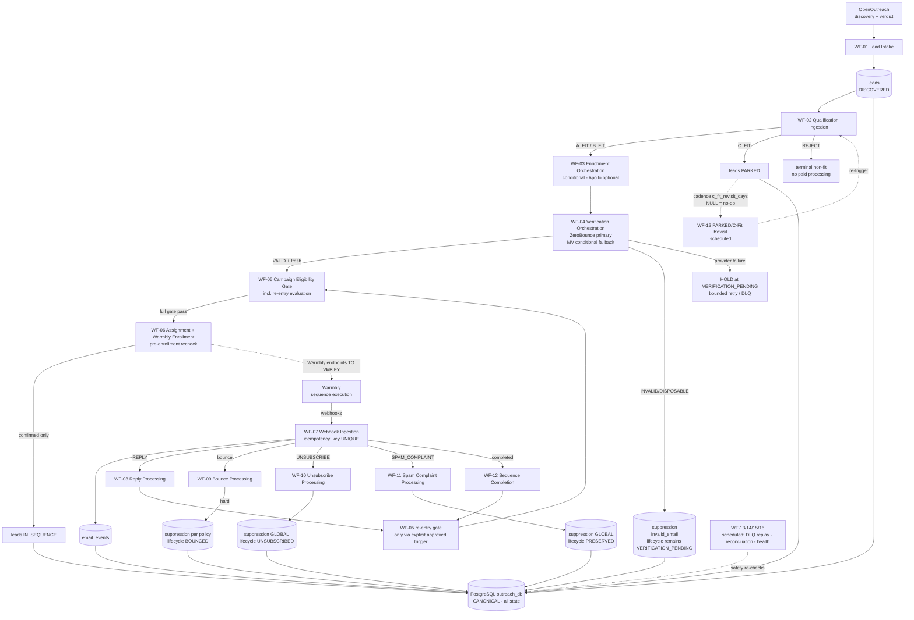
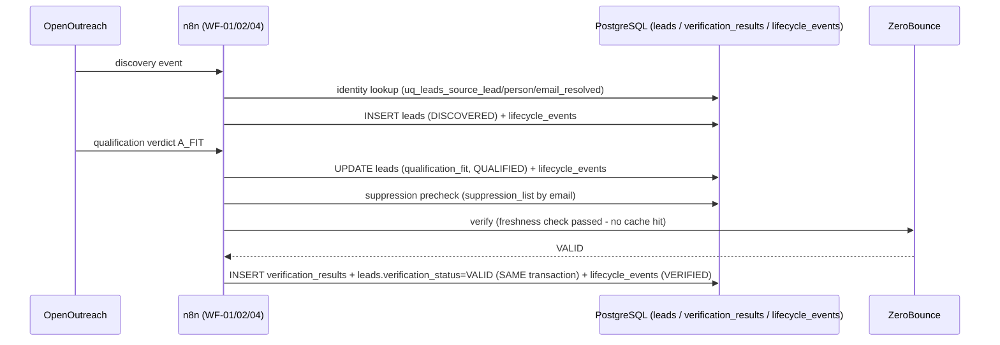
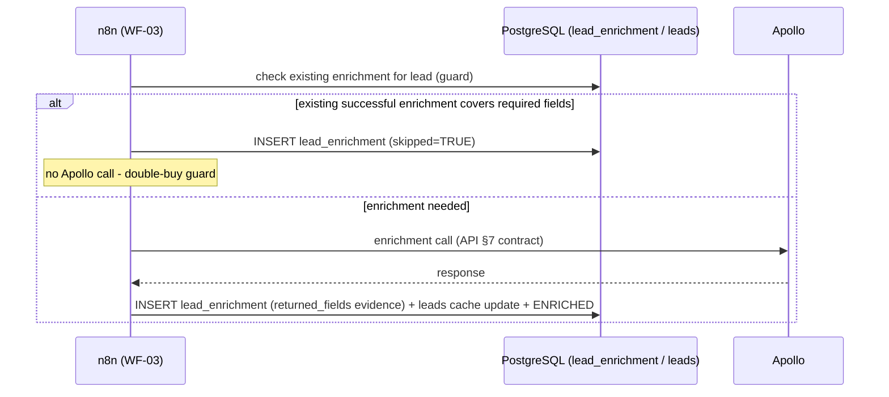
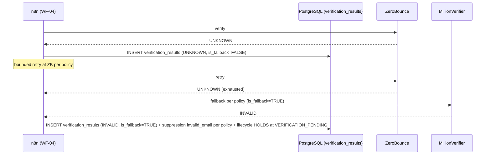
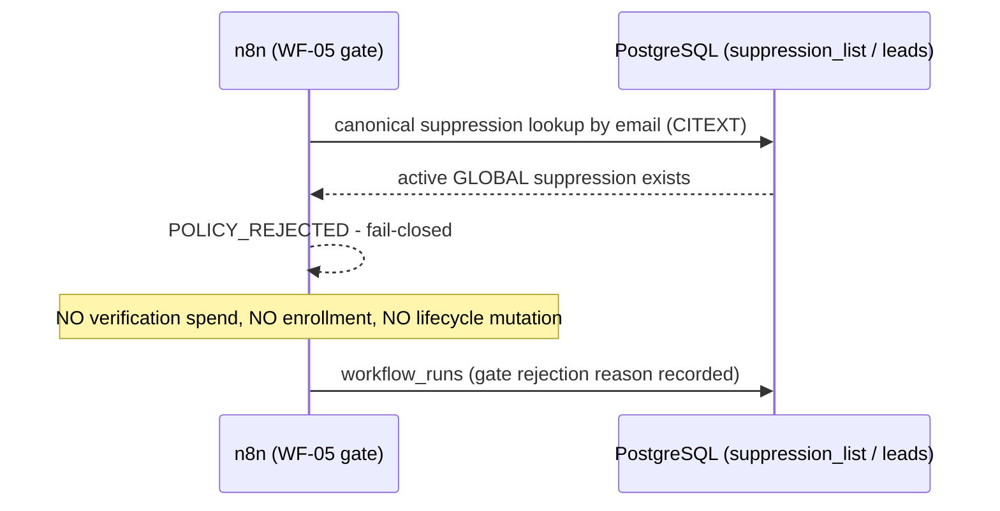
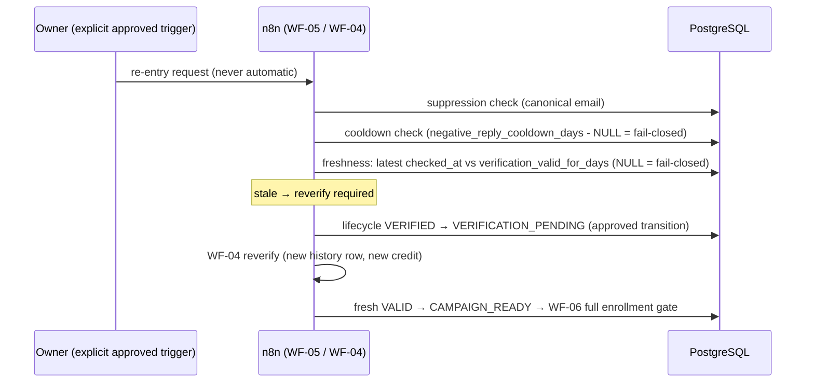
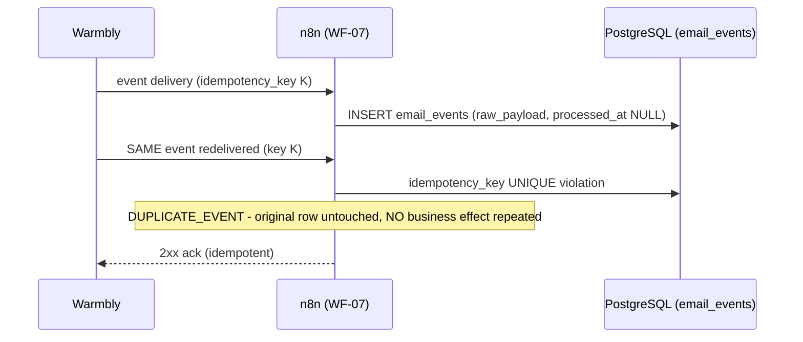
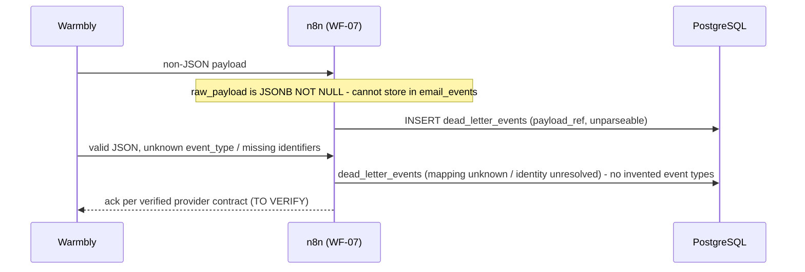
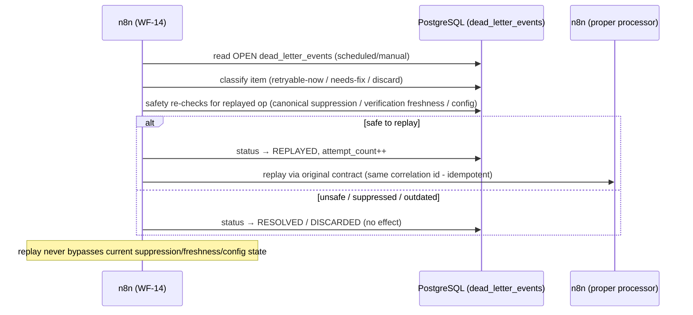
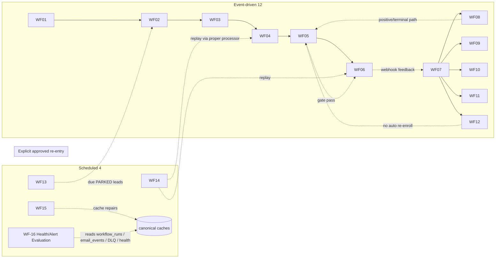

# SKMC Cold Email Automation — n8n Workflow Diagrams

**Version:** 1.0 | **Date:** 2026-10-17 | **Status:** Draft v1.0 — Pending Review. **Not approved.**

**Master references:** `n8n-workflow-spec.md` v1.1 (catalog §3, orchestration §4), `n8n-workflow-contracts.md` v1.0 (§4 contracts), `n8n-database-mapping.md` v1.0 (§3–§4 mappings).

**Derived from:** approved Architecture v1.3, Database Schema v1.2, Lifecycle v1.0, API Integration Spec v1.0, Verification & Suppression Rules v1.0 — plus the workflow contracts. **No new rules, lifecycle states, DB objects, or provider capabilities introduced here.**

---

## §1 Purpose

Visual representations of the approved orchestration: one end-to-end flowchart, 13 sequence diagrams (A–M), and the workflow dependency graph. Every diagram mirrors contract behavior exactly; where behavior is OPEN/TO VERIFY, the diagram marks it rather than assuming.

## §2 End-to-End Flowchart (single master)



PostgreSQL is canonical throughout; no provider mutates another provider's canonical state. All transitions shown are approved 14-state enum transitions or suppression-dimension changes.

## §3 Sequence Diagrams (A–M)

### A. Happy path — new qualified lead → verified



### B. Enrichment path — double-buy guard



### C. Verification fallback — ZeroBounce UNKNOWN → MillionVerifier



### D. Suppressed lead blocked at gate



### E. Re-entry with stale verification



### F. Race — suppression arrives during enrollment

```mermaid
sequenceDiagram
    participant N8 as n8n (WF-06)
    participant DB as PostgreSQL
    participant WB as Warmbly
    N8->>DB: pre-enrollment recheck (suppression / freshness / conflicts)
    N8->>DB: INSERT campaign_assignments (uq_assign_active_lead_campaign)
    N8->>WB: enrollment sync (TO VERIFY endpoints)
    par concurrent safety event
        DB-->>N8: UNSUBSCRIBE event arrives (via WF-07)
    end
    N8-->>N8: latest canonical SAFETY state wins
    N8->>DB: lifecycle IN_SEQUENCE → UNSUBSCRIBED + GLOBAL suppression
    N8->>WB: stop propagation (execution-only, idempotent)
    Note over N8: safety beats in-flight enrollment; unknown WB outcome = HOLD + reconcile, never assumed success
```

### G. Duplicate webhook



### H. Malformed / unknown webhook event → DLQ



### I. Bounce handling — hard vs soft

```mermaid
sequenceDiagram
    participant WB as Warmbly
    participant N8 as n8n (WF-09)
    participant DB as PostgreSQL
    WB->>N8: HARD_BOUNCE (bounce_type=hard)
    N8->>DB: lifecycle IN_SEQUENCE → BOUNCED + suppression (hard_bounce reason, scope per configured policy - OPEN)
    WB->>N8: SOFT_BOUNCE (bounce_type=soft)
    Note over N8: lifecycle unchanged (not lifecycle-terminal by itself); escalation ONLY via bounce policy (threshold NULL = fail-closed)
    N8->>DB: email_events evidence only
    Note over N8: observed bounce ≠ verification status (no bounce_risk_score; Arch §29 #6)
```

### J. Unsubscribe

```mermaid
sequenceDiagram
    participant WB as Warmbly
    participant N8 as n8n (WF-10)
    participant DB as PostgreSQL
    WB->>N8: UNSUBSCRIBE event
    N8->>DB: suppression_list INSERT (GLOBAL, explicit_unsubscribe, source_event_id) + suppression_events (ACTIVATED)
    N8->>DB: lifecycle IN_SEQUENCE → UNSUBSCRIBED (the ONLY event producing UNSUBSCRIBED)
    N8->>WB: sequence stop (execution-only)
    Note over N8: GLOBAL suppression has NO automatic expiry; removal = explicitly authorized audited DEACTIVATED event only
```

### K. Spam complaint — suppression WITHOUT lifecycle rewrite

```mermaid
sequenceDiagram
    participant WB as Warmbly
    participant N8 as n8n (WF-11)
    participant DB as PostgreSQL
    WB->>N8: SPAM_COMPLAINT event (email_events type - NOT a reply classification)
    N8->>DB: suppression_list INSERT (GLOBAL, spam_complaint) + suppression_events (ACTIVATED)
    Note over N8: lifecycle PRESERVED - remains IN_SEQUENCE; MUST NOT become UNSUBSCRIBED
    Note over N8: NO lifecycle_events row for preservation (approved behavior - do not "fix")
    N8->>WB: stop sequence + future sending
    Note over N8: complaint never conflated with unsubscribe (WF-10/WF-11 structurally distinct)
```

### L. Enrollment timeout / unknown outcome

```mermaid
sequenceDiagram
    participant N8 as n8n (WF-06)
    participant DB as PostgreSQL
    participant WB as Warmbly
    N8->>DB: assignment INSERT committed
    N8->>WB: enrollment sync
    WB--xN8: timeout - outcome unknown
    Note over N8: external action is NEVER DB-atomic; success never assumed
    N8->>DB: NO lifecycle transition (no IN_SEQUENCE without confirmed enrollment)
    N8->>DB: workflow_runs failed + dead_letter_events after bounded retry
    N8->>N8: WF-15 reconciliation (Warmbly state queries TO VERIFY)
    Note over N8: replay re-checks ALL safety gates before any re-sync
```

### M. DLQ controlled replay



## §4 Workflow Dependency Graph

Catalog totals (consistent with master spec §3): **16 workflows — event-driven 12 (WF-01…WF-12), scheduled 4 (WF-13, WF-14, WF-15, WF-16; WF-14 additionally manual-capable).**



- **Event-driven chain:** WF-01 → WF-02 → (WF-03) → WF-04 → WF-05 → WF-06 → WF-07 → {WF-08…WF-12}.
- **Unguarded cycles: NONE.** The only cycle-shaped edges are (a) WF-13 → WF-02 re-qualification (cadence-gated, `c_fit_revisit_days` NULL = no-op) and (b) re-entry into WF-05 — which requires an explicit approved trigger and passes the full gate (suppression, cooldown, verification existence/freshness/reverification, campaign eligibility, conflict, enrollment gate — Doc 6 §21). No direct COMPLETED → IN_SEQUENCE edge exists anywhere.
- **No unsafe sending path:** every edge into WF-06 passes WF-05's full gate plus WF-06's own pre-enrollment recheck; every DLQ replay re-checks all gates before any effect that could send.

## §5 Diagram–Contract Consistency Notes & Carried OPEN Items

- All diagrams reflect contracts v1.0 §4 exactly; no new behavior introduced.
- **TO VERIFY placeholders preserved in-diagram:** Warmbly endpoints/auth/event names/ordering (WF-06/07/08/09/10/11, §F/§H/§I/§J/§K/§L); WF-15 Warmbly state queries (§L).
- **OPEN configs shown as fail-closed:** `c_fit_revisit_days`, `verification_valid_for_days`, `negative_reply_cooldown_days`, `catch_all_policy`, bounce threshold/scope, `minimum_sample_size`, alert channel — NULL = no-op/block/no-alert as applicable.
- **Mapping gaps — RESOLVED per owner decision (2026-10-17):** `sending_domains`/`mailboxes` health ownership = authorized administrators control warmup/pause; WF-15 updates health indicators only with provider evidence + approved mapping; no automatic unpause/sending-enablement/unsupported HEALTHY assignment; all changes auditable. `companies` INSERT/UPDATE now explicit in contracts v1.1 (WF-01/WF-03). See `n8n-database-mapping.md` §3.1–§3.3.
- DB-D4 (idempotency-key composition) remains OPEN — §G shows the mechanism, not the composition.

## §6 Change Log

- v1.0 (2026-10-17): initial diagrams draft — 1 end-to-end flowchart, 13 sequence diagrams (A–M), dependency graph — derived from contracts v1.0 and approved sources. Status: Draft v1.0 — Pending Review. NOT approved.
- v1.0r (2026-10-17): §5 mapping-gap note updated to RESOLVED status per owner decision (health ownership = administrators + evidence-gated WF-15; companies explicit in contracts v1.1). Diagrams unchanged.
