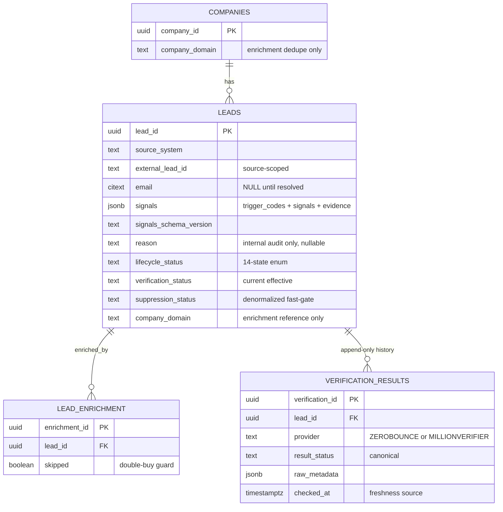
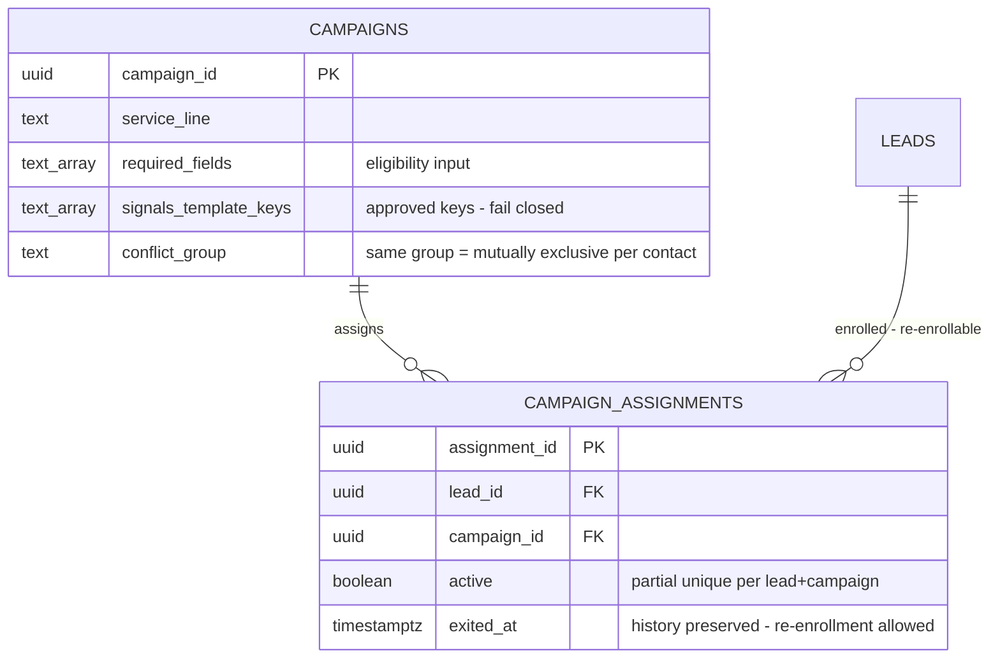
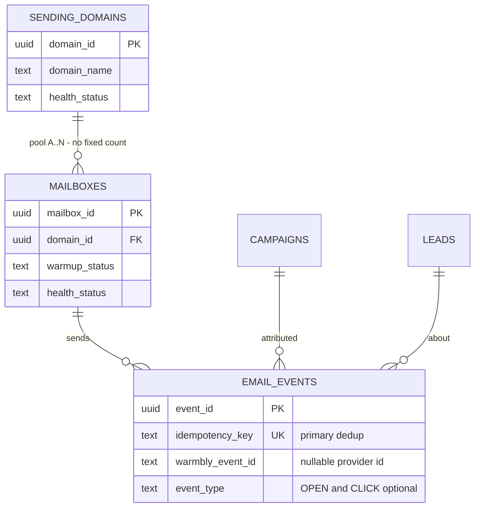
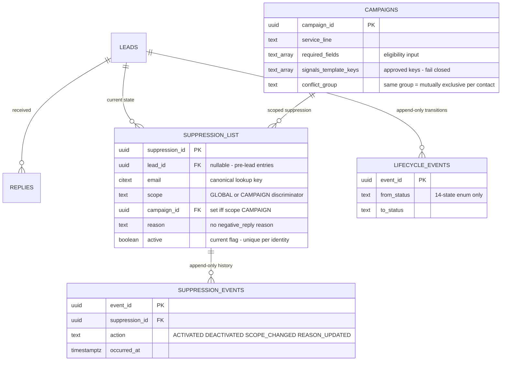
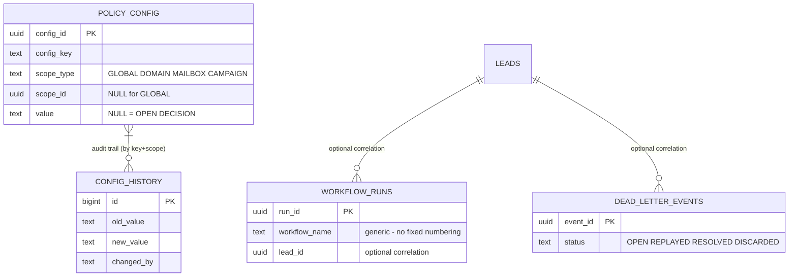
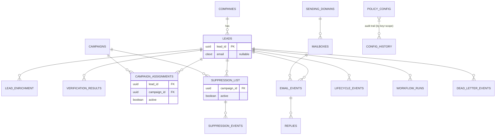

# SKMC Cold Email Automation — Database Schema / Lead Data Model

**Version:** 1.2 | **Date:** 2026-10-13 | **Status:** Approved — Database implementation of Architecture v1.3

**Governing architecture:** `/opt/data/skmc-cold-email/docs/architecture.md` — Version 1.3 — Approved — Single Source of Truth.

This database document implements the approved architecture. It does not define or override architectural policy. Where this document makes a technical implementation choice that does not alter business or architecture policy, it is marked as an implementation choice. Where a choice would materially affect architecture/business policy, it is listed in §17 Open Database / Integration Decisions.

Not authoritative for this document: implementation plans, archived architecture v1.2, source PDFs, chat history, or prior schema assumptions.

---

## 1. Document Control

| Field | Value |
|---|---|
| Document | SKMC Cold Email Automation — Database Schema / Lead Data Model |
| Version | 1.2 |
| Date | 2026-10-13 |
|| Status | Approved — Database implementation of Architecture v1.3 |
| Governing architecture | architecture.md v1.3 (Approved — Single Source of Truth) |
| Runtime | PostgreSQL, single instance, two separate databases |
| Backup of previous version | database-schema-v1.1-backup-20261013-135256.md (v1.1) |

## 2. Governing Architecture & Design Principles

Implemented architecture principles (Architecture v1.3 §2, §29) with database consequences:

1. PostgreSQL is the canonical source of operational lead state and history → all canonical state lives in `outreach_db`.
2. Contacts may exist before email resolution → `leads.email` is nullable.
3. Lifecycle, verification, and suppression are separate dimensions → separate enums/tables; suppression is NOT a lifecycle state.
4. Current effective state and auditable history are distinct → current-state tables + append-only history tables.
5. External identity is source-scoped → `(source_system, external_id)` uniqueness.
6. `company_domain` is company-level enrichment identity only → never a person identity key or campaign gate.
7. Verification results are append-only with provider, canonical result, provider metadata, `checked_at`.
8. Mailbox pool is dynamic (Mailbox A…N) → no fixed account/count fields.
9. Operating values are configurable policy → values live in the configuration model, not as structural defaults.
10. Failures must not remain invisible → workflow runs + dead-letter events.
11. Raw qualification reasoning is internal audit data; only campaign-approved structured signal keys may reach outbound templates → signals stored with schema-version contract; approved keys owned by the Campaign & ICP specification.
12. Historical lifecycle/suppression/verification/config records are never overwritten or deleted (operational audit). Future retention/anonymization policy is an unresolved Architecture Open Decision and must not be structurally excluded.

## 3. PostgreSQL Prerequisites / Database Separation

```sql
-- Execution context: run as a superuser/owner role able to create databases.
-- Migrations must run in deterministic order:
--   01: create databases (if absent)
--   02: extensions (per database)
--   03: enums
--   04: tables (dependency order: sending_domains -> mailboxes; companies -> leads -> child tables)
--   05: indexes/constraints
--   05a: privileges (GRANT/REVOKE on created tables)
--   06: seed configuration keys (NO unresolved values — see §11)

CREATE DATABASE n8n_db;      -- n8n internal runtime; n8n owns its own schema
CREATE DATABASE outreach_db; -- application data; ALL tables below live here
```

```sql
-- Per-database extensions (run inside outreach_db):
CREATE EXTENSION IF NOT EXISTS citext;   -- case-insensitive email uniqueness
-- UUID generation: gen_random_uuid() is built-in from PostgreSQL 13+.
-- For PostgreSQL < 13, pgcrypto provides it:
CREATE EXTENSION IF NOT EXISTS pgcrypto; -- explicit; harmless on 13+
```

**Roles / least privilege** (implementation choice):

```sql
CREATE ROLE outreach_app LOGIN;          -- application runtime
CREATE ROLE outreach_admin LOGIN;        -- migrations/ops
-- Role creation only; table-specific GRANT/REVOKE statements execute AFTER
-- table creation (migration step 05a). See privilege block at end of §5.
```

- n8n connects to n8n_db with its own role for internal state, and to outreach_db for application data.
- **No cross-database foreign keys.** Cross-database consistency is enforced by workflows, not FKs.

## 4. Canonical Enums

```sql
-- LIFECYCLE: exactly the approved Architecture v1.3 lifecycle states.
-- SUPPRESSED is NOT here — suppression is an independent dimension (§10).
-- RETRY/REVIEW are workflow holding states, not lifecycle states (§12, §17).
-- CRM states (MEETING_BOOKED / CLOSED_WON / CLOSED_LOST) are NOT cold-email
-- lifecycle states and are NOT persisted in this schema (see §17/DB-D3).
CREATE TYPE lifecycle_status_enum AS ENUM (
  'DISCOVERED','QUALIFIED','ENRICHMENT_PENDING','ENRICHED',
  'VERIFICATION_PENDING','VERIFIED','CAMPAIGN_READY','IN_SEQUENCE',
  'REPLIED_POSITIVE','REPLIED_NEGATIVE','UNSUBSCRIBED','BOUNCED',
  'COMPLETED','PARKED'
);

-- NOTE: CRM/sales stages (MEETING_BOOKED / CLOSED_WON / CLOSED_LOST) are NOT
-- persisted in outreach_db. Architecture v1.3 §9/§31#21 places the positive-reply
-- sales path in a downstream sales process; no sales/CRM schema is defined here.
-- See §17/DB-D3.

-- VERIFICATION: canonical concepts per Architecture v1.3 §10.
CREATE TYPE verification_status_enum AS ENUM (
  'NOT_CHECKED','VALID','INVALID','CATCH_ALL','RISKY',
  'UNKNOWN','DISPOSABLE','TEMPORARY_FAILURE'
);

CREATE TYPE verification_provider_enum AS ENUM ('ZEROBOUNCE','MILLIONVERIFIER');

-- SUPPRESSION: independent dimension.
CREATE TYPE suppression_status_enum AS ENUM ('ACTIVE','INACTIVE');
-- NOTE: no 'negative_reply' reason — an ordinary negative reply is NOT an
-- automatic suppression trigger (Architecture v1.3 §15/§16).
CREATE TYPE suppression_reason_enum AS ENUM (
  'explicit_unsubscribe','spam_complaint','hard_bounce','invalid_email',
  'manual_compliance_block','legal_or_policy_exclusion','manual'
);

CREATE TYPE suppression_event_action_enum AS ENUM (
  'ACTIVATED','DEACTIVATED','SCOPE_CHANGED','REASON_UPDATED'
);

CREATE TYPE qualification_fit_enum AS ENUM ('A_FIT','B_FIT','C_FIT','REJECT');

CREATE TYPE email_event_enum AS ENUM (
  'SENT','DELIVERED','SOFT_BOUNCE','HARD_BOUNCE','REPLY',
  'UNSUBSCRIBE','SPAM_COMPLAINT','OPEN','CLICK'
); -- OPEN/CLICK are OPTIONAL tracking events; not required for campaign
   -- health or eligibility (Architecture v1.3 §20).

CREATE TYPE reply_class_enum AS ENUM (
  'positive','negative','explicit_unsubscribe','out_of_office','neutral'
);

CREATE TYPE health_status_enum AS ENUM ('HEALTHY','DEGRADED','PAUSED','COOLDOWN');
CREATE TYPE warmup_status_enum AS ENUM ('NOT_STARTED','IN_PROGRESS','COMPLETED','FAILED');

CREATE TYPE config_scope_enum AS ENUM ('GLOBAL','DOMAIN','MAILBOX','CAMPAIGN');
CREATE TYPE dlq_status_enum AS ENUM ('OPEN','REPLAYED','RESOLVED','DISCARDED');
```

## 5. Tables

### 5.1 `sending_domains`

```sql
CREATE TABLE sending_domains (
  domain_id        UUID PRIMARY KEY DEFAULT gen_random_uuid(),
  domain_name      TEXT NOT NULL UNIQUE,
  health_status    health_status_enum NOT NULL DEFAULT 'HEALTHY',
  active           BOOLEAN NOT NULL DEFAULT TRUE,   -- soft-deactivate only
  created_at       TIMESTAMPTZ NOT NULL DEFAULT now(),
  updated_at       TIMESTAMPTZ NOT NULL DEFAULT now()
);
-- bounce/complaint windows, thresholds, and minimum sample sizes are
-- CONFIGURATION (policy_config, DOMAIN scope) — not columns (Architecture v1.3 §19/§21).
```

### 5.2 `mailboxes`

```sql
CREATE TABLE mailboxes (
  mailbox_id          UUID PRIMARY KEY DEFAULT gen_random_uuid(),
  domain_id           UUID NOT NULL REFERENCES sending_domains(domain_id),
  email_address       TEXT NOT NULL UNIQUE,
  warmup_status       warmup_status_enum NOT NULL DEFAULT 'NOT_STARTED',
  warmup_started_at   TIMESTAMPTZ,
  warmup_completed_at TIMESTAMPTZ,
  health_status       health_status_enum NOT NULL DEFAULT 'HEALTHY',
  paused_at           TIMESTAMPTZ,
  pause_reason        TEXT,
  active              BOOLEAN NOT NULL DEFAULT TRUE,
  created_at          TIMESTAMPTZ NOT NULL DEFAULT now(),
  updated_at          TIMESTAMPTZ NOT NULL DEFAULT now()
);
-- FK index (operational support: domain-level mailbox listing and FK scans):
CREATE INDEX idx_mailboxes_domain ON mailboxes(domain_id);
-- IMPLEMENTATION CHOICE: no fixed account number and NO daily-cap columns.
-- The former assigned_account CHECK (1..4) is REMOVED — mailbox pool is A..N
-- (Architecture v1.3 §18). Daily caps are policy_config (MAILBOX scope).
```

### 5.3 `companies`

```sql
CREATE TABLE companies (
  company_id       UUID PRIMARY KEY DEFAULT gen_random_uuid(),
  company_name     TEXT NOT NULL,
  company_domain   TEXT UNIQUE,          -- normalized; ENRICHMENT DEDUPE ONLY
  profile_json     JSONB,
  employee_count   INT,
  annual_revenue   TEXT,
  funding_round    TEXT,
  tech_stack       TEXT[],
  active           BOOLEAN NOT NULL DEFAULT TRUE,
  created_at       TIMESTAMPTZ NOT NULL DEFAULT now(),
  updated_at       TIMESTAMPTZ NOT NULL DEFAULT now()
);
```

### 5.4 `leads`

```sql
CREATE TABLE leads (
  lead_id               UUID PRIMARY KEY DEFAULT gen_random_uuid(),
  source_system         TEXT NOT NULL,          -- originating source/provider (identity scoping)
  external_lead_id      TEXT,                   -- source-scoped identity key #1
  external_person_id    TEXT,                   -- source-scoped identity key #3
  email                 CITEXT NULL,            -- identity key #2; NULL until resolved (Architecture v1.3 §6/§7)
  first_name            TEXT NOT NULL,
  last_name             TEXT,
  company               TEXT NOT NULL,
  title                 TEXT NOT NULL,
  company_id            UUID REFERENCES companies(company_id),
  company_domain        TEXT,                   -- display/enrichment reference only
  linkedin_url          TEXT,
  reason                TEXT,                   -- raw LLM reasoning: INTERNAL AUDIT ONLY; nullable for
                                                -- non-AI sources (manual/referral) — implementation choice
  signals               JSONB NOT NULL DEFAULT '{}'::jsonb,  -- {trigger_codes, signals, personalization_evidence}
  signals_schema_version TEXT,                  -- contract metadata for validation (§9)
  qualification_fit     qualification_fit_enum,
  verification_status   verification_status_enum NOT NULL DEFAULT 'NOT_CHECKED', -- denormalized current effective status (§7 contract)
  lifecycle_status      lifecycle_status_enum NOT NULL DEFAULT 'DISCOVERED',
  suppression_status    suppression_status_enum NOT NULL DEFAULT 'INACTIVE',     -- denormalized fast-gate state (§10 contract)
  active                BOOLEAN NOT NULL DEFAULT TRUE,   -- soft-deactivate only
  created_at            TIMESTAMPTZ NOT NULL DEFAULT now(),
  updated_at            TIMESTAMPTZ NOT NULL DEFAULT now()
);

-- Source-scoped identity uniqueness (NOT global):
CREATE UNIQUE INDEX uq_leads_source_lead
  ON leads(source_system, external_lead_id) WHERE external_lead_id IS NOT NULL;
CREATE UNIQUE INDEX uq_leads_source_person
  ON leads(source_system, external_person_id) WHERE external_person_id IS NOT NULL;
-- Nullable-email uniqueness: unique only among resolved emails:
CREATE UNIQUE INDEX uq_leads_email_resolved
  ON leads(email) WHERE email IS NOT NULL;

CREATE INDEX idx_leads_lifecycle ON leads(lifecycle_status) WHERE active;
CREATE INDEX idx_leads_company   ON leads(company_id);
CREATE INDEX idx_leads_gate      ON leads(verification_status, lifecycle_status, suppression_status) WHERE active;
CREATE INDEX idx_leads_parked    ON leads(qualification_fit, lifecycle_status) WHERE lifecycle_status = 'PARKED';
```

Note: an email-less lead cannot reach verification/campaign execution — enforced by the workflow eligibility gate (Architecture v1.3 §11), not by requiring email at discovery.

### 5.5 `lead_enrichment`

```sql
CREATE TABLE lead_enrichment (
  enrichment_id    UUID PRIMARY KEY DEFAULT gen_random_uuid(),
  lead_id          UUID NOT NULL REFERENCES leads(lead_id),
  provider         TEXT NOT NULL DEFAULT 'APOLLO',
  requested_fields TEXT[],
  returned_fields  TEXT[],                  -- double-buy guard evidence (Architecture v1.3 §4)
  raw_response     JSONB,
  skipped          BOOLEAN NOT NULL DEFAULT FALSE, -- TRUE = double-buy guard skipped Apollo
  created_at       TIMESTAMPTZ NOT NULL DEFAULT now()
);
CREATE INDEX idx_enrichment_lead ON lead_enrichment(lead_id);
```

### 5.6 `verification_results` (append-only history)

```sql
CREATE TABLE verification_results (
  verification_id  UUID PRIMARY KEY DEFAULT gen_random_uuid(),
  lead_id          UUID NOT NULL REFERENCES leads(lead_id),
  provider         verification_provider_enum NOT NULL,
  result_status    verification_status_enum NOT NULL,  -- canonical mapped result
  provider_status  TEXT,          -- provider raw status (e.g., ZB status)
  provider_sub_status TEXT,       -- provider raw sub-status
  catchall_domain  BOOLEAN,
  mx_found         BOOLEAN,
  mx_record        TEXT,
  smtp_provider    TEXT,
  free_email       BOOLEAN,
  domain_age_days  INT,
  did_you_mean     TEXT,
  is_fallback      BOOLEAN NOT NULL DEFAULT FALSE,  -- TRUE = MillionVerifier fallback per policy
  raw_metadata     JSONB,         -- provider raw fields as required
  checked_at       TIMESTAMPTZ NOT NULL DEFAULT now(),  -- freshness source (§7)
  created_at       TIMESTAMPTZ NOT NULL DEFAULT now()
);
CREATE INDEX idx_verif_lead_fresh ON verification_results(lead_id, checked_at DESC);
```

**No `bounce_risk_score`.** Provider raw fields retained as metadata only (Architecture v1.3 §10). Retry counts and catch-all hold durations are NOT stored as schema constants — they are configuration values (some still OPEN, see §11/§17).

### 5.7 `campaigns`

```sql
CREATE TABLE campaigns (
  campaign_id           UUID PRIMARY KEY DEFAULT gen_random_uuid(),
  campaign_name         TEXT NOT NULL,
  service_line          TEXT NOT NULL,          -- SKMC service (SVB, BIS, EPR, ...)
  icp_doc_ref           TEXT,                   -- link to the Campaign & ICP specification
  required_fields       TEXT[],                 -- eligibility-gate input (Architecture v1.3 §11)
  signals_template_keys TEXT[],                 -- APPROVED keys; fail-closed validation source (§14)
  conflict_group        TEXT,                   -- conflict semantics: campaigns sharing a conflict_group are
                                                -- mutually exclusive per contact; NULL = independent
                                                -- (see §8 for the full concurrency contract)
  active                BOOLEAN NOT NULL DEFAULT TRUE,
  created_at            TIMESTAMPTZ NOT NULL DEFAULT now(),
  updated_at            TIMESTAMPTZ NOT NULL DEFAULT now()
);
```

### 5.8 `campaign_assignments`

```sql
CREATE TABLE campaign_assignments (
  assignment_id  UUID PRIMARY KEY DEFAULT gen_random_uuid(),
  lead_id        UUID NOT NULL REFERENCES leads(lead_id),
  campaign_id    UUID NOT NULL REFERENCES campaigns(campaign_id),
  enrolled_at    TIMESTAMPTZ NOT NULL DEFAULT now(),
  exited_at      TIMESTAMPTZ,
  exit_reason    TEXT,
  active         BOOLEAN NOT NULL DEFAULT TRUE,
  created_at     TIMESTAMPTZ NOT NULL DEFAULT now()
);

-- Prevents duplicate SIMULTANEOUS active assignment to the SAME campaign,
-- while permitting historical re-enrollment (exit -> later re-enroll creates
-- a new row):
CREATE UNIQUE INDEX uq_assign_active_lead_campaign
  ON campaign_assignments(lead_id, campaign_id) WHERE active = TRUE;
CREATE INDEX idx_assign_campaign ON campaign_assignments(campaign_id, active);
CREATE INDEX idx_assign_lead     ON campaign_assignments(lead_id, active);
```

**Deliberately ABSENT:** a blanket `UNIQUE (lead_id) WHERE active` constraint. Contact-level conflict enforcement combines (Architecture v1.3 §13): active assignments + campaign `conflict_group` semantics + the n8n policy gate + explicitly permitted non-conflicting campaigns. It is enforced in the workflow eligibility gate, not as a blanket DB constraint. `company_domain` is never used for concurrency.

### 5.9 `suppression_list` (current effective suppression state)

```sql
CREATE TABLE suppression_list (
  suppression_id  UUID PRIMARY KEY DEFAULT gen_random_uuid(),
  lead_id         UUID REFERENCES leads(lead_id),   -- nullable: pre-lead entries (suppression keyed by email)
  email           CITEXT NOT NULL,                  -- canonical suppression lookup key (see identity contract below)
  scope           TEXT NOT NULL DEFAULT 'GLOBAL'
                    CHECK (scope IN ('GLOBAL','CAMPAIGN')),
  campaign_id     UUID REFERENCES campaigns(campaign_id), -- set iff scope = 'CAMPAIGN'
  reason          suppression_reason_enum NOT NULL,
  source_event_id UUID,                             -- traceability to email_events/replies
  active          BOOLEAN NOT NULL DEFAULT TRUE,    -- current-state flag (history in suppression_events)
  created_by      TEXT NOT NULL DEFAULT 'n8n_service',
  created_at      TIMESTAMPTZ NOT NULL DEFAULT now(),
  updated_at      TIMESTAMPTZ NOT NULL DEFAULT now(),
  -- Scope/campaign coherence: exactly one of the two scope shapes:
  CHECK ( (scope = 'GLOBAL'    AND campaign_id IS NULL)
       OR (scope = 'CAMPAIGN' AND campaign_id IS NOT NULL) )
);
-- Scope discriminator is validated; the campaign target has real referential
-- integrity (FK above) instead of an encoded 'CAMPAIGN:<id>' free-text value.
-- Note: scope values 'GLOBAL' | 'CAMPAIGN' describe the SHAPE of the scope only.
-- Whether GLOBAL and CAMPAIGN suppressions may coexist for one contact, and any
-- precedence between them, are OPEN (Architecture §15/§16 "configured scope";
-- see §17/DB-D8). This schema encodes scope identity, not precedence policy.

-- CONCURRENCY-SAFE ACTIVE-STATE UNIQUENESS (one active record per
-- suppression identity; portable to PostgreSQL < 15; NULL-safe):
-- GLOBAL identity = email alone:
CREATE UNIQUE INDEX uq_supp_active_global
  ON suppression_list(email) WHERE active = TRUE AND scope = 'GLOBAL';
-- CAMPAIGN identity = (email, campaign):
CREATE UNIQUE INDEX uq_supp_active_campaign
  ON suppression_list(email, campaign_id) WHERE active = TRUE AND scope = 'CAMPAIGN';
-- Two separate partial unique indexes are required because a single
-- (email, scope, campaign_id) unique index would NOT cover the GLOBAL
-- NULL-campaign case (NULLs are mutually distinct in PostgreSQL unique
-- indexes), and a naive (email, scope) unique index would silently forbid
-- simultaneous campaign suppressions from two different campaigns — an
-- Architecture Open Decision this schema must not resolve.

CREATE INDEX idx_supp_email ON suppression_list(email) WHERE active = TRUE;
CREATE INDEX idx_supp_lead  ON suppression_list(lead_id);  -- full index: FK-maintenance scans + lookups incl. deactivated entries

-- IDENTITY CONTRACT (suppression vs leads):
-- 1. `email` (CITEXT, case-insensitive) is the canonical suppression lookup
--    key. Suppression may exist BEFORE a lead exists (lead_id NULL).
-- 2. Intake/pre-enrollment checks MUST look up suppression by email — a lead
--    created later with a previously suppressed email must not bypass the
--    existing suppression (fail-closed; Architecture §15 enforcement points).
-- 3. lead_id is recorded when the suppressed email corresponds to a known
--    lead; it is auxiliary traceability, not the canonical key.
-- 4. Email CORRECTION on a lead while an active suppression exists:
--    undefined by Architecture v1.3 — recorded as §17/DB-D7 (OPEN). Until a
--    policy is approved, workflows MUST NOT mutate leads.email in a way that
--    could move a lead out from under an active suppression without an
--    explicit suppression re-evaluation.

-- CONSISTENCY: leads.suppression_status is a DENORMALIZED FAST-GATE CACHE of
-- EXISTS(active suppression for the lead/email). PostgreSQL does NOT enforce
-- this synchronization. It is maintained by a documented same-transaction
-- application contract. When cache and canonical state disagree:
--   - the CANONICAL lookup (suppression_list by email) takes precedence;
--   - cache disagreement MUST block sending (fail-closed), never permit it;
--   - workflows must run a periodic reconciliation query and repair the cache.
-- Canonical truth for suppression = suppression_list (current) + suppression_events (history).
-- Global suppression has NO automatic expiry; deactivation is an explicit,
-- authorized, audited event (DEACTIVATED row in suppression_events). No
-- physical DELETE of suppression rows or history at runtime (grants enforce).
```

### 5.10 `suppression_events` (append-only history)

```sql
CREATE TABLE suppression_events (
  event_id        UUID PRIMARY KEY DEFAULT gen_random_uuid(),
  suppression_id  UUID NOT NULL REFERENCES suppression_list(suppression_id),
  action          suppression_event_action_enum NOT NULL,  -- ACTIVATED | DEACTIVATED | SCOPE_CHANGED | REASON_UPDATED
  old_scope       TEXT,
  new_scope       TEXT,
  old_reason      suppression_reason_enum,
  new_reason      suppression_reason_enum,
  actor           TEXT NOT NULL DEFAULT 'n8n_service',
  source_event_id UUID,
  occurred_at     TIMESTAMPTZ NOT NULL DEFAULT now()
);
CREATE INDEX idx_supp_events ON suppression_events(suppression_id, occurred_at DESC);
```

### 5.11 `email_events` (Warmbly webhook events)

```sql
CREATE TABLE email_events (
  event_id         UUID PRIMARY KEY DEFAULT gen_random_uuid(),
  warmbly_event_id TEXT,                 -- provider event ID when Warmbly supplies one (see §12)
  idempotency_key  TEXT NOT NULL UNIQUE, -- primary dedup key (see §12 contract)
  lead_id          UUID REFERENCES leads(lead_id),
  campaign_id      UUID REFERENCES campaigns(campaign_id),
  mailbox_id       UUID REFERENCES mailboxes(mailbox_id),
  event_type       email_event_enum NOT NULL,
  bounce_type      TEXT,                 -- 'soft' | 'hard' when applicable
  smtp_diag        TEXT,
  occurred_at      TIMESTAMPTZ NOT NULL,
  raw_payload      JSONB NOT NULL,
  processed_at     TIMESTAMPTZ,
  created_at       TIMESTAMPTZ NOT NULL DEFAULT now()
);
CREATE INDEX idx_events_time     ON email_events(occurred_at DESC);
CREATE INDEX idx_events_metrics  ON email_events(event_type, occurred_at);
CREATE INDEX idx_events_lead     ON email_events(lead_id, occurred_at DESC);
-- FK indexes (performance/operational support: joins and FK scans; not correctness):
CREATE INDEX idx_events_campaign ON email_events(campaign_id);
CREATE INDEX idx_events_mailbox  ON email_events(mailbox_id);
```

OPEN/CLICK rows are OPTIONAL tracking events; campaign health and eligibility do not depend on them.

### 5.12 `replies`

```sql
CREATE TABLE replies (
  reply_id        UUID PRIMARY KEY DEFAULT gen_random_uuid(),
  event_id        UUID REFERENCES email_events(event_id),
  lead_id         UUID NOT NULL REFERENCES leads(lead_id),
  campaign_id     UUID REFERENCES campaigns(campaign_id),
  classification  reply_class_enum,
  classifier      TEXT NOT NULL DEFAULT 'n8n',   -- 'n8n' | 'manual'
  body_excerpt    TEXT,
  received_at     TIMESTAMPTZ NOT NULL,
  created_at      TIMESTAMPTZ NOT NULL DEFAULT now()
);
CREATE INDEX idx_replies_lead ON replies(lead_id, received_at DESC);
-- FK indexes (performance/operational support; not correctness):
CREATE INDEX idx_replies_event    ON replies(event_id);
CREATE INDEX idx_replies_campaign ON replies(campaign_id);
```

Reply-handling contract (Architecture v1.3 §15/§16): positive → stop sequence + sales flow; negative → stop/exit current sequence per reply policy, NO automatic suppression; explicit_unsubscribe → global suppression; out_of_office → configurable pause/resume; neutral → route per reply policy. Cooldown durations are configuration (OPEN value).

### 5.13 `lifecycle_events` (append-only audit)

```sql
CREATE TABLE lifecycle_events (
  event_id      UUID PRIMARY KEY DEFAULT gen_random_uuid(),
  lead_id       UUID NOT NULL REFERENCES leads(lead_id),
  from_status   lifecycle_status_enum,
  to_status     lifecycle_status_enum NOT NULL,
  reason        TEXT,
  triggered_by  TEXT NOT NULL DEFAULT 'n8n',
  metadata      JSONB,
  occurred_at   TIMESTAMPTZ NOT NULL DEFAULT now()
);
CREATE INDEX idx_lifecycle_lead ON lifecycle_events(lead_id, occurred_at DESC);
-- Records ONLY approved lifecycle transitions over the 14-state enum.
-- RETRY/REVIEW (workflow holding) → workflow_runs/DLQ. Suppression changes →
-- suppression_events. Never UPDATE/DELETE rows here.
```

### 5.14 `policy_config` (current effective configuration)

```sql
CREATE TABLE policy_config (
  config_id   UUID PRIMARY KEY DEFAULT gen_random_uuid(),
  config_key  TEXT NOT NULL,
  scope_type  config_scope_enum NOT NULL DEFAULT 'GLOBAL',
  scope_id    UUID,                              -- NULL iff scope_type = 'GLOBAL';
                                                 -- sending_domains.domain_id | mailboxes.mailbox_id |
                                                 -- campaigns.campaign_id otherwise
  value       TEXT,                              -- effective value (typed at read time by the reader contract)
  value_note  TEXT,                              -- e.g., 'REQUIRED CONFIGURATION — OPEN DECISION'
  updated_by  TEXT NOT NULL DEFAULT 'system',
  updated_at  TIMESTAMPTZ NOT NULL DEFAULT now(),
  -- Scope semantics enforced by PostgreSQL (corrects the v1.1 defect where an
  -- ordinary UNIQUE index could not enforce GLOBAL NULL uniqueness because
  -- NULLs are mutually distinct in unique indexes):
  CHECK ( (scope_type = 'GLOBAL' AND scope_id IS NULL)
       OR (scope_type <> 'GLOBAL' AND scope_id IS NOT NULL) )
);
-- At most one effective GLOBAL row per key (scope_id is guaranteed NULL by
-- the CHECK above, so a partial index over GLOBAL rows is exact):
CREATE UNIQUE INDEX uq_config_global
  ON policy_config(config_key) WHERE scope_type = 'GLOBAL';
-- At most one effective row per (key, scope, target) among non-GLOBAL scopes:
CREATE UNIQUE INDEX uq_config_scoped
  ON policy_config(config_key, scope_type, scope_id) WHERE scope_type <> 'GLOBAL';
-- KNOWN LIMITATION (documented, not hidden): PostgreSQL cannot attach multiple
-- conditional foreign keys to one polymorphic UUID column, so scope_id for
-- DOMAIN/MAILBOX/CAMPAIGN scopes is NOT FK-validated — a CAMPAIGN-scoped row
-- could carry a mailbox UUID. Enforcing that would require split FK columns
-- (domain_id/mailbox_id/campaign_id) or triggers; the smaller polymorphic
-- design is retained. The workflow write contract MUST resolve scope_id
-- against the correct table, and a periodic reconciliation query MUST verify
-- that every non-NULL scope_id references an existing row in the table
-- matching its scope_type. Runtime reads come from policy_config ONLY —
-- never from config_history.
```

Key registry (schema defined; **values are OPEN unless separately approved** — Architecture v1.3 §28 Open Decisions):

`daily_send_cap_per_mailbox, sending_window, send_spacing_min, send_spacing_max, warmup_period_days, bounce_pause_threshold, complaint_pause_threshold, minimum_sample_size, verification_valid_for_days, c_fit_revisit_days, catch_all_policy, negative_reply_cooldown_days, apollo_credits_alert_pct` — each: **REQUIRED CONFIGURATION — OPEN DECISION**.

### 5.15 `config_history` (immutable audit)

```sql
CREATE TABLE config_history (
  id            BIGINT GENERATED ALWAYS AS IDENTITY PRIMARY KEY,
  config_key    TEXT NOT NULL,
  scope_type    config_scope_enum NOT NULL DEFAULT 'GLOBAL',
  scope_id      UUID,
  old_value     TEXT,
  new_value     TEXT,
  changed_by    TEXT NOT NULL,
  changed_at    TIMESTAMPTZ NOT NULL DEFAULT now(),
  change_reason TEXT
);
-- Update contract (prefer transactional): configuration change =
--   UPDATE policy_config  +  INSERT config_history (same transaction).
-- config_history is NEVER the runtime configuration source.
```

### 5.16 `workflow_runs`

```sql
CREATE TABLE workflow_runs (
  run_id          UUID PRIMARY KEY DEFAULT gen_random_uuid(),
  workflow_name   TEXT NOT NULL,          -- generic name; no fixed WF numbering (Architecture v1.3 does not prescribe workflow count)
  n8n_exec_id     TEXT,
  status          TEXT NOT NULL CHECK (status IN ('ok','failed','retried','dead_lettered')),
  lead_id         UUID REFERENCES leads(lead_id),        -- optional correlation
  campaign_id     UUID REFERENCES campaigns(campaign_id),-- optional correlation
  external_ref    TEXT,                                   -- optional correlation (provider request/event id)
  items_in        INT,
  items_out       INT,
  error           TEXT,
  started_at      TIMESTAMPTZ NOT NULL,
  finished_at     TIMESTAMPTZ
);
CREATE INDEX idx_runs_status ON workflow_runs(status, started_at DESC);
-- FK indexes (performance/operational support; not correctness):
CREATE INDEX idx_runs_lead     ON workflow_runs(lead_id);
CREATE INDEX idx_runs_campaign ON workflow_runs(campaign_id);
```

### 5.17 `dead_letter_events`

```sql
CREATE TABLE dead_letter_events (
  event_id        UUID PRIMARY KEY DEFAULT gen_random_uuid(),
  workflow        TEXT NOT NULL,
  payload_ref     TEXT NOT NULL,
  error           TEXT NOT NULL,
  attempt_count   INT NOT NULL DEFAULT 0,
  last_attempt_at TIMESTAMPTZ,
  status          dlq_status_enum NOT NULL DEFAULT 'OPEN',
  lead_id         UUID REFERENCES leads(lead_id),   -- optional correlation
  created_at      TIMESTAMPTZ NOT NULL DEFAULT now()
);
-- FK index (performance/operational support; not correctness):
CREATE INDEX idx_dlq_lead ON dead_letter_events(lead_id);
-- Alert rule: OPEN count above a configured threshold in a configured window
-- → alert (thresholds are configuration; Architecture v1.3 §22/§23).
```

### 5.18 Privileges (PostgreSQL-enforced, migration step 05a)

```sql
-- These GRANT/REVOKE statements execute AFTER all tables exist (migration step 05a).
-- Append-only history/audit tables: the runtime role may only SELECT and
-- INSERT. UPDATE and DELETE are explicitly revoked so audit history cannot
-- be rewritten or erased by ordinary workflow operation (Architecture v1.3
-- §2 Principle #14, §31 Invariant #12).
GRANT SELECT, INSERT ON verification_results, suppression_events,
     lifecycle_events, config_history TO outreach_app;
REVOKE UPDATE, DELETE ON verification_results, suppression_events,
     lifecycle_events, config_history FROM outreach_app;
-- suppression_list is current state: soft-deactivation is a legitimate
-- UPDATE; physical DELETE is prohibited at runtime.
GRANT SELECT, INSERT, UPDATE ON suppression_list TO outreach_app;
REVOKE DELETE ON suppression_list FROM outreach_app;
-- Remaining operational tables (leads, companies, campaigns,
-- campaign_assignments, lead_enrichment, email_events, replies,
-- sending_domains, mailboxes, policy_config, workflow_runs,
-- dead_letter_events): SELECT/INSERT/UPDATE as required by workflows;
-- no DELETE grants are issued to outreach_app (soft-deactivation pattern).
-- outreach_admin retains full ownership-level privileges for migrations.
```

- n8n connects to n8n_db with its own role for internal state, and to outreach_db for application data.
- **No cross-database foreign keys.** Cross-database consistency is enforced by workflows, not FKs.

Implements Architecture v1.3 §6 (Lead Identity & Deduplication) and §7 (Discovery & Qualification):

1. Priority: (1) `(source_system, external_lead_id)` → (2) normalized `email` → (3) `(source_system, external_person_id)` → (4) unresolved ambiguity → manual review (no silent auto-merge).
2. External IDs are source-scoped via partial unique indexes; global uniqueness is NOT assumed.
3. `email` nullable — DISCOVERED/QUALIFIED contacts may exist pre-resolution. Uniqueness applies only among resolved emails (partial index).
4. `company_domain` is never person identity; company enrichment dedupe only (companies.company_domain).
5. An email-less lead cannot pass the eligibility gate — workflow rule (Architecture v1.3 §11), not a column constraint.

## 7. Verification Current State & Freshness

Implements Architecture v1.3 §10–§12. Two-part model with an explicit consistency contract:

- **Current effective state:** `leads.verification_status` (denormalized fast-gate/cache, used by runtime gates).
- **History:** `verification_results` — append-only (runtime role may SELECT/INSERT only; UPDATE/DELETE revoked); provider + canonical result + provider metadata + `checked_at`.
- **Consistency contract (application-enforced, not PostgreSQL-enforced):** the latest successful canonical verification processing updates `leads.verification_status` in the SAME transaction as the `verification_results` INSERT (+ lifecycle/audit event where applicable). PostgreSQL does not itself enforce this synchronization; a trigger is intentionally NOT required — the transactional contract is the accepted mechanism. When cache and history disagree, the canonical history lookup (latest row by `checked_at`) takes precedence and the cache must be repaired; gate logic must never treat a fresher history row as absent because of a stale cache.
- **Freshness:** always derived from the latest relevant `verification_results.checked_at` (+ configured `verification_valid_for_days`), NOT solely from the leads status. `verification_valid_for_days` is configuration — OPEN value.
- Reverification INSERTS a new history row; historical rows are never updated.
- Provider roles: ZeroBounce primary; MillionVerifier fallback per configured policy — never both by default. Retry counts are configuration/implementation policy, not schema constants.
- Index note: `idx_verif_lead_fresh (lead_id, checked_at DESC)` already supports the required latest-verification lookup. A status-filtered partial index is a possible FUTURE performance optimization only — not a correctness requirement.

## 8. Campaign Assignment / Re-enrollment / Concurrency

Implements Architecture v1.3 §13 (Campaign Concurrency — Contact Level):

- Re-enrollment supported: exit (active=FALSE + exited_at/exit_reason) → later eligibility/reverification → new assignment row. The partial unique index `(lead_id, campaign_id) WHERE active` blocks only duplicate simultaneous active assignment to the same campaign.
- **No blanket one-active-campaign-per-contact DB constraint** — the architecture explicitly permits multiple non-conflicting active campaigns for the same contact.
- Conflict semantics: `campaigns.conflict_group` — same non-NULL conflict_group = mutually exclusive per contact; NULL = independent. Enforcement lives in the n8n eligibility gate (active-assignment join + conflict_group comparison + explicit-permission path); this schema provides the data model supporting it.
- `company_domain` never used for concurrency.
- Historical re-enrollment preserved: exited rows are never deleted.

## 9. Signals & Personalization Contract

Implements Architecture v1.3 §14 (fail-closed):

- `leads.signals` JSONB carries `{trigger_codes, signals, personalization_evidence}`; `signals_schema_version` records the parser contract version for reliable validation.
- `reason` is internal audit only; nullable for non-AI sources (manual/referral imports) — implementation choice; the OpenOutreach contract does not require raw AI reasoning for non-AI records.
- Approved personalization keys are owned by the Campaign & ICP specification, declared per campaign in `campaigns.signals_template_keys`. This schema invents no signals.
- Fail-closed behavior (reject Warmbly sync on unknown/unapproved/missing/invalid required key) is workflow behavior; the schema provides the allowlist column and payload fields.

## 10. Suppression Current State & History

Implements Architecture v1.3 §15–§16:

- **Current state:** `suppression_list` (active flag + scope + reason; `campaign_id` FK for campaign-scoped rows). **History:** `suppression_events` (append-only, enforced by revoked UPDATE/DELETE grants: ACTIVATED / DEACTIVATED / SCOPE_CHANGED / REASON_UPDATED).
- **Canonical suppression identity is `(email, scope[, campaign_id])` while active**, enforced by PostgreSQL partial unique indexes (`uq_supp_active_global`, `uq_supp_active_campaign`) — duplicate simultaneous active records for the same identity are impossible at the database level, independent of workflow behavior.
- **Canonical lookup key is `email`** (CITEXT, case-insensitive). Suppression may exist before a lead exists (`lead_id NULL`); intake/pre-enrollment checks must match on email so a later-created lead cannot bypass an existing suppression. `lead_id` is auxiliary traceability. See the identity contract in §5.9.
- `leads.suppression_status` is a denormalized fast-gate cache maintained by a same-transaction application contract; PostgreSQL does not enforce the synchronization. On disagreement the canonical lookup wins and the cache must be repaired; cache disagreement must block (never permit) sending.
- Global suppression has NO automatic expiry; deactivation requires explicit authorized audited action (a DEACTIVATED row in `suppression_events`); runtime DELETE is revoked.
- **No `negative_reply` suppression reason** — an ordinary negative reply is never an automatic suppression trigger. Any campaign-scoped temporary block would be modeled explicitly as its own scoped suppression record with an explicit reason, never conflated with negative replies.
- **Scope representation:** `scope` is a validated discriminator (`'GLOBAL'` | `'CAMPAIGN'`), with real referential integrity via `suppression_list.campaign_id → campaigns.campaign_id` for campaign-scoped rows. Architecture v1.3 defines GLOBAL suppression for explicit unsubscribe/spam complaint (and hard bounce/invalid email per approved policy) but does NOT determine: whether GLOBAL and CAMPAIGN suppressions may coexist for one contact, precedence between scopes, or the full set of configured-scope semantics. These remain OPEN (§17/DB-D8). This schema encodes scope identity only — not precedence policy. Domain-wide suppression is NOT an architecture requirement and is not modeled.
- No physical deletion of suppression history. No jurisdiction-specific retention periods encoded.

## 11. Configuration Current State & Audit

Implements Architecture v1.3 §21:

- `policy_config` = current effective values by `(config_key, scope_type, scope_id)`; the GLOBAL ⇔ `scope_id IS NULL` relationship and at-most-one effective row per scope are enforced by PostgreSQL (CHECK constraint + partial unique indexes `uq_config_global` / `uq_config_scoped`) — not merely by workflow discipline.
- **Known limitation (documented):** for non-GLOBAL scopes, `scope_id` is a polymorphic UUID that PostgreSQL cannot FK-validate against the matching table (DOMAIN vs MAILBOX vs CAMPAIGN). The workflow write contract must resolve `scope_id` against the correct table, and a periodic reconciliation query must verify every non-NULL `scope_id` exists in the table matching its `scope_type`.
- `config_history` = immutable audit of changes; never read at runtime.
- Update contract: UPDATE policy_config + INSERT config_history in one transaction.
- **No unresolved architecture values are seeded as approved.** Keys are registered with `value_note = 'REQUIRED CONFIGURATION — OPEN DECISION'` where the Architecture Open Decision (§28) still stands: `verification_valid_for_days`, `c_fit_revisit_days`, `negative_reply_cooldown_days`, `minimum_sample_size`, `catch_all_policy`, plus mailbox/domain-level caps and windows.
- Operational initial values from earlier drafts (e.g., 25–30/day caps) may be seeded later ONLY after human approval; this schema defines no structural dependence on any specific number.

## 12. Event Idempotency

Implements Architecture v1.3 §20:

- Primary dedup key: `email_events.idempotency_key UNIQUE NOT NULL`.
- When Warmbly supplies a stable event ID: `idempotency_key = warmbly_event_id` (stored in the nullable `warmbly_event_id` column for traceability).
- When the provider event ID is missing/NULL: a deterministic fallback key derived from stable event attributes (e.g., hash of lead + campaign + event_type + occurred_at + selected raw-payload fields) prevents silent duplicate processing. The exact fallback composition and provider-event-ID behavior are **integration decisions for the API specification** (§17/DB-D4) — no Warmbly API semantics are invented here.

## 13. Health / Monitoring Data Model

Implements Architecture v1.3 §19/§23:

- Health evaluation inputs (metric, window, minimum sample size, threshold, scope, action) are configuration in `policy_config` (DOMAIN/MAILBOX scopes) — **minimum_sample_size has no seeded value** (OPEN).
- `sending_domains.health_status` and `mailboxes.health_status` are current state; escalations are context-aware per architecture — no blind cascade is encoded anywhere in this schema.
- Campaign metrics are computed from `email_events` (no duplicated metric tables without a demonstrated need).

## 14. Mermaid ERDs

### A. Core Lead / Company / Qualification / Enrichment / Verification



### B. Campaign / Assignment / Personalization Contract



### C. Sending Domain / Mailbox / Email Event



### D. Reply / Suppression Current State / Suppression History / Lifecycle



### E. Current Configuration / Config History / Workflow Runs / DLQ



### F. End-to-End Logical Overview



## 15. SQL Integrity / Invariants

| # | Invariant | Implementation |
|---|---|---|
| 1 | Extensions declared, not assumed | citext + pgcrypto in §3 |
| 2 | Lifecycle = exactly the approved states | 14-state enum; no SUPPRESSED/RETRY/REVIEW/CRM states |
| 3 | Email nullable before resolution | `email CITEXT NULL` + partial unique index |
| 4 | Source-scoped external IDs | partial unique indexes on `(source_system, external_*)` |
| 5 | company_domain not person identity | only on companies; leads.company_domain reference-only |
| 6 | Append-only histories | verification_results, suppression_events, lifecycle_events, config_history — runtime role granted SELECT/INSERT only; UPDATE and DELETE explicitly REVOKED (PostgreSQL-enforced) |
| 7 | Current vs history separated | leads.* current columns + history tables; same-transaction application contracts (§7, §10) with canonical-lookup precedence and reconciliation on disagreement |
| 8 | Verification freshness from checked_at | §7 consistency rule |
| 9 | Re-enrollment allowed | no table-level UNIQUE(lead_id, campaign_id); partial index WHERE active |
| 10 | No blanket one-active-campaign constraint | none exists; conflict enforced at gate via conflict_group |
| 11 | No 1..4 mailbox model | removed; pool is relational and unbounded |
| 12 | No negative_reply suppression reason | removed from enum |
| 13 | Suppression: no auto-expiry, no DELETE | current/history split; DELETE revoked on suppression_list; runtime role granted SELECT/INSERT/UPDATE only (soft-deactivate) |
| 14 | Current config separate from history | policy_config + config_history |
| 15 | No ambiguous scope targeting | CHECK (GLOBAL ⇔ scope_id NULL) + partial unique indexes uq_config_global / uq_config_scoped; non-GLOBAL scope_id polymorphism documented as a write-contract/reconciliation limitation |
| 15a | One active suppression per identity | uq_supp_active_global (email) and uq_supp_active_campaign (email, campaign_id), both WHERE active — PostgreSQL-enforced, NULL-safe, concurrency-safe |
| 16 | Webhook idempotency with missing provider ID | NOT NULL idempotency_key + fallback contract (§12) |
| 17 | OPEN/CLICK optional | enum comment; no health/eligibility dependence |
| 18 | Generic workflow observability | workflow_name TEXT + optional correlations |
| 19 | Retention not falsely locked in | soft-deactivation operational; future anonymization/deletion not structurally excluded (no claims of eternal PII retention; deletion would require approved policy + audit trail) |
| 20 | FK behavior | all FKs default NO ACTION (restrict-like); operational deletes never occur (soft-deactivate pattern); explicit ON DELETE policy deferred to §17/DB-D5 |

## 16. Architecture Traceability

(Section numbers verified against the approved architecture.md v1.3 read for this task.)

| Database area | Architecture v1.3 section | Implementation |
|---|---|---|
| Lead identity | §6 Lead Identity & Deduplication | source-scoped IDs + nullable email |
| OpenOutreach contract | §7 Discovery & Qualification | identity/fit/reason/signals fields; email optional |
| Qualification / fit | §8 Qualification / Fit Model | qualification_fit enum; PARKED economics via gate; sales/CRM stages NOT persisted (downstream process) |
| Lifecycle | §9 Lifecycle Model | 14-state enum + append-only lifecycle_events |
| Verification | §10 Verification Architecture | canonical enum + provider fields as metadata; no score |
| Freshness / eligibility | §11 Verification Freshness + Campaign Eligibility Gate | verification_results.checked_at + campaigns.required_fields |
| Catch-all/review | §12 Catch-all and Review Path | catch_all_policy config key (OPEN value) |
| Concurrency | §13 Campaign Concurrency — Contact Level | campaign_assignments + conflict_group; no blanket constraint |
| Signals | §14 Signals & Personalization | signals + signals_schema_version + campaigns.signals_template_keys |
| Suppression | §15 Suppression Architecture; §16 Suppression vs Lifecycle | suppression_list (+ campaign_id FK, active-state unique indexes) + suppression_events; leads denormalized cache with canonical-precedence contract |
| Reply handling | §16 (reply semantics; §15 trigger table) | replies table; no negative_reply suppression reason |
| Warmbly execution | §17 Warmbly Campaign Execution | no Warmbly state mirrored as canonical |
| Mailboxes | §18 Mailbox / Google Workspace Architecture | unbounded pool; no account count |
| Health | §19 Domain & Mailbox Health | health_status + config-driven rules |
| Events | §20 Events / Webhooks | email_events + idempotency contract |
| Configuration | §21 Configuration Architecture | policy_config + config_history; scopes |
| Reliability / DLQ | §22 Reliability / Retry / DLQ | workflow_runs + dead_letter_events |
| Monitoring | §23 Monitoring & Alerts | event indexes; DLQ alert via config |
| Security | §24 Security | role grants; no secrets in schema |

## 17. Open Database / Integration Decisions

Architecture Open Decisions remain unresolved here; values are not seeded.

**DB-D1 — Effective-value storage for unresolved policy keys.** Architecture §28 leaves several values OPEN. This schema registers the keys; storing NULL values until approval matters for gate correctness. Architecture establishes: configurable policy (§21). Undefined: approved values. **RECOMMENDATION — NOT APPROVED:** seed keys with NULL + `value_note='REQUIRED CONFIGURATION — OPEN DECISION'`; workflows must fail closed on NULL for gate-affecting keys.

**DB-D2 — Mailbox assignment ownership.** Architecture §18 leaves assignment/rotation details OPEN. If Warmbly fully owns rotation, no local `assigned_mailbox_id` column is needed (current choice: none exists); if persistence is required later, add `leads.assigned_mailbox_id → mailboxes(mailbox_id)` as a soft operational pointer. Undefined: actual Warmbly capability.

**DB-D3 — Sales-flow persistence.** Architecture §9 places the sales path (MEETING_BOOKED → CLOSED_WON/CLOSED_LOST) outside the cold-email lifecycle and hands positive replies to a downstream sales process. As of v1.2, `sales_stage` is NOT persisted in outreach_db: downstream sales/CRM persistence is outside the current cold-email database scope and may be defined by a future integration specification. No CRM schema is invented here.

**DB-D4 — Webhook idempotency fallback composition.** Architecture §20 requires idempotency but does not establish Warmbly's event-ID guarantees. Undefined: provider behavior when IDs are absent. **RECOMMENDATION — NOT APPROVED:** deterministic hash key (lead_id + campaign_id + event_type + occurred_at + raw_payload digest); exact composition fixed in the API specification.

**DB-D5 — FK delete behavior.** All FKs use default NO ACTION; operational deletes never occur (soft-deactivation pattern). Undefined: whether the approved retention/anonymization policy later needs CASCADE or ON DELETE SET NULL semantics. Architecture §24/§28: retention is OPEN.

**DB-D6 — Config value typing.** `policy_config.value` is TEXT (typed by the reader contract). Undefined: whether typed columns (numeric/boolean) are preferred for validation. **RECOMMENDATION — NOT APPROVED:** add `value_type` metadata column when the first automated config validator is built.

**DB-D7 — Suppression email/lead mutation policy.** `suppression_list.email` is the canonical suppression lookup key; suppression may exist before a lead exists (see §5.9 identity contract). Architecture v1.3 does not define what happens when a lead's email is corrected while an active suppression exists, or when a suppressed email later becomes associated with a newly created lead beyond the fail-closed email lookup at intake/enforcement points. Undefined: exact email-mutation behavior. **RECOMMENDATION — NOT APPROVED:** until a policy is approved, workflows must not mutate `leads.email` in a way that could move a lead out from under an active suppression without an explicit suppression re-evaluation.

**DB-D8 — Suppression scope coexistence and precedence.** Architecture §15/§16 activates suppression "at the appropriate scope" and references "configured scope," but does not determine whether GLOBAL and CAMPAIGN suppressions may coexist for one contact, or what precedence applies when both exist. v1.2 encodes scope identity (`scope` discriminator + `campaign_id` FK + per-identity active uniqueness) without deciding coexistence/precedence. Undefined: coexistence/precedence policy and any additional configured scopes. **RECOMMENDATION — NOT APPROVED:** keep OPEN; gate logic must treat any active suppression as blocking (fail-closed) until precedence is defined.

## 18. Change Log

| Version | Date | Change |
|---|---|---|
| 1.0 | 2026-10-12 | Initial schema draft (derived alongside early architecture drafts) |
| 1.1 | 2026-10-13 | Re-authored against approved Architecture v1.3: document control fixed (governing authority = architecture v1.3 only); PostgreSQL prerequisites section added (extensions, roles, migration order); lifecycle enum reduced to the approved 14 cold-email states (SUPPRESSED removed — independent suppression dimension; RETRY/REVIEW removed — workflow holding states; CRM states moved to separate sales_stage dimension); source-scoped identity (source_system + partial unique indexes); email made nullable with partial unique index; reason nullable for non-AI sources; signals_schema_version contract added; verification current/history consistency contract documented (atomic sync; freshness from verification_results.checked_at); bounce_risk_score removed; retry counts de-hardcoded; campaigns.conflict_group field added (was referenced but missing); campaign_assignments re-enrollment fixed (partial unique (lead_id, campaign_id) WHERE active; blanket lead-level unique removed); assigned_account 1..4 removed from leads/mailboxes; mailbox daily-cap columns removed to configuration; policy_config (current effective config) added with scope model; unresolved config values no longer seeded (marked REQUIRED CONFIGURATION — OPEN DECISION); suppression split into current-state suppression_list + append-only suppression_events; negative_reply removed from suppression reasons; leads.suppression_reason removed (denormalized status only, atomic-sync contract); email_events idempotency_key added with missing-provider-ID contract; OPEN/CLICK marked optional; workflow_runs generalized (no WF numbering) with optional correlations; dead_letter_events given lead correlation; health thresholds/windows moved to config; 6 Mermaid ERDs matching DDL; architecture traceability matrix using actual v1.3 sections; Open Database/Integration Decisions added (DB-D1..DB-D6) |
| 1.2 | 2026-10-13 | Controlled patch against confirmed review findings (architecture v1.3 unchanged): FIXED policy_config GLOBAL uniqueness — scope_id NULL ⇔ GLOBAL now enforced by CHECK constraint + partial unique indexes uq_config_global / uq_config_scoped (v1.1's ordinary unique index could not enforce GLOBAL NULL uniqueness; PostgreSQL treats NULLs as distinct); polymorphic scope_id limitation for non-GLOBAL scopes documented with write-contract + reconciliation requirement; FIXED append-only history privileges — explicit GRANT SELECT,INSERT / REVOKE UPDATE,DELETE on verification_results, suppression_events, lifecycle_events, config_history (v1.1's stated grants permitted UPDATE, contradicting the append-only claim) and REVOKE DELETE on suppression_list; STRENGTHENED suppression current-state integrity — scope as validated discriminator ('GLOBAL'/'CAMPAIGN') with real campaign_id FK and scope-coherence CHECK, concurrency-safe per-identity active-state uniqueness via uq_supp_active_global (email) and uq_supp_active_campaign (email, campaign_id) partial unique indexes (NULL-safe, portable below PG15); coexistence/precedence left OPEN (DB-D8); domain-wide suppression claim removed (not architecture-required); canonical suppression lookup key = email with explicit pre-lead identity contract; email-mutation behavior recorded as OPEN (DB-D7); CLARIFIED leads.suppression_status / leads.verification_status as application-maintained denormalized caches — PostgreSQL does not enforce synchronization; canonical lookup precedence, reconciliation, and fail-closed-on-disagreement documented; no trigger added; freshness contract unchanged (latest verification_results.checked_at + configured verification_valid_for_days); (lead_id, checked_at DESC) index confirmed sufficient; status-filtered partial verification index noted as future performance option only; REMOVED premature sales-stage persistence — sales_stage_enum and leads.sales_stage dropped (sales/CRM persistence out of scope per Architecture v1.3 §9/§31#21; DB-D3 reworded); SECONDARY INTEGRITY — workflow_runs.status now CHECK-constrained ('ok','failed','retried','dead_lettered'); selected FK indexes added (mailboxes.domain_id, email_events.campaign_id/mailbox_id, replies.event_id/campaign_id, workflow_runs.lead_id/campaign_id, dead_letter_events.lead_id; suppression_list.lead_id made a full index) and classified as performance/operational support, not correctness; campaign conflict trigger/exclusion constraint intentionally NOT added (Architecture §28 #7 leaves implementation OPEN); conflict_group documented as supporting data for downstream eligibility evaluation; webhook idempotency contract preserved (fallback composition remains an integration decision); all Architecture v1.3 Open Decisions preserved; no unresolved configuration values seeded. FINAL CORRECTIVE PATCH (same v1.2): GRANT/REVOKE DDL relocated after table creation (migration step 05a); migration sequence corrected with explicit privileges step (05a); ERD E corrected to show logical config audit association without false FK; ERD D/F synchronized with existing suppression_list.campaign_id → campaigns.campaign_id FK. |
|| 1.2 | 2026-10-13 | Approved — Final post-patch verification passed; no blockers remain; Database Schema v1.2 approved as the database implementation of Architecture v1.3 |
