# SKMC Cold Email Automation — Implementation Plan

**Version:** 1.3 | **Date:** 2026-10-12 | **Status:** APPROVED — implementation/build source of truth (subject to Open Questions in §30)

Base: v1.2 implementation plan (runtime safety, failure handling) + restored items from architecture v1.2 doc (data richness, scheduling, failure matrix, security specifics, decision tracking) + approved merge-spec additions (§10.1, §16, §29).

---

## 1. Target Architecture

```text
Campaign / ICP Specification
            ↓
OpenOutreach / OpenOutFind
Discovery + AI Qualification
            ↓
           n8n
    Intake + Policy Enforcement
            ↓
       PostgreSQL
 Canonical Business Data Store
            ↓
 Optional Apollo Enrichment
            ↓
 Email Verification
 ZeroBounce → MillionVerifier fallback
            ↓
 n8n Eligibility + Freshness Gate
      ┌──────┴──────────────┐
    PASS              REVIEW / RETRY / SUPPRESS
      ↓
   Warmbly
Campaign + Sequence Execution
      ↓
Google Workspace Mailboxes (transport only)
      ↓
   Prospect
      ↓
Reply / Bounce / Unsubscribe / Complaint
      ↓
Warmbly Webhook → n8n
      ↓
PostgreSQL + Suppression + Lifecycle + Metrics
```

**Decision authority (final principle):**

| Component | Decides |
|---|---|
| OpenOutreach | "Does this look like a qualified prospect?" |
| n8n | "Is this record operationally allowed to move forward?" |
| PostgreSQL | "What is the canonical state and history?" |
| Verification providers | "Is this email technically acceptable to attempt?" |
| Warmbly | "How does the approved sequence execute?" |
| Google Workspace | Mailbox transport only. Never suppression, never sequence logic. |

## 2. Component Ownership

| # | Step | Component | Responsibility | Explicitly NOT responsible for |
|---|------|-----------|----------------|-------------------------------|
| 01 | Discovery + Qualification | OpenOutreach / OpenOutFind | Describe-product-in → qualified leads out, with `reason` (audit) + structured `signals` (personalization). BetterContact licensed data, not scraping. Optional verified email resolution (1 credit/email). | Enrichment beyond returned fields. Cross-source dedupe. Sending. |
| 02 | Enrichment (supplemental) | Apollo.io | Firmographic only: `employee_count`, `annual_revenue`, funding, company metadata. Double-buy guard: skip when fields already present (incl. email OpenOutreach resolved). | Verification. Discovery. Mandatory enrichment. |
| 03 | Data Pipeline | n8n | Intake, merge, dedupe, normalize, verification calls, eligibility gate, suppression writes + Warmbly sync, alerts, webhook handling, config audit. | ICP qualification. Sending. |
| 04 | Verification | ZeroBounce (primary) / MillionVerifier (fallback) | MX check, SMTP handshake, spam trap / catch-all / dead mailbox detection. Returns per-lead verdict enum (§6). | Anything after the verdict. Campaign bounce accounting (observed sending data ≠ verification). |
| 05 | Campaign Ingestion | Warmbly | Loads gate-PASSED leads into multi-touch sequences (5–7 emails / 2–3 weeks), personalization from approved `signals` only, warmup, rotation, send-event webhooks. | Which leads enter (n8n's gate). Content writing. Suppression source-of-truth (Postgres is). |
| 06 | Rotational Sending | Google Workspace ×4 (2 seats × 2 secondary domains) | Transport only. | Sequence logic, volume, suppression, tracking pixels (disabled). |

## 3. PostgreSQL Structure

One instance, two databases — never share a schema:

```
PostgreSQL
├── n8n_db        (n8n internal, Postgres-backed not SQLite)
└── outreach_db   (application lead data)
```

`outreach_db` tables:

```
companies, leads, lead_enrichment, verification_results,
campaign_assignments, suppression_list, email_events, replies,
mailboxes, sending_domains, lifecycle_events, workflow_runs,
config_history, dead_letter_events
```

Lead record canonical fields: `lead_id` (UUID key), `email`, `first_name`, `last_name`, `company`, `title`, `company_domain`, `profile_url`, `linkedin_url`, `company_revenue` `{{revenue}}`, `tech_stack` `{{tech_stack}}` (high value), `funding_round` `{{funding}}`, `employee_count` `{{headcount}}`, `reason` (internal audit ONLY — never merged into email content), `signals` JSONB (§10), `verification_status`, `lifecycle_status`, `suppression_status`, `suppression_reason`, `assigned_account` (1–4, at send time), `verification_checked_at` (freshness input, §9).

Field normalization on merge: `website`/`organization.primary_domain` → `company_domain` (strip `https://`, high conflict risk); `organization.name` → `company`; revenue null handling.

### 3.1 Identity & Dedupe Keys

Contact identity hierarchy: (1) internal `lead_id` → (2) normalized lowercased `email` → (3) stable external person/profile ID → (4) ambiguous → manual review. **NEVER `company_domain` alone for person-level dedupe** — `rajesh@abc.com`, `priya@abc.com`, `amit@abc.com` are three people.

`company_domain` is the company-level key for **company enrichment dedupe only** — not for contact identity, and NOT a campaign gate (see §29 campaign concurrency rule).

### 3.2 Campaign Concurrency Rule (FINAL, approved v1.3)

> **One contact must not receive conflicting or overlapping active campaigns unless explicitly permitted. Multiple contacts within the same company may participate in different service campaigns where independently qualified.**

Enforcement at contact/lead level in WF-04 (`no conflicting active campaign` check against `campaign_assignments`). Justification (ABC India example): same company's CFO → SVB campaign, Compliance Head → BIS campaign, Sustainability Head → EPR campaign are three legitimate, independently-qualified contacts. A company-level blanket restriction blocks real multi-service compliance needs and is rejected. `company_domain` is NOT a campaign gate.

## 4. Lead Lifecycle (separate enums)

Lifecycle: `DISCOVERED → QUALIFIED → ENRICHMENT_PENDING → ENRICHED → VERIFICATION_PENDING → VERIFIED → CAMPAIGN_READY → IN_SEQUENCE → {REPLIED_POSITIVE | REPLIED_NEGATIVE | UNSUBSCRIBED | BOUNCED | COMPLETED}`; C-fit → `PARKED`; sales flow `REPLIED_POSITIVE → MEETING_BOOKED → OPPORTUNITY → CLOSED_WON/CLOSED_LOST`.

Verification: `NOT_CHECKED, VALID, INVALID, CATCH_ALL, RISKY, UNKNOWN, DISPOSABLE, TEMPORARY_FAILURE`.
Suppression: `ACTIVE, INACTIVE`. Reasons: `explicit_unsubscribe, spam_complaint, hard_bounce, invalid_email, manual_compliance_block, legal_or_policy_exclusion, negative_reply`.

Hard rules:
1. No lead enters `IN_SEQUENCE` without `verification_status = VALID`, `suppression_status ≠ ACTIVE`, and fresh verification (§9).
2. Suppression enforced at ALL boundaries in §14 (5 points).
3. Transitions logged in `lifecycle_events` (append-only, timestamped, never overwritten).
4. PARKED leads excluded from ingestion, retained for revisit (§29).

## 5. n8n Workflow Plan (no monolithic workflow)

```
WF-01 Lead Intake
WF-02 Optional Enrichment
WF-03 Email Verification
WF-04 Campaign Eligibility & Verification Freshness
WF-05 Warmbly Sync
WF-06 Reply Event Handler
WF-07 Bounce / Complaint Handler
WF-08 Suppression Sync
WF-09 Retry / Dead-Letter Processing
WF-10 Monitoring / Alerts
WF-11 Config Change Audit
WF-12 Mailbox / Domain Health Controller
```

## 6. WF-03 Email Verification

Pre-filters: syntax, global suppression, duplicate recent verification, disposable/blocked policy.

Provider flow: ZeroBounce → clear result? classify : (API failure) → MillionVerifier fallback. **Do not call both providers for every lead** (credit burn).

Routing: VALID→pass; INVALID→suppress (`invalid_email`); DISPOSABLE→suppress; CATCH_ALL→review / optional second opinion (hold-for-review initial 30 days); RISKY→review; UNKNOWN→retry (max 3, then review); TEMPORARY_FAILURE→retry/fallback.

`bounce_risk_score` (0–100): store ONLY if provider semantics documented; analytics only, never feeds the gate; undocumented → drop the column.

## 7. WF-01 Intake / WF-02 Enrichment

WF-01: normalize → resolve company identity → contact dedupe (§3.1) → global suppression check → insert/update Postgres → `lifecycle_status = QUALIFIED`.

WF-02: campaign-required fields present? YES → skip Apollo (double-buy guard). NO → call Apollo → merge → store. Apollo credits/API unavailable: data present → continue; missing required data → remain `ENRICHMENT_PENDING` + alert. **Never silently continue with missing required fields.**

## 8. WF-05 Warmbly Sync — with signals/template validation (v1.3 addition, APPROVED)

Warmbly owns: sequence, follow-ups, sending windows, mailbox rotation, daily limits, campaign execution, reply/bounce/unsubscribe events.

### 8.1 Structured Personalization Evidence (restored)

```json
{
  "trigger_codes": ["T1", "T3"],
  "signals": {
    "industry": "Automotive",
    "india_expansion": true,
    "foreign_parent": true,
    "import_activity": true
  },
  "personalization_evidence": {
    "signal_1": "Recently expanded manufacturing operations in India",
    "signal_2": "Imports components from overseas group entities"
  }
}
```

Warmbly tag mapping (approved keys only): `{{first_name}} {{company}} {{industry}} {{trigger}} {{device_type}} {{tech_stack}} {{headcount}} {{launch_timing}} {{revenue}} {{funding}}` + approved `signals` keys.

Distinction (enforced): raw `reason` / raw LLM text → INTERNAL ONLY, never in email content. Structured `signals` / `personalization_evidence` → the only template-safe surface.

### 8.2 Template/Signal Validation (hard rule, approved v1.3)

```
Warmbly template references signal key
         ↓
Key emitted by approved n8n parser?
   ├── YES → sync allowed
   └── NO  → REJECT Warmbly sync
             log validation error
             alert / review queue
```

Missing/unknown personalization keys must NEVER be silently blanked and sent — a blank `{{launch_timing}}` in a production email is a deliverability and credibility failure. Template→signals-key validation runs in WF-05 before every sync and whenever a template changes.

## 9. WF-04 Campaign Eligibility & Verification Freshness (hard gate)

Required conditions:

```
qualification_fit allowed
AND lifecycle_status = VERIFIED
AND verification_status allowed
AND suppression_status != ACTIVE
AND campaign_id present
AND required fields present
AND no conflicting active campaign          (§3.2 — CONTACT-level check)
AND verification is fresh enough            (§ below)
```

**Freshness rule:** `verification_valid_for_days` = configurable. Before enrollment: `verification_checked_at` within window? YES → continue; NO → reverify (costs 1 verification credit), update `verification_checked_at`/result, proceed only if gate passes.

Rationale: ZeroBounce will NOT asynchronously notify of verdict changes. A lead verified `VALID` today may enroll 30 days later — a stale verdict is not assumed reliable.

**Do not assume post-queue invalidation happens on its own.** Queued leads are invalidated/paused only after a real event: new verification failure, hard bounce, unsubscribe, spam complaint, manual suppression, policy event.

## 10. WF-06 Reply Handler

Classify webhook replies: positive / negative / explicit_unsubscribe / out_of_office / neutral.

- Positive: stop sequence, `REPLIED_POSITIVE`, notify SKMC team.
- Negative: stop current sequence, `REPLIED_NEGATIVE`, configurable cooldown (initial 90d). **Negative reply alone ≠ global suppression.**
- Negative with abuse/strict refusal: global suppression, reason `manual`.
- Explicit unsubscribe / do-not-contact: stop sequence, global suppression.
- OoO: keep sequence paused per policy, revisit.

## 11. WF-07 Bounce / Complaint Handler

Hard bounce: `BOUNCED`, global suppression (`hard_bounce`), update mailbox/domain/campaign metrics. Spam complaint: global suppression, update health metrics, immediate review.

## 12. WF-09 Retry / Dead-Letter Processing

Retry cases: API 429, temporary 5xx, network timeout, temporary verification failure, webhook processing failure. Post-exhaustion → `dead_letter_events` (`event_id, workflow, payload_ref, error, attempt_count, last_attempt_at, created_at, status`) with alert on DLQ volume.

## 13. WF-10 Monitoring / Alerts

Monitor: workflow failures, dead-letter count, retry queue depth, outreach_db availability, verification API failures + credit balance, Apollo/BetterContact credits, Warmbly API errors, webhook failures, webhook silence, mailbox send failures, mailbox/domain/campaign bounce rate, unsubscribe rate, complaint rate, suppression sync failures, disk usage.

**Webhook silence (context-aware):** never alert on fixed-silence alone. Alert only when activity is expected: recent sends exist + expected events missing → then check Warmbly reachability, last successful webhook timestamp, pending outbound, delivery errors. No sends → silence is normal (weekends, low volume).

## 14. WF-08 Suppression Sync — 5 checkpoints

Canonical: `outreach_db.suppression_list` (append-only via n8n service role; soft-deactivate `active = false` with reason only — deletion forbidden, so "why did we not email X" is always auditable).

Check suppression: (1) on intake, (2) before campaign enrollment, (3) **before re-enrollment** — the unsubscribe-then-Campaign-B scenario is blocked here, (4) on bounce/unsubscribe/complaint, (5) during Warmbly sync.

Google Workspace is NOT the suppression engine — transport only.

## 15. WF-12 Mailbox / Domain Health + WF-11 Config Audit

Mailbox fields: `mailbox_id, domain_id, warmup_status, warmup_started_at, warmup_completed_at, current_daily_cap, health_status, paused_at, pause_reason`. Domain fields: `domain_id, domain_name, health_status, bounce_rate_window, complaint_rate_window, paused_at, pause_reason`.

`config_history` (`id, config_key, scope_type, scope_id, old_value, new_value, changed_by, changed_at, change_reason`) — tracked keys include `daily_send_cap, bounce_pause_threshold, verification_valid_for_days, warmup_period_days, c_fit_revisit_days, apollo_credits_alert_pct, send_spacing, minimum_sample_size`.

## 16. Stale Verification in Failure-Mode Matrix (v1.3 addition, APPROVED)

```
Stale verification at enrollment / re-enrollment
  → block enrollment
  → reverify (consume verification credit)
  → update verification_checked_at + result
  → continue only if gate passes
  → failed processing visible through retry/DLQ path
```

## 17. Bounce / Health Escalation (context-aware, no blind cascade)

```
Mailbox-specific deterioration          → pause mailbox only
Domain-wide deterioration               → pause domain / affected mailboxes
Campaign-wide across healthy domains    → campaign content issue → investigate / pause campaign
```

Rate rules require: `metric, time_window, minimum_sample_size, threshold, action`. Example: `hard_bounce_rate | domain | trailing 7d | min_sample configurable | 2% | pause + alert`. 1/20 and 50/1000 are both "5%" but NOT the same operational signal.

## 18. C-Fit / PARKED Economics (v1.3 addition, APPROVED)

```
C-Fit → PARKED
  → NO Apollo enrichment credit
  → NO verification credit
  → NO Warmbly enrollment
  → revisit after configurable c_fit_revisit_days (initial 60)
      → new trigger? YES → requalify (new LLM verdict) : NO → remain parked
```

0 credits spent during parked period. PARKED ≠ SUPPRESSED: PARKED is "not yet worth credits," suppression is "never contact" — separate states, never conflated.

## 19. Sending & Warm-Up Policy (configurable, not architecture law)

Configurable: `daily_send_cap_per_mailbox` (initial 25–30), `sending_window`, `min/max_send_spacing` (initial 3–8 min randomized), `warmup_period_days` (initial 14–21), `bounce_pause_threshold` (2%), `complaint_pause_threshold`, `minimum_sample_size`, `verification_valid_for_days`, `c_fit_revisit_days`, `apollo_credits_alert_pct` (20%).

Rationale: spacing = operational pacing/deliverability control, NOT "Google AUP compliance"; secondary domains isolate domain reputation but do not make non-compliant sending compliant. All values are starting points — validate with real deliverability data.

Warm-up tracked per mailbox AND per domain. **Warm-up starts Day 1 and runs in parallel with build** (§28 Gantt); build work fills the warmup window. `warmup_period_days` = configurable initial assumption, not architecture law.

## 20. Warmbly Deployment

MVP: hosted Warmbly (self-hosting adds infra burden exactly when deliverability debugging matters most). **90-day operational review (calendar event, not threshold):** cost, API limitations, webhook reliability, features, data/control, scale → continue hosted OR evaluate self-hosted. Prevents "MVP forever."

## 21. Security (concrete controls)

- Secrets: n8n encrypted Credentials Store / env secrets only; never in workflows or Git. This doc lists *what* is needed, never values.
- Google **app passwords** (not login passwords) for Warmbly SMTP/IMAP — per seat, independently revocable.
- PostgreSQL + Redis: private, no public exposure; separate DB users per database; least-privilege service accounts.
- HTTPS on all admin interfaces; firewall configured.
- Suppression: append-only via n8n service role; no manual DELETE path in production; config + suppression changes audited.
- Tracking pixels disabled.
- Backups protected; daily, RPO 24h.
- `reason` internal only; `signals` the template-safe surface (§8.2 enforced).

## 22. Data Retention

Separate `security-data-retention.md`: retention/cleanup for active leads, rejected leads, hard-bounced contacts, suppressed contacts, unsubscribe evidence, event logs, workflow logs, backups. Suppression history never physically deleted in normal operations unless policy requires.

## 23. Sizing Baseline (provisional, not a guarantee)

n8n: 2 vCPU / 4 GB (Docker, Postgres-backed). PostgreSQL: 10 GB volume. Redis: 512 MB. Load drivers: n8n concurrency, LLM latency, DB activity, log retention — not email count alone. Baseline → pilot → measure (CPU, RAM, DB growth, queue depth, workflow execution time) → scale if required. Provisional scale trigger: sustained CPU > 60% or queue > 1,000 leads → managed Postgres first, n8n second.

## 24. VPS Deployment (MilesWeb)

VPS: reverse proxy/HTTPS, n8n, PostgreSQL, OpenOutreach (`uv tool install openoutreach`), Redis if required. External: Warmbly, ZeroBounce, MillionVerifier, Apollo, BetterContact, LLM provider (OpenRouter — GLM/Kimi), Google Workspace. Pre-deployment record: OS, vCPU, RAM, disk, free disk, Docker version, existing services, backup storage, domain/subdomain access. No CPU assumptions before pilot benchmarking.

## 25. Failure-Mode Matrix (central reference — the developer's single lookup table)

| Failure | System Action |
|---|---|
| ZeroBounce 429 | Backoff 60s, max 3 retries → MillionVerifier fallback |
| ZeroBounce down/5xx | MillionVerifier fallback; retry primary after 10 min |
| Stale verification at enrollment/re-enrollment | Block → reverify (1 credit) → update → pass gate or fail (§16) |
| Apollo credits exhausted | Continue if data sufficient; otherwise park `ENRICHMENT_PENDING` + alert |
| BetterContact out of credits | Pause lead-buying; free discovery continues; top-up |
| Warmbly API failure | Retry → DLQ |
| Warmbly webhook failure | Retry → DLQ + alert |
| Webhook silence with active sends | Alert (context-aware check, §13) |
| Unknown/missing personalization signal key | REJECT Warmbly sync + log + alert (§8.2) |
| Mailbox health deterioration | Pause affected mailbox only |
| Domain health deterioration | Pause domain / affected mailboxes |
| Campaign-wide deterioration on healthy domains | Investigate / pause campaign |
| Blacklist / reputation issue | Pause affected seats + re-route; MXToolbox daily check; operational review, replace domain if recovery infeasible |
| Google account throttled | Re-route to remaining seats; throttled seat cooldown (initial 7d, configurable) |
| n8n down | Warmbly keeps running; no new ingestion; restart, leads preserved in Postgres |
| PostgreSQL down | Halt ingestion + unsafe state transitions; Warmbly unaffected; restore daily backup, RPO 24h |
| Backup failure | Alert |
| LLM / OpenOutreach failure | Retry / park lead |
| Template change with unvalidated keys | WF-05 validation re-run before sync (§8.2) |

## 26. Implementation Order (Phases 1–6)

Phase 1 Documentation: architecture → ICP spec → schema → lifecycle states → verification/suppression policy → n8n workflow spec → API integration spec → UAT plan.
Phase 2 Infrastructure: VPS → Docker/Compose → firewall → reverse proxy → HTTPS → PostgreSQL → n8n_db → outreach_db → n8n → backups.
Phase 3 Lead Pipeline: OpenOutreach → first Campaign/ICP → test discovery → WF-01 → WF-02 → WF-03 → WF-04.
Phase 4 Campaign Execution: Warmbly connect → one campaign → one test mailbox → WF-05 (+ §8.2 validation) → reply/bounce/unsubscribe handlers.
Phase 5 Reliability: suppression sync → retry/DLQ → monitoring → webhook-silence detection → config history → mailbox/domain health controller.
Phase 6 Production Pilot: one SKMC service, limited volume → review qualification accuracy, verification results, webhook integrity, bounce/complaint metrics, infrastructure load → tune config → add mailboxes only after stable pilot.

## 27. First Pilot

1 service, 1 Campaign/ICP, 1 mailbox, small controlled volume. Full end-to-end loop (discovery → intake → enrichment → verification → gate → Warmbly → GW → events → webhook → Postgres) must work reliably before any scale-up.

## 28. Timeline — warm-up parallel to build (restored)

```mermaid
gantt
    title Build + Warm-up Timeline (configurable, initial assumption)
    dateFormat X
    axisFormat Day %d
    section Setup
    Domains, Workspace, DNS, SPF/DKIM/DMARC :a1, 0, 3
    section Warmup (starts Day 1, parallel)
    4 domains warmup 14-21d (configurable) :a2, 0, 21
    section Build (fills warmup window)
    Phase 1-2 docs + infra          :a3, 1, 8
    Phase 3 lead pipeline WF-01..04 :a4, 8, 8
    Phase 4 Warmbly + handlers      :a5, 14, 5
    Phase 5 reliability             :a6, 17, 6
    section Pilot
    1-service controlled pilot (after warmup window) :crit, 21, 7
```



## 29. C-Fit / PARKED Revisit Flow

See §18. `c_fit_revisit_days` configurable, initial 60. Requalify = fresh LLM verdict, not reuse of old `reason`.

## 30. Open Questions (unresolved decisions — tracked, owners, deadlines)

| # | Question | Owner | Required By | Status |
|---|----------|-------|-------------|--------|
| 1 | Warmbly REST endpoints + webhooks + auth method; SaaS plan tier | Assistant proposes; User confirms tier (billing) | Before WF-05 spec / integration | Open |
| 2 | ZeroBounce/MillionVerifier response fields the gate consumes; documented per-lead score? | Assistant (research during schema.sql); User confirms pricing tradeoff | Before schema.sql | Open |
| 3 | Production LLM model (OpenRouter GLM vs Kimi) + per-500-leads cost lock | Assistant proposes; User confirms | Before OpenOutreach production / ICP finalization | Open |
| 4 | Secondary domain names + registrar | USER (deferred 2026-10-08: "abhi finalize nahi karte") | Before DNS runbook + warmup start; does NOT block schema.sql/n8n spec | Open |
| 5 | Alert channel: Slack / Telegram / email | USER — decide now | Before WF-10 monitoring spec | Open |
| 6 | Catch-all policy: hold-for-review (recommended, first 30d) vs risk cap | Assistant recommends hold; User confirms in n8n spec | Before eligibility gate build | Open |
| 7 | `verification_valid_for_days` initial value (proposal: 21–30) | Assistant proposes in WF-04 spec; User confirms | Before WF-04 build | Open |
| 8 | Negative-reply cooldown (initial 90d) | Assistant default; User confirms | Before reply-handling rules | Open |
| 9 | `c_fit_revisit_days` (initial 60) | Assistant proposes; User confirms | Before campaign automation | Open |
| 10 | Initial health thresholds + minimum_sample_size values | Assistant proposes; User confirms | Before pilot | Open |
| 11 | Backup destination + RPO confirmation (initial: daily, 24h) | USER | Before production | Open |

## 31. Do Not Do (anti-rules)

- No company_domain-only contact dedupe.
- No both-verification-providers per lead by default.
- No mandatory Apollo when required fields exist.
- OpenOutreach and Warmbly are never both sending engines.
- Google Workspace is never the suppression controller.
- No hardcoded send caps / warm-up duration / revisit periods.
- No blind mailbox→domain→campaign pause cascade.
- No raw LLM reasoning in outbound emails; no silent blanking of missing personalization keys.
- No continuing with missing required enrichment fields.
- No ignoring webhook silence (context-aware only).
- No auto global suppression on a normal negative reply.
- PostgreSQL/Redis never publicly exposed.
- No all-mailboxes-at-full-volume start.
- Verification-provider verdict ≠ observed campaign bounce rate — never combined.
- Secondary domains + randomized pacing ≠ legal/provider-policy compliance.
- No company-level campaign blanket restriction (contact-level only, §3.2).

## 32. Change Log

| Version | Date | Change |
|---------|------|--------|
| 1.0 | 2026-10-08 | Initial draft from cold_email_workflow.pdf + discussion |
| 1.1 | 2026-10-08 | External review applied (see architecture.md §11 for full list) |
| 1.2 | 2026-10-13 | Updated implementation plan: 12 WF decomposition, verification freshness gate, min-sample-size health rules, context-aware escalation, smart webhook monitoring, 5-point suppression, pilot-first deployment, dead-letter + config schemas, MilesWeb topology, retention/security/pilot sections |
| 1.3 | 2026-10-12 | Approved merge: restored structured signals + personalization_evidence + Warmbly tag mapping from architecture v1.2; central failure-mode matrix (incl. stale-verification row); parallel warm-up Gantt; contact-level campaign concurrency rule (company-level rule REJECTED — ABC India multi-persona justification); C-Fit/PARKED credit economics; concrete security controls; provisional sizing baseline; 90-day Warmbly review (calendar event); open-questions tracker restored with 11 tracked decisions; WF-05 template/signal-key validation as hard gate |
